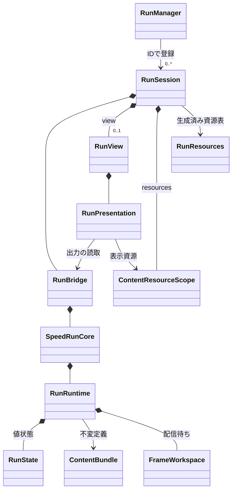
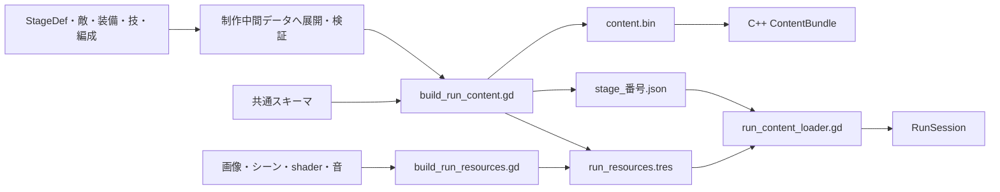
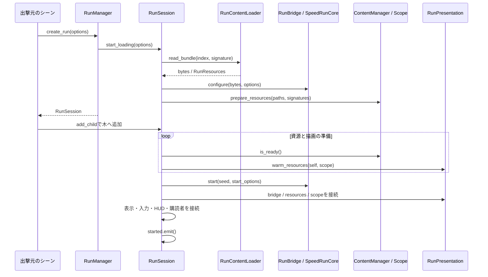
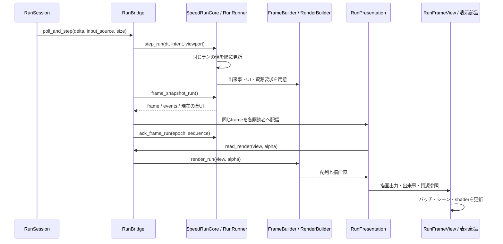

# SPEED 設計書

- demo のコードは引き継がない。ゲームの挙動は仕様書を正とし、ここでは C++ のラン処理と Godot の制作・表示の構成を定める。
- Godot プロジェクトは `speed/`（`res://`）。`.godot/` などの生成キャッシュはコミットしない。

ステージ制作の入口は[制作ガイド](dev/stage-production.md)、編集先と記録分析の進め方は[AI向け参照](dev/stage-production-ai.md)、ステージ4の制作要件は[個別仕様](game/stages/stage-4.md)を参照する。本書はツールの詳細な編集契約と記録形式を定義する。

---

## 1. 前提

設計を縛る条件。仕様書と企画書から来ている。

| 条件 | 出どころ |
|---|---|
| 敵が1300体前後いる場面でも 60fps | 仕様書 21 |
| 商用のゲームとして出す。最初は Steam、最終的に itch.io とスマホのストアにも出す | 企画書 1 |
| 特定の解像度・縦横比に固定しない | 仕様書 17、AGENTS.md |
| 見栄えは非常に重要。独自のシェーダーと描画の流れを作る | ユーザーの方針 |
| 世界の時間と実時間を分けて扱う。描画中0.1倍、なぞり中は可変、ヒットストップで停止 | 仕様書 1・6 |
| なぞり中、機体は0.5実秒で最大数千単位を移動する（1回の更新で大きく動く） | 仕様書 6.5 |
| ほとんどの数値をプレイ中に調整パネルから変えられる | 仕様書 20 |
| 武器・特性は固定の内部ID（W01、T03 など）で参照し、図鑑の表示番号は各一覧の並び順から付ける。敵はtype IDを使う | [一覧の運用ルール](game/catalog/rules.md) |
| ストーリー（5ステージ）とエンドレスの2つのモードがある | 仕様書 2 |
| ステージごとに、星系の広いフィールド・中ボス・フィールドの仕掛けが変わる | 仕様書 2〜22 |
| 中ボスは複数の部位（うみへび座の首など）を持ちうる。画面より大きくなりうる | 仕様書 12.3 |
| ステージ固有の仕掛けは、ステージごとの個別仕様で定める | 仕様書 13.2 |
| ラスボス戦の締めで、描画のルール（長さの上限・世界の速さ）を一時的に変え、自動の演出を流す | 仕様書 12.4 |
| ストーリーの進み具合・伝説のモジュール・ハイスコアを保存する。伝説のモジュールは能力値に効かない | 仕様書 14・2.3 |

## 2. 技術スタック

| 項目 | 構成 |
|---|---|
| エンジン | Godot 4.7.2（`speed/project.godot`） |
| 言語 | C++（GDExtension）がランの状態と更新を持ち、GDScriptが制作・入力・資源・表示・UI・端末保存を持つ |
| レンダラ | 本番プロジェクトは Forward+。描画処理は Forward+・Mobile の HDR 経路と、Compatibility の簡易経路を持つ（10章）。ブラウザは Compatibility を使う |
| 物理エンジン | プロジェクトの3D設定は Jolt。敵・弾の2D当たり判定は7章の自前処理を使う |

性能目標の達成と、PC・スマホで使うレンダラの最終選択は[未決事項](#18-未決事項)に置く。

## 3. フォルダ構成

パスはリポジトリの根を基準とする。Godotの `res://` は `speed/` を指す。

```
cpp/
  api/                    SpeedRunCoreのGodot公開窓口と値の検証
  runtime/                RunRuntime、RunRunner、時計、開始・終了、保持点
  content/                戦闘バイナリの読込と不変のContentBundle
    generated/            共通スキーマから生成する型とID
  state/                  ランの値状態、種類別状態、世代付きHandle
  systems/                戦闘、移動、出現、成長、回収、地形
    attacks/              攻撃種類ごとの更新
  behaviors/              敵・武器・特性・英雄の種類別処理
  bosses/                 共通フローと5体の形態・技・部位・決着
  output/                 UI、描画、出来事、資源要求、録画、計測の出力
  SConstruct              固定SDKによる拡張のビルド
  dependencies.json       SDK・API・Godot・export templateの固定版
speed/                    res://
  project.godot
  extensions/run/         拡張の登録とCPU別共有ライブラリ
  addons/                 編集機能、起動前の生成、export
  scenes/                 アプリ・ラン・ボス表示・攻撃表示・ステージ
  scripts/
    managers/             アプリ全体の窓口（4.3）
    runtime/              RunSession・RunBridge・読込・表示用読取モデル
    data_types/           編集元Resourceと実行時資源の型
      generated/run_ids.gd 実行時に使う共通ID
    bosses/               技・フローの編集元Resource
    encounters/           編成の制作シーンと経路の制作支援
    render/               描画の層・バッチ・表示専用状態
    input/  ui/           入力変換と画面
    dev/                  調整・録画・開発用表示
  data/                   パラメータの正となる.tres、編成.tscn
  assets/  shaders/       画像・音・フォントと描画処理
  gyms/                   制作・試遊用。製品の書き出しから除外
  tools/content/          編集元から実行用データへの生成
    generated/            共通スキーマの生成・書込用コード
  tools/editor/           SPEED専用の編集画面
  tools/profiling/        性能計測の入口
  tests/                  runtime・integration・content・editorの検査
  .content/               実行用データと制作中間データ（生成物）
    run/                  戦闘バイナリ・索引・RunResources
    dev/                  開発用の名前対応表・一時生成物
tools/build/              共通スキーマ生成、識別子、開発用・配布用ビルド
tools/dev/                一時作業場所の作成と片付け
```

ステージは数値の `StageDef`（`data/stages/`）と配置シーン（`scenes/stages/`）で制作する。実行時の戦闘定義と表示資源への変換は[8.1](#81-定義データresource)に示す。

## 4. 全体の構成

### 4.1 層と依存の向き

| 層 | 中身 | 依存と役割 |
|---|---|---|
| 制作・生成 | GodotのResource・制作シーン・`tools/content/`・編集用addon | 編集元を検証し、C++用の値とGodot用の資源参照を生成する |
| アプリの窓口 | `speed/scripts/managers/` | 画面、保存、索引、資源読込、音、セッションの寿命を扱う |
| Godotのラン接続 | `RunSession`・`RunBridge` | 入力と命令を渡し、値の出力を購読者と資源読込へ配信する |
| C++のラン | `cpp/runtime/`・`state/`・`systems/`・`behaviors/`・`bosses/` | 不変の戦闘定義を読み、同じランの状態・時計・乱数と更新順を所有する |
| 表示とUI | `speed/scripts/render/`・`ui/` | UIと描画出力・出来事から表示を作り、操作を命令として渡す |
| 開発用 | `scripts/dev/`・`gyms/`・`tests/`・`tools/` | 通常出撃と同じC++ランへ、制作・記録・計測の入口を接続する |

### 4.2 混合方式

戦闘の可変状態はC++の `RunRuntime.state`（`RunState`）に集める。機体・線・敵・攻撃・ドロップ・成長・英雄・地形・ボスの状態は値として保持し、種類固有の状態は型付きの構造体へ分ける。`WorldState` はその一部として攻撃予算などの世界共通状態を持つ。Godotのノードは表示・UI・入力・資源の寿命を持つ。ボスの部位と技もC++で更新し、表示ノードは描画出力の位置・姿勢・出来事を反映する。

### 4.3 アプリの窓口とラン

アプリ全体の窓口をAutoloadにする。

| 窓口 | 担当 |
|---|---|
| ContentManager | ContentCatalog、制作定義、生成済み表示資源の取得と読込要求の共有（8章） |
| SaveManager | セーブ、図鑑、伝説のモジュール、ハイスコア、機体強化（11章） |
| ProfileManager | 保存された強化からC++へ渡す倍率・加算・軽減の値を計算する |
| AudioManager | 生成済み音源とC++の出来事に基づく再生（13章） |
| GameManager | 画面、モード、ステージ選択、結果保存の入口 |
| RunManager | IDごとのRunSessionの作成・検索・命令の振り分け・登録解除 |
| DevBootstrap | 開発版の調整表示・録画・実験場・直接起動予約を接続する |

通常出撃は `RunManager.create_run()` → `RunSession` → `RunBridge` → `SpeedRunCore` → `RunRunner` の順に接続する。`SpeedRunCore` はGDExtensionのRefCounted窓口で、`RunRuntime` を所有する。`RunRuntime` は不変の `ContentBundle`、ランの値状態、更新・出力の作業領域を持つ。`RunRunner` が固定更新の順番、時計、進行を実行し、各Systemと種類別処理が同じランを使う。

| 処理 | C++の入口 | 担当 |
|---|---|---|
| 機体・線 | `systems/ship.cpp`・`draw.cpp` | 移動、HP、ゲージ、描画、なぞり、勢い |
| 戦闘 | `systems/combat*.cpp`・`collision_query.cpp` | 格子、掃引判定、命中先、ダメージ、ヒットストップ |
| 敵 | `systems/enemy_system.cpp`・`enemy_update.cpp`・`behaviors/enemies/` | 生成・解放、種類別の移動・判断・被弾条件 |
| 出現 | `systems/population_system.cpp`・`spawn_timeline.cpp`・`formations.cpp`・`clips.cpp` | 時間帯、目標数、補充、再配置、クリップと編成 |
| ボス | `bosses/flow/`と各ボスのフォルダ | 形態、部位、技、共有スタミナ、決着 |
| 攻撃 | `systems/attack_system.cpp`・`systems/attacks/` | 発生・移動・接触・残留・終了 |
| 成長・装備 | `systems/progression.cpp`・`equipment.cpp`・`behaviors/weapons/`・`behaviors/traits/` | XP、候補、カード、武器・特性、リロール |
| 回収・英雄・地形 | `systems/pickup_system.cpp`・`heroes.cpp`・`field*.cpp` | ドロップ、回収、星座の力、天体、隕石、重力、ワープ |

**更新の順番**は [RunRunner::step_play](../cpp/runtime/run_runner.cpp) が持つ。

1. UI停止・選択・死亡・決着の位相を判定し、入力と描画操作を受ける。
2. ヒットストップと線を更新し、実秒・世界秒を進める。
3. 世界側の更新回に攻撃予算、地形、敵・ボス、回避、戦闘格子を更新する。
4. 機体・英雄・装備を更新し、世界側の更新回に弾・攻撃形状を進める。
5. 撃破済みの行を解放し、世界側の更新回に遭遇・補充・回収を進める。
6. ワープ、カメラ、勝敗、保留中のカード選択を扱う。

入力・UIは `RunBridge.command()` と `poll_and_step()` を使う。命令の封筒はランID・epoch・単調な命令番号・種類・payloadを持ち、C++側が版・値・実行可能状態を検証する。公開窓口は更新中の再入を拒否する。出力は現在のUI・出来事・資源要求・描画・記録・計測の値として読む。出来事はsequenceを持ち、RunBridgeは元の列から各購読者が選んだ通知を順序通り配る。元の列の終端を全購読者が受領してからC++へackする。

通常のRunBridgeは `frame_snapshot_run()` で現在の全UIを読み、UI差分の比較と比較元の保存を省く。直接C++の差分を読む道具向けの `frame_run()` と、UIの組立て・通知・資源要求・結果の処理を共有する。両方ともUIを深く複製して返し、呼出元の書込みからラン状態を保護する。現在のライブラリに完全スナップショットの読取がない場合は、開始前に再ビルドを求めるエラーを返す。 RunBridge内部では完全UIを受領ごとに新しい私有出力へ置き換え、中間の全出力コピーを省く。公開読取と各購読者には独立した深いコピーを返し、再送待ちの古い出力は書き換えない。

#### ランの所有と参照

黒いひし形は寿命に合わせて保持・解放する関係、通常の矢印は参照を表す。RunManagerはIDで登録し、シーンの親がRunSessionを木に保持する。



実装の入口は [RunSession](../speed/scripts/runtime/run_session.gd)、[RunBridge](../speed/scripts/runtime/run_bridge.gd)、[SpeedRunCore](../cpp/api/run_core.h)、[RunRuntime](../cpp/runtime/run_runtime.h)。種類別処理との接続は[6.1](#61-敵とボスの-ai)、資源の準備と解放は[8.1](#81-定義データresource)に示す。

### 4.4 守る決まり

1. ランの時計・乱数・状態・戦闘判断・更新順をC++へ集め、Godotから入力と命令で操作する。
2. 各ランが状態と作業領域を所有し、固定の戦闘定義を不変のContentBundleとして参照する。
3. 種類固有の処理は `behaviors/`・`systems/attacks/`・`bosses/` へ分ける。
4. Godotは出力値を表示へ変換し、資源参照・入力機器・音再生・端末保存を所有する。
5. 終了時は命令受付を止め、録画終端を届け、資源・表示・C++実体・登録を解放する。
6. `tests/content/check_rules.gd` で依存と配布の機械的な規約を確認する。
7. 生成から利用・解放までは[15.1](#151-ビルドと実行時の境界)に従ってレビューする。

### 4.5 シーンの木

```
Main (Node)
└─ RunSession (Node)          シミュレーションと資源の寿命
   └─ Run (Node)              表示を使う場合の run.tscn
      ├─ RunPresentation
      ├─ World (Node2D)
      │  ├─ InputRouter
      │  ├─ Camera2D
      │  └─ 描画の層・ボスの表示
      └─ Hud (CanvasLayer)
         └─ HudRoot
```

開発用の起動処理が、表示のある通常ランへDebugPanelとPerfOverlayを加え、PlayRecorderをアプリに接続する。配布パッケージの範囲は15章で定める。

## 5. 時間

**仕様から来る条件**：実秒と世界秒の2つの時間がある。描画中は世界が0.1倍、なぞり中は「260 ÷ 突進の速さ」倍、ヒットストップでは止まる。ランの時計・ゲージ・なぞりの0.5秒は実秒。ポーズと3択ではすべて止まる。

- `RunSession._physics_process()` が固定更新ごとに `RunBridge.poll_and_step()` を呼ぶ。
- C++の `RunRunner` が毎回 `real_dt` と `world_dt`（＝ `real_dt` × `SpeedRunCore::world_scale()`）を計算し、各システムに渡す。各数値をどちらの時間で数えるかは仕様書に従う。
- `Engine.time_scale` は使わない。UI や実秒で動くものまで一緒に遅くなり、2つの時間を分けられないため。
- ポーズ命令はC++のランの位相を切り替える。`get_tree().paused` は UI の扱いが複雑になるので使わない。
- 表示補間の方式は[未決](#18-未決事項)。

- ラスボス戦の締め（仕様書 12.4）の「止まった世界で描く」段階は、世界の速さを0にして実現する。描画と UI は実秒で動くので、この仕組みのまま扱える。自動の演出（叩き込む段階）は実秒で進める。

固定更新は1秒に120回。入力・線・機体・武器は毎回進め、敵・ボス・天体・格子・弾・出現・回収（世界側）は `config.world_tick_div` 回に1回（2で60Hz）、たまった `real_dt`・`world_dt` でまとめて進める。各処理は1回あたりの時間（dt）を使って書き、回数を前提にしない。すり抜けは更新の回数ではなく、線分と円の判定（7章）で防ぐ。

## 6. 大量の敵・弾・ドロップ

4.2の構成に従い、敵・弾・ドロップはデータとして持つ。

**仕様から来る条件**：敵が1300体前後いる場面でも60fpsを目指す。敵・経験値の結晶・機雷・弾・破片を扱う。個数と履歴の管理は[17章](#17-システムの限界)を参照する。

**実装**

- 敵はC++の `RunState.enemies` にある `Enemy` の行で持つ。弾・攻撃・回収物もC++の型付き状態でまとめて更新する。可変の行とその索引はランの寿命で保持する。
- 敵の空き行は再利用する。行番号の参照は世代付きHandle、外部への個体識別は安定IDを使い、行を使い回した別個体への命中・所有・親子関係を防ぐ。敵の行の詳細は[6.2](#62-敵の表の列)に示す。
- 敵の更新は種類ごとの行の一覧を使う。遠方で間引ける判断と、毎更新必要な移動区間・接触を種類別処理で分ける。地形までの余裕を保持し、十分な余裕がある間は近傍判定を省く。
- 経験値の結晶は種類・基準XP・安定IDを持つ。地面の上限と枠不足時の消失、運搬中の結晶の保持・再ドロップはC++の回収処理が所有し、[取得・保持の規則](spec.md#102-取得と保持)に従う。
- 空間格子は敵の行を候補として返し、命中先と生存を戦闘処理で再確認する。出現は世界側の更新で目標数・四辺の偏り・再配置・クリップを調べる。
- 表示は描画出力の配列を `MultiMesh` 等へまとめる（`scripts/render/instance_batch.gd`）。Compatibilityでは `custom_aabb` を設定する。ボスの表示ノードも同じ描画出力から部位の位置・姿勢を反映する。

### 6.1 敵とボスの AI

通常敵の行動・被弾条件は `cpp/behaviors/enemies/`、共通の生成・更新は `cpp/systems/enemy_system.cpp`・`enemy_update.cpp` が持つ。生成時に敵定義のkindと値を型へ解決し、各個体の段階・待ち時間・狙い・所有関係をラン状態へ保持する。武器・特性・英雄は同じランのイベントと更新順から `cpp/behaviors/` の種類別処理を呼ぶ。

| 対象 | 戦闘の所有者 | 表示の入口 |
|---|---|---|
| 通常敵 | Enemyの共通値・種類別状態と種類別処理 | `run_frame_view.gd` と `render/enemies/` |
| 5体のボス | 共通の状態は `state/boss_states.h`、ボス固有の状態は `cpp/bosses/<ボス>/state.h`、処理は `cpp/bosses/<ボス>/` | 同じ描画出力から体・部位・技シーンを更新する |
| 区間フロー | `cpp/bosses/flow/flow_runner.cpp` | GodotのボスAI編集画面 |
| 技とコンボ | `technique_runner.cpp` とボス固有の技処理 | 技ごとの予告・実行・回復の表示 |
| 形態・登場・決着 | `phase_controller.cpp` とボス固有のbody・finish | 出来事と位置・姿勢・演出位相 |

**ボスの技と見た目の編集元**

5体のボスは `BossTechnique` 派生Resourceを編集元に使う。共通値は表示名・分類・技後の隙・予告中の追尾、技固有値は各スクリプトの `@export` で公開する。編集欄は型・`@export_range` の範囲と単位・直前の `##` の説明から組み立て、`radians_as_degrees` の欄は度で表示する。

| 編集元 | 役割 |
|---|---|
| `scripts/data_types/boss_techniques/<ボス>/<技ID>.gd` | 公開する性能値の型・範囲・説明。C++への生成入力 |
| `data/bosses/<ボス>_moves/<技ID>.tres` | 技の値、表示名、見た目への参照 |
| `scenes/bosses/<ボス>/<技ID>_visual.tscn` | 中心原点・正面+Xの予告とエフェクト。`Telegraph` が形の編集口 |
| `scenes/attacks/*.tscn` | 弾・攻撃の見た目。既定と専用シーンを選べる |
| `scenes/bosses/*_presentation.tscn` | 体、被弾、登場、決着の表示 |
| `data/bosses/ai/*_action_rules.tres`・`*_flow.tres` | 技参照、発動条件、消費、コンボ、区間の接続 |

`tools/editor/boss_flow/` が上段の区間グラフ、下段の技グラフ、右側の編集欄を提供する。Godotへの登録は `addons/boss_flow/`、操作は[制作ガイド](dev/stage-production.md#55-ボスaiを調整する)に示す。通常技を複製すると性能Resourceを共有し、発動条件と接続を別に持つ。条件選択の接続・非表示・図配置は `graph_nodes` に保存する。

生成は `build_boss_program.gd` が検証したスナップショットを `build_run_content.gd` へ渡し、フロー・技・コンボ・形態の値を戦闘バイナリへ含める。図配置と実行条件を分け、意味的署名と形式の版で更新する。ノード移動・値入力・通常の保存は編集元だけを更新する。試遊と正規ビルドは生成済みの値で同じC++ランを動かす。

共通フローは区間・履歴・スタミナ・休息・遷移を保持し、具体的な参加者と技の成立を個別処理が返す。開始時に参加者・距離方向・再使用待ち・予算を再確認し、成功した分だけ消費する。接続された同じ技の条件はORで評価し、技IDの組で直前の選択を識別する。コンボは順次・並列・待機・分岐を持ち、並列の失敗では実行中の枝を取り消す。ボスの判断は現在の自機・線・地形・部位・HPを読み、使う条件は各ボスの仕様に従う。

**部位・命中先・決着**

`Enemy.damage_target` と親子のHandleで、部位へ当たった攻撃を論理的なHP対象へ解決する。接触・なぞり・味方弾の同じ一撃内の記録もその対象で共有する。独立HPの複製は独立した命中先を持つ。形態境界のHP補正・実減少量・捨てた量をC++の戦闘処理で確定し、表示はその結果を読む。

りゅう座の複製・ピカロ・残留攻撃は `cpp/bosses/draco/` と攻撃状態で寿命を管理する。操作保護・専用カメラ・HP0後の実秒進行・最後の入力をC++が扱い、決着結果を一度だけGodotの結果保存へ渡す。詳細は[りゅう座仕様](game/bosses/draco.md)に従う。

**うみへび座の戦闘と表示**

`cpp/bosses/hydra/` が中央HP、首の増加・再生・合体・分離、部位、技、最終決着を管理する。`squad.cpp`・`squad_tactics.cpp` は分離後の戦術・陣形・攻め手・迎撃・割り込み、`swim.cpp` は移動と視線、`grid.cpp` は領域と配置、`normal_attack.cpp` と技別ファイルは攻撃を担当する。群れは現在の位置・速度・生存部位・残量で判断し、各部位の位置と姿勢を戦闘値として確定する。頭の通過点列を胴体がたどり、技の伸長・発射・持続判定と同じ軌道を表示へ出す。

攻撃形状は点列・幅・時刻・寿命をC++に持ち、機体と形状の移動区間を掃引する。世界停止では形を保ち、残留攻撃は所有者の技終了と区別して寿命を進める。戦闘エリアの外周は機体・線・弾・地形で共有する。ゲームの決まりは[ヒュドラ仕様](game/bosses/hydra.md)、実装項目は[敵一覧](game/catalog/enemies.md)を参照する。

Godotの共通実験場からHydraを選び、停止・巻き戻し・機体固定・技指定で試せる。単独の `gyms/hydra_trial.tscn` とボスAIの試遊もRunSession・RunBridgeで同じC++を動かす。ヒットストップの試遊値は実験内で保持し、恒久保存は編集元への明示保存で行う。

本体・首・羅針盤・頭・瓦礫・技の素材はボスの表示シーンと生成済みのRunResourcesから取得する。`hydra_tornado.tscn`・`hydra_tornado.gdshader` は瓦礫竜巻の表示を持つ。体と技の表示は描画出力の位置・姿勢・点列・時間を読み、表示用のNode・material・被弾パルスを表示の寿命で持つ。判定・部位の生存とHPはC++が所有する。素材の契約は[ボス仕様](game/bosses/hydra.md)を参照する。

Hydra単独試遊の描画確認は `--hydra-inspect --hydra-attack=<通常技ID>` または `--hydra-inspect --hydra-tech=<大技・コンボID>` で指定する。`--hydra-split` は分離状態、`--hydra-capture=/tmp/<任意名>.png --hydra-capture-at=<実秒>` は撮影時刻を指定する。`--hydra-inspect --hydra-review` は確認用の攻撃力と線入力で増加・分離・決着を進める。`--hydra-arena-edge` は外周の角付近へ機体を固定する。これらの自動進行と機体固定は開発用の起動引数がある実行で使う。

**みなみのかんむり座の渦**

`cpp/behaviors/enemies/corona_vortex.cpp` が種類別の捕捉一覧、所有者と個体のHandle、旋回位置、投擲の時刻を持つ。捕捉は戦闘格子で候補を取り、死亡・解放・再配置で所有を外す。抽選は保持中の種類と重みを使い、その種類から予告後に最も早く機体の方を向く個体を選ぶ。

可視速度は冠の実移動速度と円の接線速度の和。吸い込みでは半径を連続的に縮め、円へ着いた個体だけを発射する。機体方向との角度を更新の両端で調べ、許容差か折り返しを除いた符号変化で一致点を検出する。更新内の時刻を求め、同じ個体をその位置から接線方向へ残り時間だけ直進させる。投擲の接触は機体との相対線分で判定する。詳細は[敵一覧](game/catalog/enemies.md#みなみのかんむり座)に従う。

### 6.2 敵の表の列

実体は [enemy_states.h](../cpp/state/enemy_states.h) の `Enemy` と [run_state.h](../cpp/state/run_state.h) の `enemies`。1個体の行に共通値を集め、種類固有の値を `behavior_state` のvariantへ持つ。

| まとまり | 主なフィールド | 役割 |
|---|---|---|
| 識別と生存 | `id`・`alive`・`dead`・`definition` | 安定ID、生存、固定定義の索引 |
| 更新の分類 | `behavior_group`・`behavior_slot`・`origin`・`role` | 種類別更新の所属、出現元と役割 |
| 移動と戦闘 | `pos`・`vel`・`facing`・`radius`・`hp`・`max_hp`・`armor`・`speed` | 位置・姿勢・接触・能力値 |
| 行動 | `mode`・`timer`・`charge`・`fire_t`・`age`・`behavior_state` | 共通段階と種類別状態 |
| 所有と命中先 | `parent`・`parts`・`damage_target`・`pump_owner`・`picaro_owner`・`corona` | 部位、論理HP対象、捕捉・所有関係 |
| 攻撃予算 | `attack_group`・`attack_value`・`attack_priority`・`attack_managed` | 群れと個体の開始許可 |
| 状態効果 | `stone`・`knock_t`・`shove_time`・`slash_hold`・`held`・`guard` | 石化・外力・停止・保護 |
| 接触と表示の観測 | `hit_cd`・`flash`・`fire_hit`・`dash_seen`・`dash_fresh`・`landmark`・`elite` | 連続命中、演出値、最初の突進接触、目印 |
| 地形の余裕 | `body_gap`・`body_gap_pos`・`body_gap_time`・`rock` | 近傍判定の省略条件と配置岩への参照 |

世代付きHandleは [EntityStore](../cpp/state/entity_store.h) が管理する。`slot` と `generation` の両方が一致する使用中の行だけを有効とし、解放で世代を進める。Enemy・Attack・Boss等のタグを型で分ける。外部の命令・出来事は安定IDを使い、内部へ戻すときに現在の個体へ解決する。

追加・解放は敵Systemが種類別一覧・ID索引・Handleをまとめて更新する。行と種類別状態を変更するときは、生成・解放・保持点コピー・出力・既存命令の参照範囲を照合する。

## 7. 当たり判定と空間分割

**仕様から来る条件**：円同士の判定が中心。なぞり中は1回の更新で長い距離を進むので、点の判定では敵をすり抜ける。線の左右45の帯との判定がある。地形（惑星・月）で弾・線・敵が止まる。

- Godot の物理エンジン（`Area2D`・`RigidBody2D`）は使わず、自前で判定する。数が多く、判定のルールも独自のため。
- 一様な格子で空間を分け、毎回の更新で敵の位置から作り直す。配列は使い回す。格子の範囲は保持し、敵が範囲外へ出たときだけ全件から求め直す。前回使ったセルだけ初期化する。
- なぞりは「線分と円」の判定で、通った区間を漏れなく調べる。
- 地形の詳細判定は線分と円で調べる。天体の範囲を512単位の格子へ毎更新登録し、短い移動区間では線分の太さを含む矩形に重なるセルから候補を取る。長い区間や格子外では全天体を調べる。敵の近傍確認では、月を軌道の半径帯に登録して候補を絞る。雑魚は、前回確かめたときの天体の表面までの距離・位置・世界時刻を持ち、その距離からその後に動いた距離と月が動けた距離を引いても余裕が残る間は、近傍確認を省く。敵の弾は等速なので、いちばん近い天体の表面までの距離を弾ごとに持ち、弾の移動量と月の公転の速さの上限で毎回減らす。この余裕が残る間は天体の判定を省く。月の軌道半径・大きさがラン中固定であることを利用し、周回位置は毎更新の実位置で判定する。惑星の判定と近傍の条件は維持する。
- フィールドの仕掛けの作りは、それぞれの仕掛けを実装するときに考える。

隕石・彗星・鉄のがれき・丸鋸は配置情報を保持し、カメラ近傍で敵の表へ登録する。範囲を離れると表の行を解放し、破壊済み状態はラン中維持する。惑星と月はC++の地形状態と空間索引で管理し、月の位置は世界時間から更新する。重力とワープホールは世界時間と寿命で管理する。各仕掛けの挙動は[仕様書13.1](spec.md#131-フィールドの要素)に従う。

## 8. データ構造

### 8.1 定義データ（Resource）

数値のデータのうち、今後調整する必要があるものはすべて `.tres` で管理する。数値のパラメータの正は `.tres` で、ドキュメントでは管理しない（[catalog.md](game/catalog/rules.md)）。

| クラス | 中身 | 対応する一覧 |
|---|---|---|
| `WeaponDef` | 固定の内部ID（`W01`）、処理ID（`forward`）、名前、Lv ごとの値、図鑑用の任意画像 `preview_texture` | [weapons.md](game/catalog/weapons.md) |
| `TraitDef` | 固定の内部ID（`T03`）、処理ID、名前、重ね数ごとの値、図鑑用の任意画像 `preview_texture` | [traits.md](game/catalog/traits.md) |
| `EnemyDef` | type ID（`drifter`）、名前、半径、HP、装甲、速度、報酬個数の上書き `xp_reward_counts`、倒し方、行動の種類と値、攻撃の重さ | [enemies.md](game/catalog/enemies.md) |
| `PhaseDef` | 開始の時刻、敵の数、敵レベル、補充の速さ、出現の重み、攻撃の予算、特別なルール | 仕様書 4.2 |
| `MetaUpgradeDef` | 強化の名前、効果、段階ごとの費用 | 仕様書 14 |
| `StageDef` | 星系、フィールドの配置、仕掛けの領域、時間帯の表、ステージの敵、雑魚の目標の数の曲線、出現のクリップ、出現タイムラインのトラックの名前、敵の見た目、中ボス、伝説のモジュール | 仕様書 2〜22 |
| `SpawnClip` | ラベル、タイムラインのトラック、種類の組み合わせ、フォーメーション、開始の時刻・長さ、同時の群れの数、出す間隔、攻撃優先度 | 仕様書 11.3・11.7 |
| `SpawnCurve` | 雑魚の種類、時刻と目標の数の点 | 仕様書 11.3 |
| `BossDef` | ボスの名前、部位、HP・装甲、行動 | 仕様書 12.2・12.3・12.4 |
| `HeroDef` | 英雄の星座の ID、名前、捕らわれているステージ、星の位置と星座線、クールダウン、効いている時間、力の値 | 仕様書 8.1・13.1 |
| `LegendaryModuleDef` | 伝説のモジュールの名前と対応する中ボス、図鑑用の任意画像 `preview_texture`。能力値は持たない | 仕様書 2.3 |

- 敵の組み合わせ（フォーメーション。`data/formations/*.tscn`）は、置ける種類（`types`）を持つ根の `EnemyFormation` の下に、配置の `FormationLayout`（子に敵1体ずつの `FormationMarker`）と出現位置の `FormationEntry` を何種類かずつ置くシーン。エディターでは、機体・止まっているときの画面の枠・回しても画面に入らない目安の円を描き、選んだ配置を出現位置に重ねて見せ、円の内側に入る敵や、置ける種類にない敵があれば警告する。置き場所の敵の種類は、置ける種類の中から選ぶ。出現位置の向きは自動で機体の方を向く。生成時にシーンから位置と向きの一覧を取り出し、生成時に解決した編成とクリップの値をC++の出現処理で使う。
- ステージの敵の見た目（`StageDef.enemy_looks`）は、全ステージ共通の雑魚の絵をステージごとに替える（type ID → `assets/pixel/<絵の名前>.png`）。
- 敵の局所調整は `StageDef.enemy_tuning` に敵ID → 項目名 → 数値の疎な辞書として保存する。`StageEnemyTuning` が編集可能な数値を定義し、生成時に検証する。生成時に共通定義と上書きからラン用の実効値を解決し、戦闘バイナリへ書く。`hp` は星から計算した標準HPを上書きし、`params.*` は該当する敵の行動値を上書きする。未指定項目は共通値を使う。実験場は複製した定義から同じ生成処理へ渡す。
- 管理 ID は一覧と同じものを使う。一覧からデータへ、データから一覧へ、ID で行き来できるようにする。
- 武器・特性はC++の種類別処理が一定間隔・高速接触・なぞった跡・線の終点・撃破・被弾などへ接続する。実秒・世界秒と位相は同じランから読み、付着攻撃も共通の攻撃状態へ登録する。

**編集元と実行用データ**

`data/content_catalog.tres` のContentCatalogは、ID・表示文言のキー・並び順・費用・素材パスなどの小さな索引を持つ。タイトル・図鑑・強化画面は索引を読み、必要な表示資源を取得する。

StageDef・SpawnClip・編成シーン・敵と装備の定義・ボスの技とフローを編集元とする。共通生成はRuntimeStage・RuntimeClipを制作中間データへ展開し、`build_run_content.gd` が戦闘で使う実効値を型付きレコードへ解決する。`build_run_resources.gd` が表示・音・shaderとその依存を収集する。

**編集元から実行用データへの生成**



`tools/build/generate_run_schema.py` は共通スキーマからC++の型とID、生成側の書込コード、Godot実行時の `scripts/data_types/generated/run_ids.gd` を作る。生成・書込用の `tools/content/generated/` は制作側で使う。

`.content/run/stage_<番号>.json` は入力署名・payload署名・戦闘バイナリと資源表のパス・資源表ハッシュを持つ。署名で分けたフォルダへ `content.bin` と `run_resources.tres` を保存し、読込検証を通してから索引を置換する。`RunResources` は資源キー・パス・依存署名・装備ごとの依存・背景・表示設定を持つ。C++は検証したバイナリから不変のContentBundleを作り、Godotの資源キーを値として扱う。

実装は [共通生成](../speed/addons/content_build/builder.gd)、[戦闘定義生成](../speed/tools/content/build_run_content.gd)、[資源収集](../speed/tools/content/build_run_resources.gd)、[読込検証](../speed/scripts/runtime/run_content_loader.gd)を参照する。開発用のトラック名・表示ラベルなどは `.content/dev/` に分ける。

**資源の寿命**

通常起動はタイトルを先に表示し、[起動準備](../speed/scripts/ui/startup_preparation.gd)が裏で全ステージの生成済みRunResources.orderから装備を含む依存を取得する。ContentManagerが起動用Scopeをアプリ終了まで保持する。複合資源の取得は主スレッドの処理を分割し、shaderはmaterialごとに同じ照明・幾何の組を描いて準備する。起動準備は戦闘Sessionを作らない。準備の完了前に出撃すると、Sessionがそのステージの資源を読込画面で待つ。読込画面の間は画面更新を待たず、フレーム単位の読込と描画準備を早く進める。headlessと明示した開発用起動は、それぞれの入口で必要な準備を行う。

RunSessionがRunResourcesのパスと署名をContentManagerへ渡し、SessionのContentResourceScopeが利用中の参照を保持する。ContentManagerは同じ依存署名の要求を共有する。起動用Scopeが同じパスと署名を準備済みなら、その資源と描画準備を再利用する。生成後の版が異なる要求は、そのScopeで追加の準備を行う。セッション終了・出撃取り消しでSessionのScopeを取り消し、遅れて届いた結果と未使用資源を回収する。起動用Scopeはタイトルへ戻ったあとも保持し、アプリ終了で解放する。

C++のカード候補と装備は資源要求のキー・revisionを出す。`run_choice_resources.gd` が候補の定義・見た目・画像を別Scopeへ用意し、shaderの準備完了を命令で通知する。C++は対応する選択と資源revisionが有効なときに装備へ反映する。候補破棄・装備解除・終了では対応する参照を解放する。

**通常出撃のロードと開始**



`create_run()`はSessionを木へ追加する前に資源の準備を始める。資源を同期的に取得できた場合も、C++の開始・表示・購読者の接続はSessionが木へ入ってから進める。

バイナリ・索引・資源表の整合が取れず、拡張や必須資源が欠けている場合は開始を拒否する。資源とshaderの準備中はC++を開始前の状態で保持する。画面遷移の入力抑止もランへ通知し、戦闘の時計と入力消費を止める。セッション終了は受付を止め、録画終端の通知、Scope、表示、C++、RunManager登録を順に解放する。

### 8.2 ラン中の状態

| まとまり | 中身 |
|---|---|
| ステージ | モード、ステージ、ボス戦・締めの段階 |
| 時計 | 経過時間、世界の速さ、ヒットストップの残り |
| 機体 | 位置、速度、HP、無敵の残り、勢いの状態 |
| ゲージ | 容量、充填率 |
| 描画 | 描いている線の点の列、上限、開始時の充填率、なぞりの進み具合 |
| 成長 | レベル、経験値、武器ごとの Lv、特性ごとの重ね数、保留中の3択 |
| 英雄の星座 | 特別な枠の力、使えるまでの時間、効いている残り時間 |
| 敵・弾・ドロップ | 6章の配列 |
| フィールド | 月の位置、隕石の状態（壊したかどうか） |
| 結果 | 撃破数、拾った部品、そのランの最高の速さ |

機体の能力値（最高速度、攻撃力の倍率など）は、基礎値・レベル・特性と、ProfileManagerが渡す強化値から計算する。伝説のモジュールはこの計算に入れない。

ステージごとにランの状態を作り直す。武器・特性などプレイ中に手に入れたものは持ち越さない。ステージをまたいで残るのは、セーブデータ（11章）だけ。


武器と特性の通常育成完了後の追加選択は、C++の成長処理が同じカード・資源要求経路で扱う。固定の調整値と武器ID別適用先は `GameConfig.post_max` を生成時に解決する。現在の装備・HP・選択回数に応じた抽選と能力値計算をラン中に行い、選択回数はロードアウト状態に保持する。能力値は基礎・特性・永続強化から計算する。ラン中の成長は終了時に解放し、永続のプロフィールと端末保存はGodotが扱う。

### 8.3 調整できる数値

- demo の `config.js` にあたる数値を、1つの `GameConfig`（`data/config.tres`）にまとめる。
- 戦闘用の固定値は生成時に解決する。開発用の調整パネルは公開命令でラン専用の実効値を変え、元ファイルへの保存は明示操作で行う。
- 調整パネルは開発版でだけ使えるようにし、配布版には含めない。

### 8.4 データ編集ツール

Godot エディタの拡張の専用画面で、`.tres` のデータをまとめて管理する。

- 情報が見やすく、調整しやすい形にする。
- 見やすくするために情報を隠さない。すべての値をその画面で見られるようにする。
- その画面だけで分かるようにする。すべての項目に日本語の名前・説明・単位を付ける。
- エディタの上部の画面ではなく、メニューバー（プロジェクト → ツール → データ編集）から別のウィンドウで開く。

## 9. 入力

**仕様から来る条件**：PC はマウス、スマホはタッチ、キーボードは補助。ゲームパッドは一旦対応しない。

機器ごとの入力を、`scripts/input/intent.gd` の意図にまとめる。

| 意図 | マウス | タッチ |
|---|---|---|
| 移動：進みたい向きと強さ | カーソルの向き（強さは一定） | 仮想スティックの向きと倒し具合 |
| ペン先：描く位置と押した瞬間 | カーソルの位置とクリック | 指の位置と「描く」ボタン |

- 移動とペン先のほかに、描画の補助（`alt_press`）と英雄の星座の力の発動（`hero_press`）を、押した瞬間の意図として渡す。C++のRunRunnerが `hero_press` を受けて `HeroesSystem::activate()` を呼ぶ。
- ゲームのシステムは変換された意図を読む。機器を足すときは、変換するところだけを足す。
- キー操作は Godot の InputMap で定義する。設定画面で変えたキーの割り当ては、設定のファイルに保存し、起動時に InputMap へ反映する。

## 10. 描画と演出

RunPresentationがRunBridgeの出力を受け取り、2Dの層とシェーダーの段を組み立てる。`run_frame_view.gd` が敵・攻撃・装備・地形・ボスの描画値を各表示部品へ渡す。表示用の読取モデルは出力の写しを持ち、戦闘の可変状態はC++が所有する。

### 10.1 出来事と状態から描画まで

固定更新で積んだ出来事は `FrameBuilder` の配信列に保持し、RunBridgeが現在UI・資源要求と一緒に購読者へ渡す。位置・線・攻撃形状は `read_render(view, alpha)` で取得し、表示側がバッチ・技シーン・演出を更新する。



UIは同じ出力の位相・カード・HP等を表示し、入力結果を命令として返す。表示と音と録画が同じ出来事をそれぞれ購読する。出来事の受領状況は戦闘状態の保持点と分け、復元後のepochで古い命令と通知を区別する。入口は [FrameBuilder](../cpp/output/frame_builder.h)、[RunBridge](../speed/scripts/runtime/run_bridge.gd)、[RunPresentation](../speed/scripts/render/run_presentation.gd)、[RunFrameView](../speed/scripts/render/run_frame_view.gd)。

### 10.2 層・資源・画面効果

体当たりのクリティカルは `critical_hit` イベントから専用の短い表示へ渡す。`tools/art/critical_hit_source.mjs` を編集元とし、制作時の `bake_critical_hit.mjs` が固定版pixelfxの描画部品から `assets/effects/critical_hit/critical_hit.png` と `data/visuals/critical_hit.tres` を書き出す。コマ・文字・火花の合成は制作工程に置く。PNGは専用アート素材として保持し、通常の画像importとResource依存で配布する。Resourceは原点・寸法・再生値・入力と画像のハッシュ・MITのLICENSEとNOTICEを持つ。RunResourcesはRunPresentationの依存から素材を準備し、表示開始時に専用の再生処理がResourceを取得して表示の寿命で保持する。実行時は上限付きの出来事ごとに経過時間・位置・向きを保持し、既存の前面層でコマを描き、寿命が尽きた出来事を解放する。ポーズ・選択中は既存の演出時計とともに停止する。

ビルドの攻撃は、RunFrameViewが装備ごとの表示部品（`scripts/render/equipment/<code_id>.gd`）へ出力を渡し、演出の試作と同じドット単位の規則で描く。共通部品は `scripts/render/fx/` にあり、`PixelPainter` が円・輪・線・光弾・砲口などを1ドットの格子にそろえて MultiMesh へまとめ、`PixelSparks` が火花、`FireBursts` がノイズで縁の崩れるピクセル炎、`BlastBursts` がピクセル炎と同じ4段の色で閃光・火球・衝撃波の輪・煙・燃えかす・火の粉をまとめた爆発を描く。数の多い輪・針・太い輪・六角形は `PixelShapes` が同じドットの規則を shader で判定し、1つの図形を1枚の四角として GPU でまとめて描く。武器・特性の演出は途中で手に入るので、出撃前の shader の準備（`build_run_resources.gd`）は `scripts/render/equipment`・`friendly`・`fx` が使う shader をすべて含める。重力レンズ・帯状のビームなど面の大きい演出は装備専用の shader を使う。RunFrameViewは装備IDと出来事の種類に応じて表示部品へ通知し、同じ攻撃の表示を重複させない。ギアアップの炎は共通ピクセル炎を後ろ向きに置いた `GearFire` で描く。表示の上書きは `effect_settings.tres` の装備キーで保持する。shader の調整値は各 shader の `group_uniforms tuning;` にまとめ、`ShaderTuning` が装備キーの `shader/<shader名>/<uniform名>` の値を material へ当てる。

ペルセウス座の力は `cpp/behaviors/heroes/perseus.cpp` が効いている時間の経過で進め、目が開ききる時刻に画面内の敵と弾を石にし、砕ける時刻に石の敵を倒して大物とボスへ最大HPの割合のダメージを与える。表示は `scripts/render/equipment/heroes.gd` が受け持ち、効いている時間の残りから目の進みを求める。目（`hero_medusa`）は機体と画面の演出より上の専用の CanvasLayer に描き、開ききった瞬間の画面のブラーとオーラ（`hero_medusa_screen`）は直前の BackBufferCopy で取り込んだ画面から描く。石の色は、RenderBuilder が敵の色の b に石になってからの秒を入れ、敵のベースと装甲の shader が `hero_stone.gdshaderinc` で元の絵を灰色へ置き換える。汎用の絵の描画は敵の絵のときだけ `stone_enabled` を有効にする。石の敵の `kill` では `StoneShards` が破片・粒・土ぼこりを1つの MultiMesh にまとめ、置いた瞬間の値から動きを頂点で求める。これらの shader は色を sRGB の数値で受けて sRGB で計算し、HDR の画面へ描くときだけ最後にリニアへ直す（`hero_color.gdshaderinc`）。色の uniform には source_color を付けない。

共通の `PixelSparks` と `ShotFlashes` は、粒子と命中閃光の配列を表示順のまま再利用し、更新中に期限切れを整理する。命中閃光は種類ごとの描画時間と共通の保持期限を持つ。

図鑑は `CodexAnimation` の固定の実演配置（演出の試作の描画命令）を `data/codex/*.res` から読み、`SubViewport` の中で同じ描画部品（`PixelPainter`・炎・レンズ・空間の歪みの shader・`GearFire`）で再生する。命令の番号は [codex_demonstration.gd](../speed/scripts/ui/codex_demonstration.gd) の冒頭にある。共通生成の `build_codex_thumbnails.gd` は実演の42%の1コマを `.content/codex_thumbnail_*.res` へ保存し、生成物の欠落検査とexportへ含める。たる型の対応表は固定画像を読み、投影の走査線・横ずれ・段階色・ディザはshaderで合成する。

一覧は画面内に見える項目の固定の1コマを1フレームに1件ずつ準備し、最初の描画結果を保持して実演の資源を解放する。詳細は選択した実演を非同期で読み、表示中だけ保持する。読み込み待ちは投影を弱参照で扱い、選択変更・画面を閉じたあとの古い読み込み結果を受け取って解放する。項目選択は一覧を再生成せず、選択枠と詳細を更新する。


重ねた絵の編集元は `data/visuals/looks/<外観名>.tres` のEnemyLookに本体・装甲・法線と任意の `decorations` を指定する。[固定外観の生成](#固定データ処理の生成と参照)が本体・固定塗装・サムネイルと牽引船体用の合成画像を用意し、`base_texture()` は合成済みの本体を返す。戦闘用には、外周を1ドット広げた本体・塗装ごとの装甲・法線と、本体・装甲（分離する外観は相手側も含む）の外形に沿って縁を焼き込んだ本体も用意する。分離する外観は `split_other` にもう片側を持ち、`ruler` の表示が `buds` に応じて描画する。パーツのバッチは元の敵の外観設定・塗装を共有する。種類の外観を足す入口はこのResourceとし、ステージの `enemy_looks` から外観名を選ぶ。バッチ・照明・種類固有の表示は、そのランで使う種類を初めて表示するときに作り、照明の値は編集時に反映する。水流の専用層とshaderも初回使用時に作る。

出撃とカード選択では、資源準備に続いて `scripts/render/shader_warmup.gd` が小さなSubViewportで使うマテリアルと描画形式を準備する。1回に数個のマテリアルを並べて描き、描画を終えてから次の組へ進む。並べる数は、単調増加時計で測ったその組の最も長い実フレーム時間が1/30秒未満なら倍（上限64）、0.1秒を超えたら半分にする。幾何の作成とCPU・GPUの待ち時間を含めて調整し、ロード表示を止めずにまとめる。準備済みのマテリアルはScopeが保持する。開発版では、出撃の読み込みの区間ごとの時間とタイトル裏の準備の時間を出力へ1行ずつ出す。

英雄星座の光雲は、共通生成で曲面関数の一次元表と単位四角形を保存する。RunResourcesが準備対象へ含め、SessionのScopeが保持し、ロード中にshaderを事前描画する。表示は生成済みの表から星座の回転後の範囲・カメラ倍率に応じた格子を参照し、呼吸の明るさだけ時刻から更新する。表示固有のmaterialはランごとに持ち、固定の表と形状は共有する。

目印の敵の輪郭は、制作時の `tools/art/bake_landmark_masks.py` が本体・装甲・装飾のアルファから距離場を作り、`assets/effects/landmark/masks.tres` とPNGへ保存する。画像空間の距離をRへ8段階/画素で符号化し、32画素の余白・元寸法・入力ハッシュ・サイズ観測値を素材に持つ。サイズは画像へ焼かず、本体と同じ個体半径・表示倍率で描く。塗装のRGBは同じマスクを共有する。固定素材の入力・出力・候補と外観差替えの整合を共通生成の `build_visuals.gd` が確認する。通常の依存収集がマスク・ノイズ・実行用materialとshaderをRunResourcesへ登録し、SessionのScopeがラン開始時から保持する。表示は開始時に用意した少数のSpriteとランごとに1つの共有materialを再利用する。時刻は変化したフレームに1度、マスク寸法・余白・ポンプの有無は対象切替時、膨張量は変化時にだけ送り、位置と向きは本体へ追従する。部位ごとの寸法と変形はinstance uniformで保持する。じょうぎ座は上下と合体のマスクを選び、見えない三角の中心は生存する星へ表示する。ポンプ座はG/Bの前後別距離場と、本体と共有する後部の逆変形を使う。

目印の調整値は `landmark_mark.tres` を編集元に持つ。制作時の `tools/art/bake_landmark_aura.py` は共通の `build_aura.gdshader` から38項目を定数化した専用shaderとノイズ参照のmaterialを保存し、入力と出力のハッシュを記録する。HDR用の線形色とCompatibility用のsRGB色も固定値として持ち、開始時に描画方式を選ぶ。実行用materialの可変値は時刻・ノイズ参照・描画方式だけとし、shaderとノイズはScopeの参照を共有する。編集画面は共通shaderへ未保存の調整値を適用する。更新手順は[ビジュアル編集ツール](dev/tools/visual-editor.md)に定義する。機体オーラは共通shaderの機体用の寸法・原点・色を使う。

エリートの接点・近隣の接点組・枝分かれ経路は `bake_landmark_masks.py` と `elite_contacts.py` が共有距離場と可動部位の区分から制作時に保存する。`elite_contacts.tres` は画像・import設定・生成コードの入力ハッシュとマスクへの参照を持つ。`bake_elite_crackle.py` は `elite_mark.tres` と設定の既定値から色・濃さを定数化した `elite_crackle_runtime.gdshader` と、発生間隔・本数を固定した `elite_runtime.tres` を保存する。入力と出力のハッシュを共通生成で照合する。RunResourcesが接点と生成済み実行用設定を準備し、SessionのScopeがランの寿命で共有する。`elite_crackle.gd` は画面内のエリートごとに独立した発生時刻と最大4件の短いイベントだけを保持し、保存済みの経路を選ぶ。退出した個体の状態を回収し、時刻の巻き戻しで初期化する。黒い縁と赤い芯はラン内で共有する2つのMultiMeshへ送り、最大8192区間のバッファを再利用する。shaderは元画像の画素格子へ区間を量子化する。位置・回転・倍率と波動変形は本体と共有し、噛みつく雑魚の顎は同じ支点と姿勢、ポンプは同じ前後の変形へ接点を合わせる。本番shaderの可変値は描画方式と縁・芯の描画パスだけとし、区間の位置・濃さ・個体ごとの時刻はインスタンスから渡す。ビジュアル編集だけが同じ描画へ元の可変shaderと未保存の設定を渡す。

経験値は、固定の面マスク `assets/pixel/xp_crystal_facets.tres` をScopeから取得し、3色共通の単一MultiMeshで描く。面マスクはImageを内包するImageTextureとし、実行時は `gem_kind` から指定色を渡す。共通寸法は通常の基準結晶の高さを維持し、表示倍率に応じた下限を共用する。`pickups` のz=6、通常敵の図形と ボス・ヒュドラ・りゅう座の複製の表示の基準z=7を使い、結晶を敵の背後へ置く。C++は128pxセルの空間索引を生成・移動・削除時に更新し、描画・回収・からす座探索で照会する。描画はセルまでの最短距離順に検索し、上限個の候補ヒープを保つ。候補より遠いセルを打ち切り、選択済みの行だけを生成ID順に整列して描画データを作る。同一セルへの集中では全行の距離を確認するが、保持全数のソートは行わない。静止結晶は位置更新の対象から外し、散乱・吸引中の行だけを更新する。保持点からの復帰では結晶の位置・状態から索引と移動対象を再構築する。法線付きの通常敵も既存の上位CanvasLayerへ描く。

敵の表示半径は、そのランの定義と生成済み外観の数値を種類ごとに1描画パスだけ共有する。共有値は衝突倍率・画像寸法・基準半径などの数値だけとし、個体の半径をその場で反映する。パス終了時に破棄し、次の描画でライブ編集後の値を読む。Resourceの所有は既存のSessionとScopeに保つ。

噛みつく雑魚の本体・左右の顎は、制作時の `tools/art/bake_biter_parts.py` が保存済みの領域マスクでBase・Armor・Normalを分割する。共通キャンバスと回転支点・入力と出力のハッシュは `data/visuals/biter_parts.tres` に持ち、共通生成で整合を確認する。RunResourcesの依存収集が分割素材・shaderを登録し、SessionのScopeが保持する。共通生成は全部位を合わせた外形の外側に縁を焼き込み、隣り合う画素の多い部位へ持たせて、外周を1ドット広げた部位の絵を生成済み外観に持つ。表示は種類内で部位ごとのMultiMeshとmaterialを共用し、本体と装甲を1体ずつ重ねて描く。確定塗装のRGBへ部位のアルファを重ね、顎の回転と同じ基底で法線を回す。構え・回復の時計から姿勢を求め、噛み閉鎖時の火花は活動中の個体だけを共通の四角形バッチへ追加する。専用shaderが6本の筋と伸縮・濃淡を描く。`biter` の攻撃は表示だけを専用シーンへ渡し、共通の範囲判定を維持する。蛇の外観は同じ火花と元の船体を使う。

- 背景・敵・演出を描画の層に分ける。Forward+・Mobile ではメインViewportの2D HDRとグローを使う。Compatibility では発光対象に `visibility_layer` を設定し、メインViewportと同じ `World2D` を共有する半解像度のSubViewportを `canvas_cull_mask` で絞り込み、ぼかして加算合成する。
- 各段は、PC・スマホ用（HDR・コンピュートシェーダーを使える）とブラウザ用の簡易版に差し替えられるようにする。
- 背景の星は、開始時に共通の円メッシュと400個の乱数配置・色をMultiMeshへ登録して使い回す。位置・視差・ズームは頂点シェーダーで計算し、毎フレームは視点のパラメータだけ更新する。既存の乱数シード・星の大きさ・色・視差の式を維持する。
- 法線マップを持つ敵は、種類ごとにカメラへ追従するCanvasLayerへ2灯のDirectionalLight2Dと、縁を焼き込んだ本体と装甲を1体ずつ重ねて描くMultiMesh（`pixel_enemy.gdshader`）を置く。本体と縁は照明を受けず、装甲だけが照明を受ける。予告は上の専用CanvasLayerへ重ねる。装甲シェーダーは個体の変換行列で法線を回し、被弾フラッシュと敗北時の減光を描画へ適用する。共通の照明設定は `data/visuals/enemy_lighting.tres`、種類ごとのサイズ倍率と照明の上書きは `EnemyDef.visual_settings` に持つ。当たり判定のみの `collision_scale` は生成時と外観編集時に接触半径へ掛け、描画寸法の算出時には除く。吸い込みで膨らむ敵も同じ倍率を保つ。実験場は外観の編集を `parameter` コマンドへ記録し、半径と戦闘用グリッドを更新する。グリッドは登録した敵の最大半径を保持し、衝突候補の探索と画面外判定の余白へ反映する。画面効果とHUDのCanvasLayerは、敵と予告の上に置く。外観を追加・差し替えたときは、RunPresentationが外観IDの最大値から画面効果とHUDの層を更新する。 `ui/canvas_order.gd` は同じViewportのランと画面上の表示を対応付け、出撃ロード・導入案内、録画通知、画面フェードの順にHUDより手前へ置く。ランの層が増えたときと表示を追加したときに更新する。保存時はディスクの敵データを読み直して外観だけを書き換える。装甲の塗装は `EnemyDef.armor_colors` に持ち、連結成分と濃淡は[固定データ処理の生成](#固定データ処理の生成と参照)で解析する。画像の経路・寸法・透過マスクのハッシュで塗装を識別する。実行時は生成済みの塗装を種類内で共有し、実験場で変更したときは明示的なライブ変換で差し替える。元画像と法線画像を保持し、合成サムネイル・牽引船体にも同じ塗装を使う。実験場の `armor_paint` コマンドへ塗装を記録する。実験場がHDRの本番映像を通常のUIへ合成するときは、表示色をsRGBへ変換する。
- 敵弾の赤い円と暗い中心は開始時に共通のメッシュを作り、MultiMeshでまとめて描く。位置と半径だけを各インスタンスへ渡す。画面外の描画除外・弾の更新・寿命・攻撃頻度は維持する。
- ゲームの処理と描画は完全に分ける。ゲームの処理は「何がどこにあるか」だけを持ち、描画側が層ごとに描き分ける。
- スクリプトで描いている図形（`_draw` の円・矩形・弧など）は、すべてスプライトに置き換える。大量に出る物はすべて MultiMesh でまとめて描く。
- Godot の Compositor は3D専用なので使わない。
- 演出にはシェーダーを使う。コンピュートシェーダーは演出（破片、光の跡、背景、光のにじみ、波動の歪みなど）に積極的に使う（PC・スマホ。ブラウザの Compatibility では使えないので簡易版で代える）。敵の移動・当たり判定などのゲーム処理はC++で計算する。描画込みの性能目標の合格は計測結果で判定する。

- 描いている線・なぞった跡は、線の点の列から描く。
- 破片・火花・炎などの大量の演出は、6章と同じく配列とまとめた描画で扱う。スマホの性能を考えて、GPU のパーティクルに頼り切らない。
- GPU の火花は、発生順のデータをまとめてリングバッファへ送る。折り返しを含めてフレームあたり最大2回の転送とし、容量を超える発生では最後の粒を残す。表示は同期的な撃破・結晶イベント列の最低発生数を先に渡し、確実に上書きされる先頭分の組立を省く。省いた粒も要求時に同じ乱数を消費し、残る粒の値・順序と他の演出へ続く乱数列を維持する。予告外の追加発生も末尾へ積み、送信前に同じ容量で切る。
- 画面外の演出は描画だけ省き、位置・寿命の更新は続ける（カメラが動けば同じ状態が見える）。
- 画面の拡大縮小は、表示を伸ばす方式（`canvas_items`）と、縦横比に合わせて広げる設定（`expand`）を使う。カメラのズームは画面の短い辺を基準に計算する（仕様書 15）。

ワープホールは `scripts/render/fx/warp_hole_visual.gd` が値型フレームの位置・半径・消える時刻と世界時刻から開閉と点滅を求め、1枚の四角形を `warp_hole.gdshader` で描く。ボーナスステージは `scripts/render/fx/bonus_stage_visual.gd` がUIの `bonus_remaining` の変化から、潜る演出・閃光・背景・画面効果を表示側だけで動かす。背景は地色の範囲へ `bonus_background.gdshader` を重ね、画面効果は `RenderPipeline.add_screen_layer()` で光のにじみの層と同じ順番へ置いた全画面の `bonus_screen.gdshader` が描く。トンネルの模様は `warp_tunnel.gdshaderinc` を共有し、ノイズは[爆発のノイズ](#固定データ処理の生成と参照)の焼き込み済みの格子を読む。どれもRunFrameViewとRunPresentationのpreloadから出撃前の準備へ含める。

## 11. 保存

- `user://` に保存する。中身は仕様書 14 のとおり（ストーリーの進み具合、伝説のモジュール、ハイスコア、図鑑の獲得状況を含む）。
- データに版の番号を持たせ、版が変わったら古いデータを新しい形に変換する。読めないデータは壊さずに初期値で始める。
- 設定（音量、画面モード、言語、キー設定）は、セーブとは別のファイルに保存する。
- C++の結果通知をRunSessionが一度だけGameManagerへ渡し、SaveManagerが進行・獲得・ハイスコアを端末へ保存する。ランの保持点は開発用の値状態としてラン内に持ち、端末の進行保存と分ける。
- 導入の視聴済み状態を `intro_seen` として保存する。不足するセーブ項目は `SaveManager._migrate()` が初期値で補う。

## 12. UI

- すべての UI は `Control` で作り、アンカーとコンテナで画面の大きさに合わせる。座標を決め打ちしない。
- 色と文字の大きさは1つのテーマにまとめる。強化段階の色（仕様書 8）もテーマで管理する。
- イントロのストーリー本文と結果画面のLabelは `assets/ui/aseprite_font.tres` を個別に指定する。共通テーマとThemeDB経由の直接描画はプロジェクト既定のフォントを使う。OS依存の日本語フォントは `aseprite_font.gd` が起動時に読み、TTCの対象面をメモリへ展開して文字の資源と同じ寿命で保持する。フォントファイルの解析はOSのインストール内容に応じて一度行う。
- 3択・ポーズ・結果は、ラン中の状態を表示するだけにする。選んだ結果は RunManager に命令として渡す（4.2）。
- 導入は `GameManager.Screen.INTRO` と `scenes/app/intro.tscn` が持つ。`scripts/ui/intro_story.gd` が制作済みの画像参照と文章キーを再生順に保持し、`intro_screen.gd` が場面・段落・文字表示・星の消灯を進める。画像はシーンの依存から読み込み、ControlとTweenを導入画面の寿命で保持する。
- Mainは通常起動時の視聴フラグから導入とタイトルを選ぶ。GameManagerは再視聴の入口と完了・スキップの出口を持ち、SaveManagerが視聴済みを保存する。シナリオの文章は共通の文言生成、Asepriteのレイヤー書き出しは制作時のLuaから実行し、実行時はPNGと翻訳キーを参照する。

速度計はHUDがランの突進・ブースト保持・滑走と巡航速度超過を読み、`scripts/ui/speed_indicator.gd`へ表示状態を渡す。表示専用の乱数で時間間隔を持つ目標を選び、実秒の固定刻みで針の慣性と内部色を更新する。HUDが位相とオーバーレイに応じて更新を止め、速度計のNode・独立したShaderMaterial・画像参照をHUDの寿命で保持する。固定の画像とshaderは依存参照から取得し、shaderが元画像の内部色だけを現在の表示色へ置換する。輪郭とマスクは既存画像を使い、実行時の入力は表示状態・経過時間・表示用の乱数とする。

## 13. 音

`tools/content/build_audio.gd` が `.content/audio.res` のAudioBankへ効果音とループBGMをまとめる。AudioManagerは起動時に生成済みのバンクを読み、BGMは専用のMusicバスと単一の再生口で切り替える。ボス出現によるフェードの予約は、次の切り替えや画面退出で取り消す。メニューのBGMはMain、戦闘のBGMはHUDが所有し、前の画面の退出で次の画面の曲を止めない。

AudioManagerは要求中の曲と実際に再生中の曲を分け、停止時に `menu`・`stage_select` の音源参照・再生位置・離脱要求時刻をメモリへ保持する。[再開の時間窓](spec.md#18-音)は `Time.get_ticks_msec()` で判定する。同じ音源なら停止位置をループ範囲へ整えて再開し、音源が変わった場合は既定の開始位置を使う。切り替え要求番号とTweenの取り消しで古い再生予約を無効化し、再生開始に至らなかった曲の記憶は維持する。保持した音源参照は再開時に解放する。

C++の音に関わる出来事はRunBridgeからAudioManagerと敵レーザーの音処理へ配信する。再生口・音源参照・音量・バス・端末の時刻はGodotが所有する。 アプリ終了時は再生口とフェードを停止して音源参照を外し、停止要求後の音声ミックス完了を上限付きで待ってから音声サーバーを終了する。

- 音の再生口を使い回し、同時に鳴る数に上限を設ける。
- バスを「全体」「効果音」「エンジン音」に分ける。
- 方向性は未決（仕様書 18）。

## 14. 検証

- 乱数の種を指定できるようにし、同じランを再現できるようにする。
- 開発版では、fps・敵の数・各システムの処理時間を画面に表示できるようにする。
- 処理時間はC++の計測出力とGodotの `PerfLog`（`scripts/runtime/perf_log.gd`）から読む。`RunBridge.perf` は入力・更新・出力構築、`RunPresentation` と `RunFrameView` は描画準備と表示の区間を記録する。`run_metrics.gd` がフレーム数・実時間と累計値から区間値を求め、F3・性能計測・プレイ記録へ渡す。計測項目と利用可能な内訳は `read_metrics()` の実出力を使う。 詳細表示と録画は別の読取先を登録し、読み手がいる間だけ処理・敵種・武器別の詳細を測る。区間最大は読み手ごとに取り出し、共有の累積時間・回数・最大を維持する。描画フレーム時間とC++更新時間を分け、性能目標の合格を個別処理の短さだけで判断しない。
- Packed配列の論理量はC++の集計関数で求める。RunBridgeは同じ出力の集計値を読取・配信で再利用し、窓口内のUIと出力を保持する。公開読取は全UIを返す。購読者は読むUI項目と通知種別を登録し、コピー前にその項目と通知を選ぶ。各指定の省略は全件、空配列は受信なしを表す。公開読取とF9は全通知を保持し、結果・資源要求・識別情報は全購読者へ渡す。選んだ通知の順序を保ち、元の通知列の終端を全購読者の受領とackの基準にする。公開読取と各購読者へ独立したコピーを渡し、同じ配信の論理量は受取先ごとに保持する。入力の可否と描線中の状態は直近の確定出力から読み、初回・復帰直後・配信失敗では本体から読み直す。
- 約1300体を維持する開発用計測では、単体生成と同じ種類・位置・群れ・乱数消費・生成順で補充し、補充の最後に出力を1回配信する。補充全体の時間と、出力構築・複製などと重ならない補充の時間を分けて記録する。
- 自動テストと長時間の自動プレイは、依頼があるときだけ行う（AGENTS.md）。

### 14.1 ステージ・実験場を直接起動するエディタ拡張

エディタ拡張 `addons/stage_launcher/` から、特定のステージと実験場を直接起動する。

Godot の「プロジェクト → ツール」直下に各ツールを登録する。データ編集・ボスAI・出現タイムライン・ステージ敵調整は各編集プラグインが自身の項目を登録し、無効化時に除去する。試遊・計測はステージ起動プラグインが既存シーンを登録する。ツールバー・Inspector・各画面の保存動作は維持する。

- エディタのツールバー（「2D／3D／スクリプト」の並びの直後）に「▶ 実験場」「▶ ビジュアル編集」の順でボタンを置く。
- 「▶ 実験場」は `EditorInterface.play_custom_scene()` で `gyms/enemy_lab/enemy_lab.tscn` を直接起動する。編集対象のシーンはそのまま保つ。
- 「編集中のステージを起動」は起動先のステージを次の順で決める：編集中のものがステージならそれ → 直前に起動したステージ → ステージ1。編集中のシーンは保存してから起動する。
- 起動先を `user://` の設定ファイルに「1回だけ有効な予約」として書き、メインシーンを実行する。project.godot は書き換えない。
- ゲーム側は起動時、エディタから実行したときだけ予約を読み、すぐ消してからそのステージへ直行する。予約がなければ通常どおりタイトルから始める。F5 の挙動は変えず、製品版ではこの経路に入らない。
- 予約は開始時刻も持てる（出現タイムラインの「再生」）。開始時刻があれば、ランの時計をその時刻から始める。

### 14.2 出現タイムラインのエディタ拡張

エディタ拡張 `addons/spawn_timeline/` で、ステージの時間帯と出現のクリップを動画編集のようなトラックに並べて編集する。

- インスペクタでステージ（時間帯の `phases` と出現のクリップの `clips` を持つリソース）を開くと、エディタの下のパネル「出現タイムライン」に表示する。中身はプロパティ名で読み書きし、Godot 本体だけに依存する（4.1）。
- 上から、時刻の目盛り、時間帯（区間と名前）、雑魚の補充の目標の数のグラフ（曲線があればその合計）、雑魚の目標の数の曲線（種類ごとに1行）、クリップのトラック（1本に複数のクリップを置ける。一番下は新しいトラック用の空の行）を並べる。クリップは、開始から長さの間の棒に、名前・種類・同時の群れの数・出す間隔を書いて描く。クリップのトラック（`track`）が -1 なら、クリップの並びの番号のトラックに置く。フォーメーションに、クリップの種類の組み合わせにない敵を置いているクリップは赤く囲む。クリップを選択すると、該当する配置シーン・不足する敵の名前とID・現在の Types・修正方法をタイムライン上部のスクロールできる詳細欄に表示する。赤枠のクリップにカーソルを当てると、選択やクリックなしで同じ理由をフロート表示する。フロートは表示幅に合わせて折り返し、クリップから離れると閉じる。上段の「ルール違反のクリップ」の詳細ボタンから全件を読める。判定は登録シーン全体を対象とし、Formations の使用する並びの選択にかかわらず検査する。移動・貼り付け・長さ変更を拒否したときは、種類の不一致・重なっているクリップと時刻・配置先の範囲など、その操作の拒否理由と修正方法を詳細欄に表示する。
- ドラッグで変えるもの：時間帯の境目（開始の時刻）、クリップの開始とトラック（棒を左右・上下に。移動先は同じ敵の種類の組み合わせを持つトラックか空のトラックとし、重なる場所や雑魚の曲線へ落としたときは元に戻す）と長さ（右端）、雑魚の曲線の点。曲線の何もない所をダブルクリックで点を足し、点をダブルクリックで時刻と数を入力し、↑↓で選んだ点の数を1ずつ（Shift で10ずつ）変え、Delete で選んだ点を消す。「強敵」で空の強敵トラックを追加し、強敵トラックの空き部分をダブルクリックしてクリップを置く。空の強敵トラックも `track_names` の要素として保持する。「雑魚敵」でステージの敵のうち雑魚（敵の定義の `rank` が 1）から種類を選び、時間帯・合計表示の下にまとまった雑魚敵トラックの末尾へ曲線を追加する。Shift を押しながらのドラッグは 0.1 秒刻み。クリップ（棒）・トラック（左の欄。ステージの `track_names` に入る）・時間帯の名前は、ダブルクリックで変える。クリップは右クリックのメニューと ⌘C・⌘V・⌘D で、コピー・貼り付け・複製ができる。貼り付けはコピー時の元クリップと同じトラックの終了時刻へ、複製は選択したクリップのすぐ後ろへ置く。重なるときは同じトラックの次の空きまで右へ送る。⌘（Ctrl）＋クリックで複数のクリップを選び、時刻差と行の間隔を保ってグループの右へ貼り付け・複製する。グループの移動と削除もまとめて取り消し・やり直しに載せる。ステージを切り替えるとコピーを解除する。トラックは、左の欄の名前をクリックすると選ばれ、Delete でクリップごと削除（下のトラックが詰まる）、⌘D でクリップごと複製（すぐ下に）できる。名前をつかんで上下に動かすとトラックが浮き、落とした所（トラックの間）へクリップと名前ごと差し込む。右クリックのメニューでも複製・削除ができる。名前のないトラックは「トラック 番号」と表示し、その形の名前は保存しない。クリップは追加・削除できる。ホイール・2本指の縦スクロールで上下に、Shift＋ホイール・2本指の横スクロールで左右に動かし、Ctrl（⌘）＋ホイール・ピンチ・上部のボタンで拡大縮小する。上段は「雑魚敵」「強敵」「ボス」「終了」「-」「+」「最大」「再生」、再生位置、ルール違反のクリップ数の順に並べ、丸い「？」だけ右端に固定する。「雑魚敵」「強敵」には追加の＋、「再生」には▶のアイコンを付ける。「最大」と初期表示は0:00〜11:00が収まるスケールにする。終了ピンがなければ、エンドレス用に180分まで横へ移動できる。文字と行の大きさはエディタの表示倍率に合わせる。クリップのトラックは縦にスクロールし、目盛り・時間帯・雑魚の数の行は上に留める。タイムラインはエディタの上部の画面のタブ「出現タイムライン」にも表示する。
- 時間帯と同じトラックに、ボス出現・ステージの制限時間をピンとして重ねる（`stage_clocks.gd`）。上段の「ボス」「終了」は、共通のピンのアイコンを付け、同じ幅で横に並べる。ONは灰色のボタン、OFFは背景・文字・アイコン全体を暗く表示する。押すと再生位置へ配置し、もう一度押すと削除する。再生位置が先頭なら既存の配置の末尾へ置く。ボスピンの配置・削除はステージの `boss_enabled` を切り替える。ピンは左右のドラッグで時刻を変え、画面の端でつかみ続けると横へスクロールする。クリックして選んだピン・クリップは左右キーで1秒ずつ動かす。クリップは長さ・トラックを保ち、同じトラックのほかのクリップと重なる移動は止める。ピンはダブルクリックで時刻を入力する。時間帯の右クリックから、指定位置への時間帯の追加・対象時間帯の削除・名称変更・強化区間のON/OFFを選ぶ。追加した時間帯はその位置の時間帯の設定を引き継ぎ、ステージ内に保存する。削除はステージから参照を外し、元の時間帯リソースと残る時間帯の名称・開始時刻を保つ。最後の1つは残す。強化区間の時間帯名は赤字で末尾に「(強化区間)」を表示し、元の名称には付け加えない。時間帯をクリックするとそのリソースをインスペクターに開き、強化間隔・1段ごとの敵数増加・撃つ敵の出やすさ・エリート確率を編集できる。インスペクターの編集・取り消しも保存へ反映する。各時間帯の強化ON/OFFはステージの `surge_phases` に保存し、未指定の時間帯は既存の強化開始・終了時刻を引き継ぐ。共通設定のリソースはプロジェクト設定 `spawn_timeline/defaults_resource` から読み、ステージの上書きがあれば優先する。表示範囲はこれらの進行時刻も含める。
- 雑魚の曲線の名前欄・曲線・点を右クリックすると、敵名とIDを示すメニューからその曲線トラックを削除できる。削除は `zako_curves` の対象参照だけを外し、点の編集と同じステージの取り消し・やり直しと保存へ接続する。
- 名前欄と編集領域の境界は左右へドラッグして幅を変えられる。名前欄と編集領域の両方に最小幅を確保し、目盛り・描画・入力判定は同じ境界位置を使う。幅はパネルの表示状態として保持する。
- 編集はエディタの取り消し・やり直しに載せ、確定するたびにステージと、別ファイルの時間帯を保存する。
- インスペクタでは、ステージの敵の一覧（`enemies`）と、クリップの種類の組み合わせ・フォーメーションの置ける種類（`types`）を、チェックボックスで選ぶ。クリップの使う並び（`layouts`）も、クリップのフォーメーションの配置（置き場所を持つ子のノード）をチェックボックスで選ぶ。チェックボックスの並びは見出しで折りたためる（ステージの敵の一覧は初めは折りたたむ）。クリップの種類は、タイムラインで開いているステージの敵の中から選ぶ。敵の定義の場所はプロジェクト設定 `spawn_timeline/enemy_dir` から読む。
- 時間帯に整数の「予算」を表示し、クリックで直接入力する。ステージのインスペクターの「Enemy attack values」で種類ごとの個体valueを0.5刻みで調整する。「Enemy attack priorities」で種類ごとの優先度を編集し、未設定は標準0を使う。未設定の種類には「仮値」を表示する。クリップのインスペクターは「Spawn assets」で配置シーンを登録し、「Formations」でそのシーン内の並びを選択する。各行の「Auto」（個体合計）はステージの値・クリップの種類フィルター・実際の配置を読み、ステージの値が変わると再計算する。「Override」（群れ共有）をONにすると共有valueを入力でき、OFFにすると自動の個体消費へ戻る。保存名 `formation_values` は整数の項目も共有overrideとして維持する。開始時刻と長さはタイムラインで編集し、インスペクターは同時の群れの数を「Group counts」、間隔を「Interval」と表示する。種類のチェック一覧は折り畳むと下部エディターの背景も取り除く。時間帯とクリップの編集は保存と取り消し・やり直しに載せる。攻撃の制御は[仕様書 11.7](spec.md#117-敵の攻撃の形)に従う。
- 目盛りをクリックして再生位置を決め、「再生」でその時刻からステージを起動する（14.1）。

### 14.3 プレイの記録

ステージの調整に使うため、遊んだランのデータをファイルに書き出す。戦闘・経験値は出来事と区間の数を記録し、性能は実時間の窓で集約する。記録を読む側（AI など）が対応づけて分析する。

- 開発用の起動処理が作る記録ノード（`scripts/dev/play_recorder.gd`）。Ctrl+F9 で記録・待機を入・切し、有効な間は Ctrl+F10 で記録のフォルダを開く。プレイ中の Ctrl+F9 は、その場の時計・成長・装備を保って記録を始める。タイムラインの再生、ポーズ、カード選択中も同じ操作を使う。待機中は画面の右下に小さく「● REC 待機」、記録中は「● REC」とランの時計を出し、記録を閉じたら保存したファイル名を数秒出す。
- 待機中に始めたランは初期化直後から、プレイ中に有効にしたランはその時点から、終わる（クリア・やられた・やめた）か Ctrl+F9 で停止するまで1つのファイルに書く。待機は Ctrl+F9 で切るまで続き、次のランと停止後の再開は別のファイルになる。記録対象は本番のランとし、実験場は専用の記録を使う。
- 置き場所は書類フォルダの `SPEED/recordings/cpp_run<ランID>_<日時>.jsonl`（Mac は `~/Documents/SPEED/recordings/`。書類フォルダが分からなければ `user://recordings/`）。同名ファイルがあれば連番を足して保存する。ほかの開発者もこのファイルを送って共有する。1行に1つの記録（JSON）。書いたそばからファイルへ出し、メモリにためない。
- 記録の種類（`type`）：
  - `start`：ステージ、録画開始時のラン秒（`start_time`）、日時、まとめる間隔、時間帯の一覧（名前・開始）、形式の版（`schema_version=4`、追加計測は `measurement_version=3`）、Godot の版、報酬・メニューでの停止を性能集計から除く識別子（`perf_excludes_ui_pause=true`）、録画開始時のステージファイルの SHA256、性能の実時間間隔、経験値の設定（`xp_reward_version=2`、`xp_config`。色別基準XP、星数別既定個数、解決済みの敵別報酬、黄色確率、上限方式、必要経験値の係数と取得倍率）、ランで使う機体の強化の段（`meta_levels`。ID → 段）と、調整パネルで段を上書きしたか（`meta_dev_override`）、下記の開始条件
  - `sample`：3秒（ランの時計）ごとのラン秒・世界秒とまとめ。取得した実XP・供給した基準XP・フィールドに残る基準XP、レベル、HP、敵の数（星ごと・画面の中）、種類ごとの撃破数、倒した原因ごとの撃破数（`kills_by`）、与えたダメージの原因ごとの合計（`dealt`。倒しきった余りも含む）、攻撃の種類ごとの被弾（撃った敵が分かる攻撃は「攻撃/敵の種類」）、攻撃の予算の使用量の最大。`measurement_version=3` では命中を武器ID・敵種・敵級・エリート・原因で集約した `effective_damage` に解決後の量・実際のHP減少・超過分・形態境界などで捨てた量と命中回数、`enemy_life` に敵種・敵級・エリート別の出現時最大HPの合計と件数、出現・撃破・退場・生存終了数、観測できた出現から死亡・初被弾から死亡までの世界秒の合計と件数、`enemy_contacts` に機体への幾何接触の原因・判定結果別件数とバリアが受け止めた敵弾数を置く。未観測の出現と退場を撃破時間へ含めない。`enemy_contacts` は攻撃の発動数ではない。
  - `performance`：PLAY 中の実時間3秒ごとの描画フレーム間隔。`real_t` は書き込み時の記録開始からの実秒、`window_start_real`・`window_end_real` は計測区間の実秒、`duration_real` は観測した間隔の合計とする。`t`・`world_t` でラン秒・世界秒に対応づけ、ボーナス中も実時間で書く。平均FPS、平均・最大フレーム時間、33ms・50ms超の回数、ヒットストップを観測したフレーム数と割合（`hitstop_frame_ratio`）、描線中・駆け抜け中のフレーム数を保持する。ポーズ・カード選択・報酬表示・メニュー表示・ボーナス切替で窓を分け、遊んでいる最中のボーナス切替フレームの待ちは残す。割合はフレーム観測値であり、停止時間の厳密な割合とは区別する。`objects_at_write` に書き込み時点の敵・味方弾・敵弾・攻撃範囲・経験値粒・部品の使用数と確保行数、カプセル数、冠の保持数を置く。`bonus` は計測区間、`bonus_at_write` は書き込み時点の状態を表す。`profile` に計測区間の処理時間を置く。`sim`・`view` は世界側・表示側の `PerfLog` の項目 → [合計ms, 回数, 1回の最大ms]、`enemy_rows` は敵の描画1回あたりの行の数の平均、`recorder` は区間中に記録が書いた行数と書く時間の合計（`lines`・`write_ms`）。`profile` は `measurement_version=2` の記録から持つ。毎フレームは定数個のカウンタだけを更新し、フレーム別の行は保存しない。
  - `bonus`・`run_phase`：ボーナスの出入りと、ポーズ・カード選択を含むラン状態の切り替わり。全ての行に `real_t` を追加し、既存のXP・戦闘の `t` と結び付ける。
  - `band`：時間帯の切り替わり（名前）
  - `levelup`・`pick`：レベルアップと、従来の通常選択記録。`measurement_version=3` の `offer` は初期選択・引き直し・通常選択・彗星交換で表示した候補、`choice` は確定した選択を同じ `offer_id` で結ぶ。録画開始時に表示中だった候補は `offer.snapshot=true` とする。版3の提示率・選択率は `offer/choice` を正本とし、表示待ちイベントから作る `pick.offered` は照合用とする。
  - `loadout`：武器・特性が実際に変わったラン秒・世界秒、種類・管理ID・変更前後の段（`previous`・`current`）、取得経路（`source`）。初期武器選択は `initial_choice`、通常カードは `card`、おまけは `level_bonus`、彗星の空き枠取得は `comet`、交換の取り外しと取得は `comet_swap`、直接付与・取り外しは `direct`、全解除は `reset`。段0は取り外しを表す。取得時に実際に参照した定義のハッシュ（`definition_sha256`）も持つ。装備の復元は開始装備とこの差分を使い、`pick` の回数やおまけ数を重ねて加算しない。
  - `enemy_tuning_changed`・`enemy_tuning_saved`：ライブ適用とステージ保存の通知。`values` に通知時点の上書き辞書全体を保持し、空の辞書は全解除を表す。ライブ適用は既存個体と以後の出現へ反映する変更、保存は対象ファイルへの書き込みとして区別する。`t`・`world_t` は通知処理時点、`event_t`・`event_world_t` は発行元が添えた実際の適用・保存時点を表す。発行元に時刻がない場合は後者を `null` として保持する。保存通知は `path` も持つ。
  - `hurt`：HPが減った被弾ごとの発生ラン秒・世界秒、1発のダメージ（`amount`。致死時の超過分を含む）、原因・発生元・被弾直後のHP（`hp_after`）。無敵・盾で拒否した攻撃は実被弾の件数から区別する。`sample.damage` は同じ被弾の区間集計として読む。
  - 経験値の出来事は `xp_reward_version=2` で識別し、結晶の安定ID、種類 `low/mid/high`、保持基準XP、ラン秒・世界秒を持つ。新規供給には元の敵種・敵個体IDと発生時刻を保持し、運搬と再ドロップは同じ供給の移動として追う。上限による消失は `xp_lost` の `reason=capacity` で結晶ID・種類・基準XPを記録する。
  - `xp_collect`：通常回収とビーコンを区別し、結晶ID・種類・保持基準XPの内訳、基準合計、取得時の倍率と実取得合計を保存する。ビーコンは一括回収の開始時に使った倍率を持つ。
  - `xp_transfer`：結晶ID、種類・保持基準XPと運搬する敵の安定IDを結ぶ。再ドロップと持ち去りを区別する。
  - `xp_existing`：途中録画の開始時に `PickupSystem.xp_snapshot()` の `ground`・`carried`・`cap` を保存する。`origin=unobserved` とし、観測前の生成時刻・出所は欠測として保つ。
  - `strong`：強敵と大物（星3以上）が倒れた（ランの終わりにまだいた）ときの、出た時刻・生きていた時間・受けた体当たりの回数・武器のダメージの合計と原因ごとの内訳（`by_cause`）・とどめの原因（`killed_by`）
  - `clip_group`・`clip_group_end`：出現のクリップの群れが出た・全滅した
  - `end`：終わり方、レベル、撃破数、武器と特性、やられたときは最後に受けた攻撃、ラン全体の `xp_cumulative`、録画区間の `xp_observed`、装備の完成度 `equipment_progress`
- ゲーム側は、記録のために出来事（`strong_spawn`・`clip_group`・`clip_group_end`、撃破と命中の個体の `id`、被弾の `source`）と、経験値の合計（`RunState.xp_gained`・`xp_dropped`）を出す。

#### 経験値の区間集計

C++の録画出力の `xp` は、種類別の `supplied`・`collected`・`lost` に個数 `count` と基準量 `base_xp` を持ち、`collected` は実取得量 `actual_xp` も持つ。`gold_rolls` は適格な実撃破の抽選数 `eligible` と当選数 `won`、`collected_actual_xp` は実取得の合計を表す。`ground`・`carried` は現在の残存、`cap` は `mode=offscreen_low_far_old`・`limit` を持つ。

供給・地面・運搬中・回収・消失は結晶の種類別に個数と基準XPを照合する。区間集計は `counter_color_basis=crystal_kind_preserved` で色を保持する方式を識別する。

録画の `start.xp_cumulative_at_start` は開始時点の累計、`sample.xp` は `scope=recording_interval` の区間差、`end.xp_cumulative` はラン全体、`end.xp_observed` は `scope=recording_total` の録画区間全体を表す。供給・回収・持ち去り・抽選は区間差を取り、地面・運搬中・上限設定は各時点の現在値を保存する。録画前からの残存と録画区間中の供給を区別する。

`sample.xp_picked_actual`・`xp_dropped_base`・`xp_field_base` で実取得と基準量を明示する。互換用の `xp_picked`・`xp_dropped`・`xp_field` は同じ出来事の参照値で、明示項目と重ねて集計しない。旧録画の `big_crystal`・`big_crystals` と数値の `tier` は、その版の意味で読む。

`equipment_progress` は武器と特性の取得段数 `weapon_levels`・`trait_levels`、上限段数 `max_levels`、完成度 `completion` を保存する。選択回数と装備の実取得段数は、`offer`・`choice`・`loadout` と照合して分ける。成長換算では[共通仕様の確認範囲](spec.md#91-経験値とレベル)を示す。

#### ボス戦闘の診断

既存のschema 4へ `combat_version=1` の出来事を追加する。Ctrl+F9の記録中にMonocerosとDracoの判断と、全5ボスの動作・判定・機体へのダメージを観測する。Hydraの通常攻撃は首ごとの行動IDで区別し、録画停止・ボスの解放では並行する観測も閉じる。`start.combat_config` は適用した詳細度と上限を持つ。起動時の `SPEED_COMBAT_LOG_LEVEL` は `0`（戦闘診断停止）、`1`（動作・判定・ダメージ）、`2`（候補理由も含む。既定値）を指定する。既存の成長・被弾・性能記録は同じファイルへ保存する。

戦闘行はラン内で共通の `run_id`、録画区間の `recording_id`、ステージ、発生ラン秒 `t`・世界秒 `world_t`、書き込み実秒 `real_t`、通し番号 `sequence` を持つ。ボス由来が分かる行には種類・`body_id`・表の行番号・形態を付ける。座標と速度はワールド座標の `[x,y]` とする。

- `boss_decision`：選択を試みた区間・要求分類・スタミナ・上限、各技の成立／不成立と理由、直前の選択、実際の確率重み・抽選値・反復回避後の候補群、選ばれた技を保持する。理由は形態、距離、方向、再使用待ち、近接技優先、旋回時間、予測射程、区間の許可技・コスト、連携の開始条件を区別する。抽選後の開始拒否は `boss_action.step=start_rejected` に状態または攻撃予算の理由を記録する。
- `boss_action`：技ID・選択ID・技インスタンスの `action_id`、予告・照準固定・実行・回復・完了・中断とその理由を記録する。往復の予告は `pass` で区別する。境界で本体位置、機体位置・速度、向き、距離、照準位置と方向を保存する。`origin=natural_ai` は共通フローの選択、`external_forced` は直接の技開始、`final_strike_replay` と `scripted_finale` は決着経路を表す。途中録画は開始を観測するまで `origin=unobserved`、`observed_start=false`、`action_id=null` を保持する。
- `boss_phase`：実際の形態変更とHP閾値の理由を保持する。
- `combat_damage`：対象、原因、要求量、HPの前後、残HPから求めた実減少量 `applied` を保持する。盾、被弾無敵、調整用無敵、ラン状態、操作固定、遭遇保護、ガード、ダメージゲートの拒否理由を区別する。ボスの複数部位は命中した `struck_id` とHP対象の `target_id` を持ち、形態境界では補正後の量と `discarded` を保存する。既存の `hurt` と重複集計する場合は片方を選ぶ。
- `boss_effect`：現在の技の更新中に生成した敵弾・範囲攻撃を `effect_id` で識別し、生成時の技との対応を寿命の終わりまで保つ。生成・終了位置、評価回数、接触回数、実ダメージ、消去理由を保持する。行の再利用時は対応を外す。

技の結果は `observation_scope=actor_direct_geometry`、生成攻撃は `effect_observed_lifetime` の範囲で読む。`hit` は実ダメージ、`contact_blocked` は幾何接触後のダメージ拒否、`evaluated_miss` は実際に評価した判定で接触を観測しなかった場合、`no_hit_observed` は判定自体の観測がない場合を表す。中断・録画停止の結果はその観測区間までを示す。通常敵が出した攻撃など、技との対応が取得できない被弾は原因だけを保持し、技別の命中率は求めない。技の直接結果と生成攻撃の結果を合算して命中回数にしない。

既定値は実秒120行、録画区間30,000行、戦闘診断32MiB、1行16KiB、同時追跡する生成攻撃512個とする。行数と容量はrecorderのexport変数で指定する。`end.combat_summary` は送出数、上限で落とした数、容量、記録経路の欠落有無を持つ。判定の更新は固定数のカウンタへ集約し、毎フレームの位置を保存する代わりに動作境界を記録する。停止中はイベント購読と生成攻撃の対応を外す。 通常の実ダメージ・敵の寿命・接触・撃破・攻撃予算は診断上限から独立して集計し、詳細度0でも保存する。書き込み・flush失敗時は記録を閉じ、戦闘を継続する。通常終了では未通知の既存イベント、観測中の技と生成攻撃、終端を順に書き、flushして閉じる。 保持点へ復帰するときは復帰前に録画区間を閉じ、録画待機中なら復帰後を新しい途中録画として開始する。通常開始では初期通知も保存する。

`python3 tools/combat_log_summary.py <記録.jsonl>` は理由・結果・実ダメージ・欠落を集計する。`--boss draco --action charge --timeline` は対象の判断と照準の時系列、`--json` は機械可読の結果を出す。旧形式は戦闘診断の有無を示し、未知の行を読み飛ばす。終端欠落、途中開始、破損行、診断の欠落がある区間は部分観測として扱う。

#### 実行条件の識別

現在の録画は `format=cpp_events_v2`・`version=2` を持つ。`schema_version=4`・`measurement_version=3` はXP・成長の集計形式も識別する。形式名と実在項目を一緒に確認する。

`start.identity` はC++の `read_recording(true)` が返す戦闘定義・API・状態スキーマ等の識別子に、recorderが `implementation_revision`（`SPEED_BUILD_REVISION`）、`implementation_version`、XP設定ハッシュを足す。`start.run_start` はRunBridgeが保持するconfigureのoptions・payloadハッシュ・seed・start options・開始元と初期状態、`start.recording_start` は録画開始時のC++状態を持つ。seedは文字列で保持する。`run_id`・`epoch`・`tick`・`event_sequence_at_start` でランと通知の開始境界を識別する。

`run_start.conditions` と `recording_start.conditions` は、それぞれの時点の戦闘設定・機体能力・有効な機体強化係数・強化段数と上書き・物理更新周期・乱数状態・ヒットストップ・無敵を持つ。C++実装はビルド時のSHA、戦闘定義は実際に読み込んだbundleの入力・payloadのSHA、Godot資源は生成済み依存署名と読み込み済みスクリプトの実ソースSHAで識別する。

出来事はC++の共通封筒の `epoch`・`sequence`・`tick`・`t`・`world_t`・`type` とpayloadを保存する。録画は他の購読者と同じ通知を読み、既に記録したsequenceを除いて書く。途中開始は `missing_prefix=true` とし、既に存在する結晶等を `xp_existing` の `origin=unobserved` で記録する。

旧形式の `conditions.identity`・ファイル別ハッシュ・`git_state` 等は、その録画に項目が存在する範囲で読む。現在のpayload識別とディスクのGit状態・未保存のResource・全入力再生を同一視しない。コード版が空、対応する設定が欠落、変更命令の観測が不足する場合は不明として扱う。ライブ調整の区間は記録済みの定義変更イベントと時刻・revisionから分け、通知がない前半を補完しない。

#### 開始条件と分析の読み方

ランの開始と録画の開始を `start.run_start`・`recording_start` で分ける。現在のC++形式は開始元の `source`、start optionsのscenario（通常開始・timeline等）、録画開始の `trigger` とその時点の状態を使う。旧形式も実在する項目で分類し、形式間で欠けた項目を補わない。

| 項目 | 意味 |
|---|---|
| `run_start.source` | `stage_start` はステージ選択・再挑戦・ランシーンの直接実行、`stage_launcher` はエディタのステージ起動、`timeline` は出現タイムラインの再生、`unknown` は出自不明の起動予約 |
| `run_start.t` | ランの時計を始めた時刻。タイムラインは再生位置の時刻を使い、成長はランの初期状態から始める |
| `recording_start.t` | 録画を始めた時点のラン秒 |
| `recording_start.trigger` | `armed_before_run` はラン開始前から待機、`during_run` は既に存在するランで開始 |
| `missing_prefix` | `true` はラン初期化から録画開始までの観測が欠ける。時計0でカード選択中に開始した場合もこの区分を使う |

`run_start` と `recording_start.run_state` は、それぞれの時点のラン秒・世界秒（`t`・`world_t`）、状態（`phase`）、レベル、現在のレベル内の XP、取得・ドロップ XP 累計、HP・最大HP、撃破累計、武器・特性、英雄の力、ボーナス残り秒、エンドレスの有無を保持する。初期武器の選択前はレベル0・装備なしを記録し、選択後の値と区別する。

分析は記録を読む側（AI など）が次の順で区分し、除外したファイル名と理由を表示する。

1. 通常のバランス分析に使う候補は、`run_start.source` が `stage_start` または `stage_launcher`、`run_start.t=0`、`recording_start.trigger=armed_before_run`、`recording_start.t=0`、`missing_prefix=false` をすべて満たす記録とする。
2. `timeline` の記録はタイムライン検証ランとして扱う。途中時刻では XP0 など通常の成長と異なる初期条件になるため、通常のバランス分析から既定で除外する。時刻0からのタイムライン再生も開始経路で区分する。
3. `missing_prefix=true` は前半欠落として既定で除外する。通常開始ランでも完全なランの観測と区別する。`end.result=stopped`・`quit`、または `end` 行の欠落も、それぞれ記録停止・途中終了・終了未確認として示し、完走記録と区別する。
4. 出自・開始条件の欠落や `unknown`、旧形式の記録は出自不明として既定で除外する。時刻やレベルだけから通常開始と推定する扱いは避ける。過去の JSONL は原本のまま保持する。

除外した記録も、明示した区間と初期条件のもとで開発・挙動・性能の確認に使える。途中録画の `sample` の XP・撃破・ダメージは録画開始以降の区間値、`recording_start.xp_gained`・`xp_dropped`・`kills` と `end.kills` はラン全体の累計として読む。強敵の生存時間・被弾原因・カード取得などの出来事も観測した範囲で解釈し、欠けた前半を0や未発生で補わない。

## 15. ビルドと配布

### 15.1 ビルドと実行時の境界

配布用の固定入力から決まる解析・合成・索引生成は、原則として制作・ビルド工程で完了させる。入力には画像、定義Resource、配置、参照先、確定した塗装、生成条件を含む。実行用データは生成結果と必要な資源への参照を持ち、実行時はその結果を利用する。

実行時は、生成済みファイルの必要なメモリ読み込み、GPU資源・描画パイプラインの準備、実際のゲーム状態に応じたインスタンス作成・更新を担当する。`load()`・`preload()` 等による取得はこの役割に含む。取得する時期、同期・非同期の別、参照の所有者と解放条件を設計で示す。Resourceの直接参照やスクリプト・シーンの依存によって、予定した準備より前に重い同期読み込みが発生する経路も確認する。

実行時に解析・合成を残す場合は、ゲーム中に変わる入力、端末への依存、生成物の規模など、実行時に残す必要がある理由と適用範囲を設計に示す。処理の移動は見た目・判定・保存済みデータの意味を維持し、生成物の量と読み込み・保持の負担も評価する。

開発時のライブ編集は、変更した入力から同じ変換処理を明示的に呼ぶ別経路として扱う。敵実験場とF4の数値プレビューは検証済みの戦闘データをメモリ上で渡し、塗装は表示資源だけを更新する。編集元の保存は `.tres` を更新し、実行用キャッシュは次回起動前に差分生成する。開発用の複製・一時生成物と配布用の生成物を分け、配布版は正規ビルドの生成結果を使う。editor起動時の不足・更新検出による再生成は[生成入口](#153-生成と配布の入口)の開発用経路である。

生成処理は共通のビルド入口とexportへ接続する。入力・生成条件・形式の版・出力一覧を更新判定へ含め、入力変更や出力欠落で再生成する。依存画像を追加する変換では画像とimport設定も入力として追跡する。生成物は実行用の依存一覧と配布対象へ登録する。実行中の再生成・再読込では既存利用者の参照を保ち、新しい利用者へ更新済みの参照を渡す。取り消した要求の結果と未使用資源は所有者が回収する。

ビルドで確定する処理の配置と、残る資源準備の開始時期・ロード表示は別の設計判断として扱う。通常起動のロード画面と出撃時の追加準備は[8.1のロード経路](#81-定義データresource)に従う。

#### 固定データ処理の生成と参照

次の項目の移行状態と、維持する契約を項目ごとに照合する。

| 対象 | 現在の実装 | 維持する契約 |
|---|---|---|
| 経験値の結晶の面 | 固定の `xp_crystal_facets.tres` とshaderをRunResourcesの依存へ登録し、通常ランはSessionのScopeから取得する | 表示開始時に共通バッチへ面マスクを設定し、表示中は位置・種類の色だけを渡す。実験場は同じ固定素材を明示的にScopeへ提供する |
| 経験値の固定報酬 | `build_run_content.gd` が星数と `xp_reward_counts` から報酬の実効値を解決し、戦闘バイナリへ保存する | 撃破時は解決済みの個数と必要な抽選だけを使う。ライブ編集後は定義の変更を照合して解決し直す。取得倍率は回収入口で一度だけ適用する |
| 背景の透明余白 | `prepare_background.gd` が使用範囲を生成し、RunResourcesは範囲と画像パスを持つ。表示はSessionのScopeから画像を取得する | 背景エディターは同じ変換を明示的に呼ぶ。原点・寸法・重なり・透明部分・明るさを維持する |
| 強敵の撃破 | `bake_elite_death.py` が既存の輪郭マスクから破片ごとの形と中心へ縮小する動きを16コマの元画素座標アトラスへベイクし、共通生成が入力・出力ハッシュを検査する。Scopeが生成済みマスクを出撃時に取得する | kill通知に速度・外観ID・死亡時の姿勢を値で保存する。表示は外観別の本体・装甲バッチと既存のポンプ表示を使う。画面外は描画せず、寿命内に入らない個体は生成しない。個数による表示省略は行わない。死亡情報は0.5秒の寿命・世界時刻の巻き戻しで破棄し、外観別描画とポンプの再利用プールはSession終了で解放する。生成・テクスチャ解析・破片ごとの軌道計算は実行時に行わない |
| 固定の敵外観 | `build_visuals.gd` が `.content/look_<外観名>.res` へ本体・塗装・合成画像を保存し、ステージの依存一覧へ登録する。表示はScope内のEnemyLookを使う | 戦闘・サムネイル・牽引船体で同じ結果を使い、分離する外観との対応も維持する。対になる装甲の塗装キーと領域対応はEnemyLookに持ち、生成とライブ編集は同じ解決済みの色を使う。画像を生成するときに対応元のマスクと領域の存在を確認する |
| 装甲の領域と塗装 | `visual_transforms.gd` が透過の連結領域と任意の `<装甲画像名>.regions.json` から塗装領域を求め、濃淡を保って確定塗装を生成する。領域データは `.content/dev/armor_<外観名>.res` へ保存する | 部位キーと保存済み塗装の対応・濃淡・アルファを維持する。明示した分割領域は元の領域の塗装を継承する。実験場は変更対象の外観に不足する配色だけを同じ変換で補い、メモリ上の表示資源を差し替える。開始・履歴再構築でも描画開始前に未保存配色を補う。解析用スクリプトと領域データは配布から除外する |
| 外観の索引 | `.content/visual_index.tres` の外観名と生成物パスをRunResourcesへ引き継ぎ、照明はその順序を使う | 外観の差し替え・追加・削除、照明の層順とHUDとの関係を維持し、資源は必要な種類の利用範囲で保持する |
| 機雷・ポンプ着弾・自爆敵の爆発と圧縮弾 | `bake_burst_profiles.py`・`bake_pump_shell.py` が保存profileと可変shaderから専用shader・素材・時間や倍率の定数を生成する。共通ビルドは対象profileと入力・出力のハッシュを照合する。BlastBurstsと圧縮弾の表示スクリプトの依存参照から実行用資源を取得し、配布にも含める | 通常ゲームは固定値と必要な動的時刻・位置・種・収納物を使う。編集用プレビューは可変shaderと作業コピーを使い、寿命・到達域・粒の順番・色空間を共有する。制作時の反映手順は[ビジュアル編集](dev/tools/visual-editor.md#戦闘エフェクトの調整項目)に置く |
| りゅう座の決着の経路 | `speed/tools/art/bake_draco_finale.py` が連撃の経路・命中・残像・切り口を `data/visuals/draco_finale_rush.tres` へ、星雲の素材を `assets/effects/build/draco_finale_puff.png` へ生成する。表示だけが読み、戦闘へ影響させない | 中心からの相対座標で保持する。段階の時間は `data/bosses/draco.tres` の値で定め、経路の長さと合わせる |
| 爆発のノイズ | `tools/art/bake_burst_noise.py` が既存の格子点を `assets/effects/build/burst_noise_volume.png` に保存し、8×8のスライスとして64×64×64のTexture3Dへ取り込む。`burst_noise.tres` は版・入力と出力のハッシュ・画像参照を持ち、共通ビルドが照合する | L8・可逆圧縮・mipmapなしで格子値を保持する。`burst_noise.gdshaderinc` は周期64とsmoothstepの補間座標を使い、linear・repeatの1回の参照で読む。時刻・位置・seedによる動きとプラズマの3オクターブを保つ。BlastBursts・PlasmaBursts・ワープホール・ボーナスステージの表示が同じ資源を依存として取得する。ワープホールのトンネルとボーナスステージの背景は `warp_tunnel.gdshaderinc` から同じ読み方で使う |

共通生成の署名は画像とimport設定も含め、外観・領域データの欠落を出力一覧から検出する。外観の索引が指す生成物を配布し、開発用の領域データを分ける。実験場のランの外観・塗装はSessionの表示で保持・解放し、一覧の合成画像は実験場画面の上限付きキャッシュで保持する。

一角獣のパーツ画像は制作工程で `tools/art/export_monoceros.lua` をAsepriteのbatch実行へ渡して書き出す。切り出し範囲、BaseとArmorの重なり、法線への参照は `monoceros_parts.tscn` と `monoceros_gait.tres` に保存する。実行時はシーンの依存として画像とシェーダーを取得し、表示ノードの寿命で保持する。回転に合わせた法線の照明と色の置換はGPUで処理し、色と位置補正は `BossDef.part_appearance` から表示へ反映する。敵実験所は同じ表示シーンを使い、独立したプレビューと実験所の定義へ編集を適用する。

ケンタウルスのパーツ制作画面は `data/visuals/centaurus_animation.tres` に基礎ポーズ・コマ・追加パーツの画像参照を保存する。固定の切り出し範囲と法線参照はパーツシーンに保持する。戦闘表示は同じResourceをシーンの依存として取得し、表示ノードの寿命で保持する。実行時は攻撃状態と経過時間に応じて保存済みの姿勢を選び、指定された変形だけを補間する。画像の解析・合成を再実行せず、法線の照明はGPUで処理する。制作画面はResourceを複製して編集し、明示保存で全ポーズとコマを反映する。部位の固定回転支点は同Resourceの `part_pivots` で共用し、コマは親座標系の支点位置を保存する。支点設定時は保存済み変形から支点位置を更新して絵の配置を保ち、実行時は補間した支点位置と変形から部位の位置を求める。腕の接続点は `arm_joints` で共用し、コマは接続状態・肩の支点・弓の手からの相対姿勢を持つ。手先IKは制作画面の操作時に実行して姿勢を保存する。戦闘中は補間した姿勢の接続点と握り位置だけを補正し、手先を追うIKを再計算する処理は制作画面に置く。

りゅう座のパーツ画像と法線は `tools/art/export_draco.lua` がAsepriteから制作時に書き出す。`draco_parts.gd` が画像を依存として取得し、本体・全身複製の表示寿命で保持する。実行時は既存の背骨から節の位置・向きを更新し、少数色の法線照明をGPUで処理する。画像の切り出し・合成は制作工程で完了する。

### 15.2 背景の配置

画面全体の地色は `StageDef.background_color` に保存し、制作時にRunResourcesへ引き継ぐ。通常時の描画はその色を使い、ボーナス中は地色の範囲へ専用の背景を重ねる（[10.2](#102-層資源画面効果)）。背景エディターは地色を配置と同じ履歴・未保存判定で扱う。星は `background_star_field.gd` と `background_stars.gdshader` を本番とプレビューで共有する。メッシュと固定乱数の星データを表示開始時にGPUへ送り、表示中心・範囲・倍率だけを更新する。プレビューは開始地点からの座標を本番のカメラ座標へ変換し、地色・星・背景素材・ガイドの順に描く。星の表示切替は編集画面内で保持する。

ステージの背景は `StageDef.backgrounds` の `BackgroundPlacement` 配列へ保存する。画像・開始地点からの位置・倍率・回転・色と明るさ・移動倍率 `parallax` を持ち、配列の後ろほど手前へ描く。`tint` のRGBを色、Aを明るさとして保存し、`display_tint()` がRGBへ明るさを掛けて描画用のAを1に保つ。元画像のアルファは画像の穴・輪郭に使う。`position_at()` が開始地点からのカメラ移動量に応じた表示位置を計算し、本番と背景エディターの視差プレビューで共有する。実行用の `texture_path` と `used_rect` は生成時に解決し、`bounds()` は生成済み範囲を返す。`RunPresentation` と開発用の `gyms/background_lab/` が同じ原点と寸法で描く。背景エディターは保存時にステージを読み直して地色と背景配列を書き換え、外部変更はファイルのハッシュで検出する。実行用の依存資源にも背景画像を含める。

共通炎の固定配置は `StageDef.fire_uses` に用途名・設定パス・開始地点からの位置・倍率を保存する。背景に付く炎は `BackgroundPlacement.fire_preset_path` と位置・倍率を使う。どちらも指定した設定だけを RunResourcesの依存資源へ登録し、表示開始時に PixelFire を作る。

### 15.3 生成と配布の入口

Godot本体・API・SDK・export template・SCons・精度とMacの最低OSは `cpp/dependencies.json` で固定する。Macの最低OSは `cpp/SConstruct` がSDK・拡張のコンパイルとリンクへ適用し、export presetの両CPUの宣言と配布時に照合する。Metalの描画要件と、対象OS・GPUでの実動作確認を区別する。拡張は `cpp/SConstruct` が完全コミット・追跡ファイルの変更・APIハッシュを検査してビルドする。手順は[README](../README.md#godot-で開発する)に示す。

`addons/content_build/builder.gd` は実行前・CLI・exportの共通生成入口で、編集元の署名と出力一覧をstampに持つ。ボスプログラム、外観、攻撃表示、星座、図鑑、音、制作中間データ、各ステージと導入の戦闘バイナリ・索引・RunResourcesを生成する。エディター内の不足・更新検出は開発用の生成経路として使う。配布版は生成済みの定義と資源を読み、必須データの不整合と欠落を拒否する。`.content/` と共有ライブラリは生成物としてGit管理から外す。

差分生成はボスごとの技とフロー・外観・攻撃表示・星座・図鑑・索引・音・診断入力・各ステージ・導入を単位にし、入力の内容と参照先・import設定、必須出力の存在を照合する。全編集元の内容と必須出力が前回と一致するときは、Resourceの読み込みと単位ごとの照合を省く。更新時は変更がない単位の出力を再利用し、出力が欠けた単位を作り直す。単位ごとの入力は、出力内容を決める生成処理とデータを追跡する。ステージと導入の生成内容は `tools/content/build_stage_bundle.gd` に置き、入口・実行順・進捗集計を担う `addons/content_build/` とCLI入口 `tools/content/build_all.gd` の変更は全体の編集元署名だけへ反映する。この境界は戦闘の準備キャッシュと実行資源の依存一覧でも共有する。エディターの実行前生成とexport前生成は、同じGodot実行ファイルの新しいheadlessプロセスで共通の生成入口を呼ぶ。エディターが保持する古いC++拡張やResourceを生成に使わず、終了コードと単位別の結果を親へ返す。実行前生成は、処理時間と作り直した単位数を出力する。ステージの配置・記録名・診断入力・戦闘データは同じ生成単位で更新する。戦闘と固定外観の解決結果を開発用キャッシュへ保存し、UIなどの変更ではその結果を再利用して資源の参照・署名だけを更新する。同じ生成内の依存探索と署名計算は共有し、生成の終了時に破棄する。全体の編集元署名は各ステージの索引へ反映し、開始後に編集元が変わったランの判定を維持する。`--force` は全単位と戦闘の解決結果を作り直す。キャッシュは `.content/dev/` に置き、配布には生成済みの戦闘データと実行資源だけを含める。

`tools/build/build_run.py` は固定SDKでの拡張ビルドを担当する。`--package-dir` を指定するとソース外の新しい独立コピーで、import・共通生成・export・配布構成の検査を順に行う。Macはarm64・x86_64を作ってuniversalへまとめ、Windowsはx86_64を作る。公式godot-cppのLICENSEと依存固定情報を `licenses/run/` へ含める。Mac配布では共通生成の後、配布用コピーの `shader_bake_targets.tres` に配布対象のCanvas shaderと標準素材相当のShaderMaterialをまとめ、次のeditor走査とShader Bakerへ渡す。生成対象はexport presetの除外指定に従い、通常ランの資源参照・warmup対象は維持する。

Macのexportは `shader_baker/enabled` を有効にし、描画デバイスを使って変換したshaderキャッシュをPCKへ含める。中間形式からMetal用ライブラリまで変換する場合はAppleのMetal Toolchainを使う。利用できる変換の範囲と警告を配布の確認ログへ残し、端末依存の描画パイプラインは[起動ロード](#81-定義データresource)で準備する。Macの配布対象は翻訳Resourceを含み、編集元の翻訳CSVと参照のない星環の実験シーンを除外する。

配布物は通常の `user://` 保存先と本番の起動Scriptで `export/` へ出力する。`--verify`・`--verify-final` は `verification/` 内の独立コピーに隔離した保存先と確認用の起動Scriptを設定し、確認用パッケージで配布エンジンによる最小ランとライブラリ欠落時の拒否を確認する。Macの `--rendered` は `--verify` または `--verify-final` と併用し、描画付きの起動を行う。Macのexportと描画付き確認はGodot本体を直接使い、PATHに `godot-bg` があれば補助として使う。性能や全種類の意味的な照合は別の確認範囲とする。

`speed/export_presets.cfg` は通常ラン・導入に必要なC++拡張、`.content/run/`、Godotの表示・入力・UI・保存・音を含める。制作元の戦闘定義・生成器・生成用スキーマ・`gyms/`・`tests/`・開発用計測・編集用addon・`.content/dev/` を除外し、実行時の共通IDは含める。配布検査の入口は `speed/tests/integration/export_package.py`。Macのローカル実行用パッケージはGodot組み込みのad-hoc署名を使う。製品向け証明書・公証・ストア公開の設定は未決。

### 15.4 開発用ライブラリの配布

`tools/build/runtime_id.py` が `cpp/` の全ソースからOS共通の識別子を計算する。改行はLFへ正規化し、パスは `/` 区切りで並べる。`addons/runtime_library/runtime_id.gd` は同じ値を計算する。ライブラリの横の記録ファイルが配置済みの識別子と由来を持ち、F5は実行時に配置済みのライブラリを読むので、判定はこの記録とソースを比べる。

`main` のC++が変わると `.github/workflows/runtime-library.yml` が対応する全OS・CPUのライブラリをビルドし、GitHub Releasesの `runtime-library` へ識別子付きの名前とSHA-256で置く。保持期間は30日で、`main` の最新は残す。開発用プラグインは起動時とエディターへ戻ったときに識別子を比べ、完全に一致するライブラリだけを取得する。手元でC++を編集している間は識別子が公開分と一致しないので、取得で上書きされない。

手元ビルドは押したときだけ `tools/build/dev_build.py` を別プロセスで実行する。実行前処理は `addons/runtime_library/run_gate.gd` の判定を通し、古いライブラリは利用者の選択で起動する。C++のビルドを実行前に自動で始める経路は持たない。

## 16. demo との対応

demo のどのファイルが、仕様書のどこにあたり、本番のどこへ行くかの対応表。demo のコードは移さず、挙動を確かめる参考にする。

| demo のファイル | 仕様書 | 本番の担当 |
|---|---|---|
| `config.js` | 全体 | `data/config.tres`、ContentManager |
| `spawner.js` | 2.3、9.2、9.3 | C++の出現処理、`data/phases/` |
| `enemies.js` | 9 | `cpp/behaviors/enemies/`、`data/enemies/` |
| `controls.js`、`input.js` | 3.1、17 | `scripts/input/`、ShipSystem |
| `world.js` | 3、4、5 | RunRunner、C++の機体・線・戦闘処理 |
| `combat.js`、`hits.js` | 5、8、9.5 | C++の戦闘・回収・攻撃処理 |
| `run-build.js`、`run-weapons.js`、`modules.js`、`effects.js` | 6、7 | C++の成長・装備処理、`cpp/behaviors/weapons/`、`cpp/behaviors/traits/`、`data/weapons/`、`data/traits/` |
| `progression.js` | 7.1、12 | C++の成長処理、SaveManager、`data/meta_upgrades/` |
| `field.js`、`meteor-field.js`、`gravity.js` | 11 | `cpp/systems/field*.cpp` |
| `finale.js` | 14 | RunRunner、RunPresentation |
| `debris.js`、`impact-fx.js` | 9.5、14 | C++の攻撃処理、RunPresentation |
| `render.js`、`ui.js` | 13、14、15 | RunPresentation、`scenes/ui/`、`scripts/ui/` |
| `debug.js` | 18 | `scenes/ui/`、`scripts/dev/`（調整パネル） |
| `grid.js` | — | C++の戦闘格子（7章の空間分割） |
| `portals.js`、`portal-loops.js`、`experimental-weapons.js`、`parts.js`、`stages.js` | — | 移さない（描画版の仕様に含まれない。demo の `stages.js` は速度の段階の演出で、本番のステージとは別物） |
| （なし） | 20〜24 | GameManager、C++のボス・地形処理、RunRunner、`scenes/stages/`、`scenes/bosses/`、`scenes/gimmicks/`、`data/stages/`、`data/bosses/`。demo に対応する実装はない |

## 17. システムの限界

| 項目 | 管理方法と参照先 |
|---|---|
| 敵 | C++の出現処理が通常補充・波状出現・クリップの上限を管理する。敵Systemが通常敵と部位の行・Handle・ID索引を追加・解放し、`pending_enemies` で確定済みの派生生成を更新末尾へ渡す。予約はラン内で保持し、実行後・全消去・終了時に回収する。[生成の共通規則](spec.md#113-出現と補充) |
| 経験値の結晶 | 地面の全色合計を `config.gem_max` 内に保つ。生成前に必要枠を確保し、除去した既存結晶のXPを消失へ計上する。[取得と保持](spec.md#102-取得と保持) |
| 機雷 | [W07_mines.tres](../speed/data/weapons/W07_mines.tres) の `params.max` まで追加する |
| 破片の光の跡 | 1つの破片につき `config.corpse_trail_points` 点まで保持し、超えた最古点を除く。[仕様書16章](spec.md#16-演出) |

数値は参照先の `.tres` で管理する。敵が1300体前後いる場面での60fpsは、[仕様書21章](spec.md#21-性能)の性能目標とする。

## 18. 未決事項

| 項目 | 章 |
|---|---|
| 通常ランの描画込み性能目標の最終合格と、未達箇所の改善 | 2、6、10、14 |
| PC・スマホで使うレンダラの最終選択 | 2 |
| 表示補間の方式 | 5 |

## 19. 敵・ルート実験場

`gyms/enemy_lab/` が開発用の編集・記録・隔離試行を持つ。LabSessionは複製した編集元から通常と同じ生成器で戦闘バイナリを作り、独立したRunSession・RunBridgeでC++ランを開始する。seed・初期条件・tick付き命令履歴を保持し、外部から固定tickを進める。表示あり・なしでも同じ戦闘を使い、実験結果は通常ランの保存先と分ける。

閲覧用の読取モデルは出力値の写しを持つ。編集は現在のstate revisionを照合し、通常生成器で検証したreplacementを `dev_edit`・`dev_set_scenario` 等の公開命令へ渡す。変更した定義はラン専用に保持し、保存済みの共通定義と区別する。種類別ヒットストップの変更・元に戻す操作も命令履歴へ加える。実験リセットは試遊値を破棄し、恒久保存はデータ編集・ステージ敵調整の明示操作で行う。

巻き戻しはC++の値状態と不変定義を保持点へコピーし、復元後にepochを進める。戦闘の時計・乱数・部位・技・残留攻撃を同じラン状態から復元し、通知の配信待ち・表示・資源要求の世代は再接続する。実験場は初期条件・命令履歴に対応する保持点を上限付きで管理する。

敵・ルート実験場、ボスAIの試遊、Hydraの単独試遊、導入の練習は同じC++ランを使う。`route_trial.gd` は独立ランへ本番の入力と経路問い合わせを渡す。静止形状と時間包絡の検査はC++の `systems/route_constraints.cpp`、攻撃の要求・待機・開始・残留・終了は `systems/attack_budget.cpp` と攻撃状態が担当する。形状のHandleと発生元・攻撃グループを区別し、行の再利用と所有者の終了を照合する。

`systems/encounters.cpp` は採用されたencounter profileのランで配置候補・攻撃管理・出現を接続する。時間帯と生成済み設定を読み、通常の敵更新と同じ時計・乱数・判定を使う。成立区分と操作は[仕様書20.1](spec.md#201-敵ルート実験場)を参照する。
