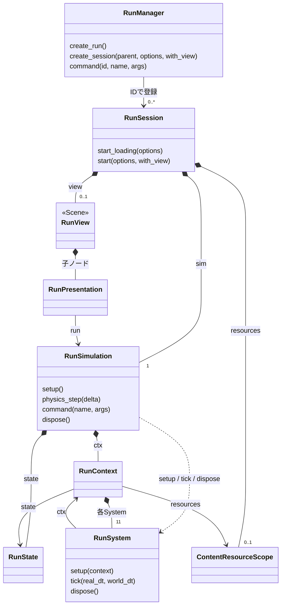
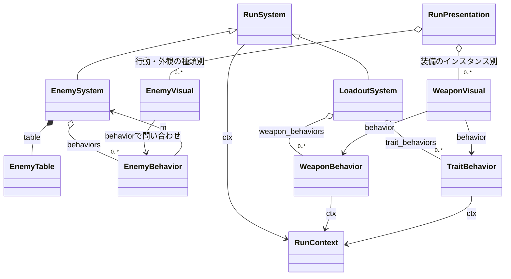
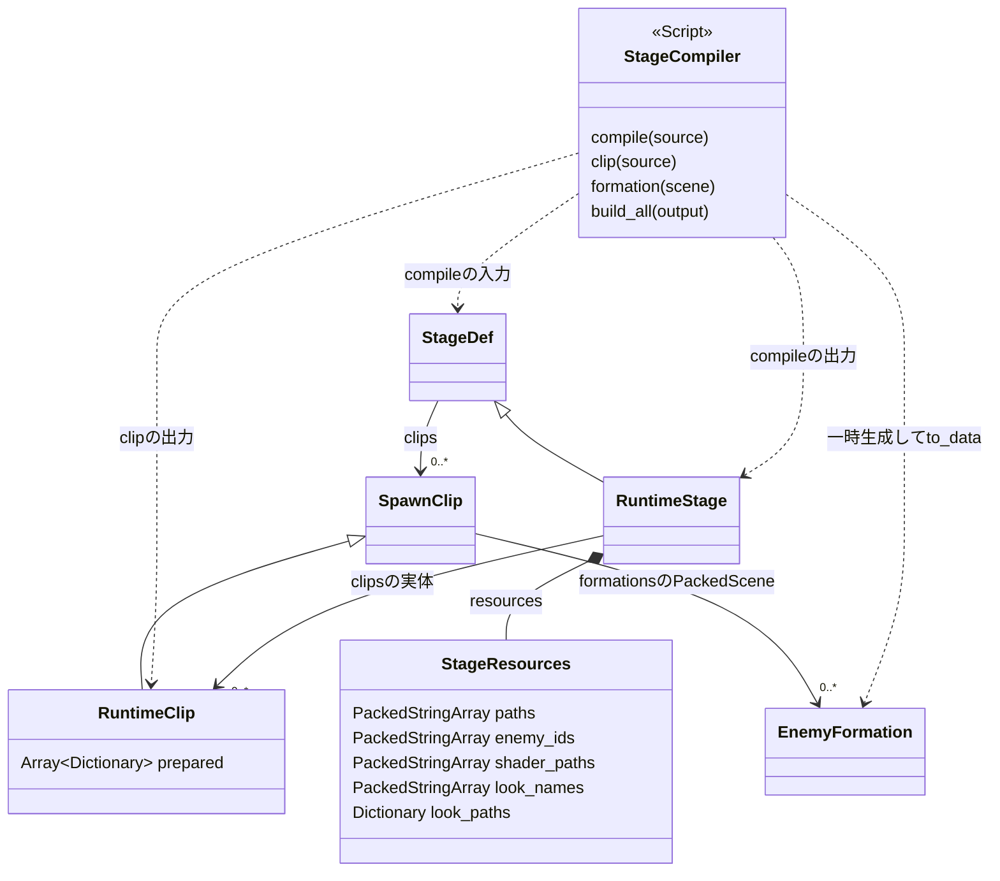
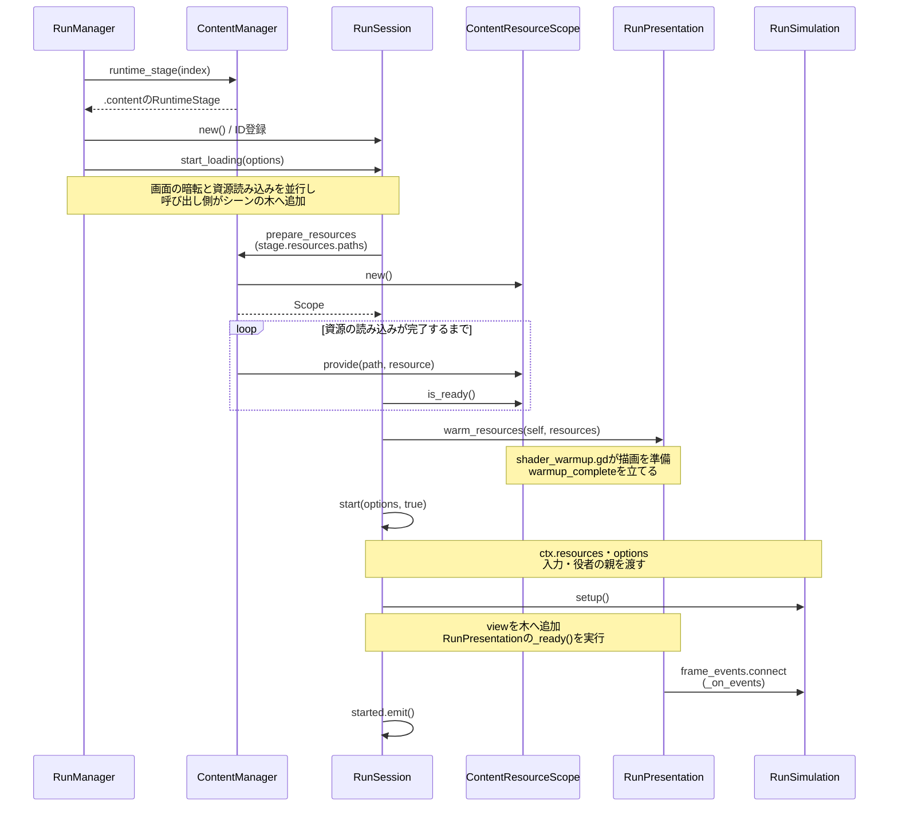
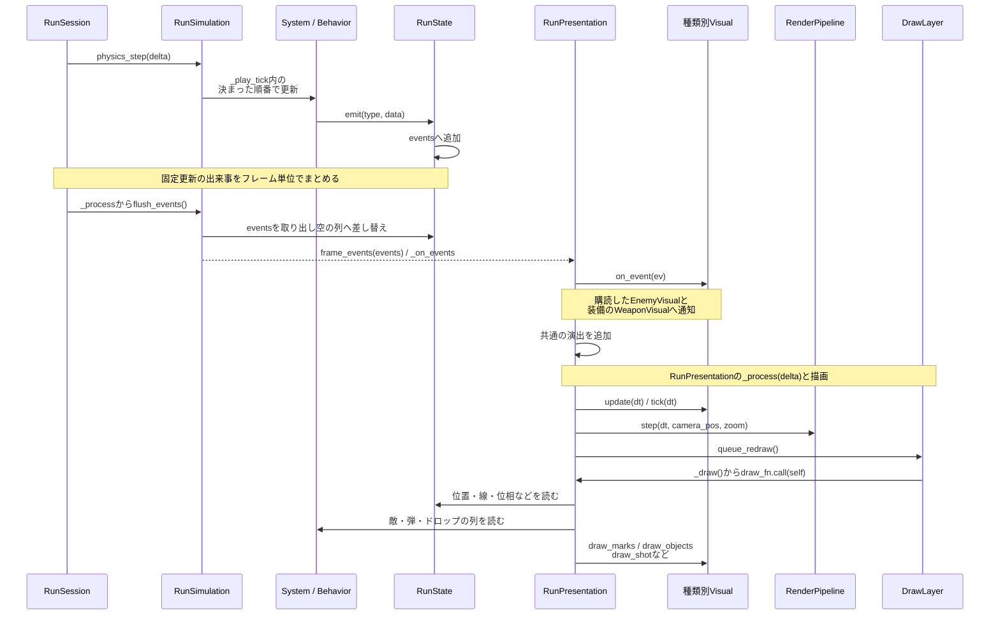

# SPEED 設計書

- demo のコードは引き継がない。ゲームの挙動は仕様書を正とし、ここでは Godot での正式な開発に向けて設計し直す。
- Godot プロジェクトは `speed/`（`res://`）。`.godot/` などの生成キャッシュはコミットしない。

ステージ制作の入口は[制作ガイド](dev/stage-production.md)、編集先と記録分析の進め方は[AI向け参照](dev/stage-production-ai.md)、ステージ4の制作要件は[個別仕様](game/stages/stage-4.md)を参照する。本書はツールの詳細な編集契約と記録形式を定義する。

---

## 1. 前提

設計を縛る条件。仕様書と企画書から来ている。

| 条件 | 出どころ |
|---|---|
| 敵が1300体前後いる場面でも 60fps | 仕様書 21 |
| 商用のゲームとして出す。最初は Steam、最終的に itch.io とスマホのストアにも出す | 企画書 1 |
| 特定の解像度・縦横比に固定しない | 仕様書 17、AGENTS.md |
| 見栄えは非常に重要。独自のシェーダーと描画の流れを作る | ユーザーの方針 |
| 世界の時間と実時間を分けて扱う。描画中0.1倍、なぞり中は可変、ヒットストップで停止 | 仕様書 1・6 |
| なぞり中、機体は0.5実秒で最大数千単位を移動する（1回の更新で大きく動く） | 仕様書 6.5 |
| ほとんどの数値をプレイ中に調整パネルから変えられる | 仕様書 20 |
| 武器・特性・敵は一覧の管理 ID（W01、T01、`drifter` など）で管理する | [catalog.md](game/catalog/rules.md) |
| ストーリー（5ステージ）とエンドレスの2つのモードがある | 仕様書 2 |
| ステージごとに、星系の広いフィールド・中ボス・フィールドの仕掛けが変わる | 仕様書 2〜22 |
| 中ボスは複数の部位（うみへび座の首など）を持ちうる。画面より大きくなりうる | 仕様書 12.3 |
| ステージ固有の仕掛けは、ステージごとの個別仕様で定める | 仕様書 13.2 |
| ラスボス戦の締めで、描画のルール（長さの上限・世界の速さ）を一時的に変え、自動の演出を流す | 仕様書 12.4 |
| ストーリーの進み具合・伝説のモジュール・ハイスコアを保存する。伝説のモジュールは能力値に効かない | 仕様書 14・2.3 |

## 2. 技術スタック

| 項目 | 構成 |
|---|---|
| エンジン | Godot 4.6（`speed/project.godot`） |
| 言語 | GDScript。大量処理（敵の移動・格子・当たり判定など）は、GDExtension（C++）へ差し替えられる境界を保つ |
| レンダラ | 本番プロジェクトは Forward+。描画処理は Forward+・Mobile の HDR 経路と、Compatibility の簡易経路を持つ（10章）。ブラウザは Compatibility を使う |
| 物理エンジン | プロジェクトの3D設定は Jolt。敵・弾の2D当たり判定は7章の自前処理を使う |

性能目標の達成と、PC・スマホで使うレンダラの最終選択は[未決事項](#18-未決事項)に置く。

## 3. フォルダ構成

種類ごとに分ける。シーンは人が一番よく触るところなのでまとめておく。スクリプトは人が触る頻度が低く、主に AI が書く。データはまとめて取り込むことが多く、一括で管理したい。スクリプトはアプリ全体の窓口、ランの処理、種類ごとの振る舞い、表示に分ける。

```
speed/                    res://
  project.godot
  addons/                 編集用の道具、実行用拡張、ゲーム専用の生成（4.1）
    content_build/        実行用データの生成とexport
    spawn_timeline/       出現タイムライン（14.2）
    speed_data_editor/    データ編集ツール（8.4）
    stage_launcher/       ステージの直接起動（14.1）
  scenes/                 シーン（.tscn）。人が一番よく触る
    app/                  Main、タイトル、設定、メインメニュー、ステージ選択、強化、図鑑、結果
    run/                  ランの土台と、報酬演出の差し替えシーン（ULT・伝説モジュール）
    bosses/               中ボス・ラスボス（部位、タイムライン、AI）
    fx/                   演出のシーン
    stages/               ステージごとのフィールドの配置（今は空の仮シーン）
    gimmicks/             フィールドの仕掛け（未作成）
    ship/  render/  ui/   （未作成）
  scripts/                スクリプト（.gd）。主に AI が書く
    managers/             アプリ全体の窓口（4.3）
    runtime/              RunSimulation・RunSession・RunContext・systems/
    dev/                  開発用の起動・命令・調整・性能表示・録画
    actors/               機体の見た目、ボスの役者の共通部分
    bosses/               ボスごとの行動と共通フロー
    enemies/              EnemyBehavior・EnemyMotion・種類別の行動・被弾条件
    attacks/              攻撃の生成・移動・接触の種類別処理
    heroes/  gimmicks/    英雄の力とフィールドの仕掛け
    pickups/              回収時の効果
    encounters/           強敵の群れ・フォーメーション・攻撃の予算（11.3・11.7）
    weapons/              武器ごとの発動
    traits/               特性ごとの発動
    render/               描画の層と段
    input/                機器ごとの変換（9章）
    ui/
    data_types/           定義データのクラス（8.1の WeaponDef など）
    common/               複数の場所で使う関数
  shaders/                compute/ はコンピュートの演出
  data/                   定義データ（.tres）。数値の正（8.1）
    config.tres
    phases/ weapons/ traits/ enemies/ stages/ bosses/ heroes/ legendary_modules/ meta_upgrades/
    formations/           敵の組み合わせのシーン（.tscn、8.1）
    legendary_aura_bakes/ visuals/ text/ lab/
  assets/                 画像、音、フォント（pixel/ ui/ fx/ placeholders/）
  gyms/                   実験用。規約なしで試せる。製品の書き出しから除外する
  .content/               実行用ステージ・音・開発用の名前対応表（生成物）
  tests/
  tools/                  素材の切り出し・アート確認・性能計測
    editor/               SPEED専用のボス行動・ステージ敵調整の編集機能
```

ステージは、人が配置を触るシーン（`scenes/stages/`）と、数値の `StageDef`（`data/stages/`）に分ける。配置のシーンは今は空の仮シーンで、ステージの直接起動（14.1）の対象として使う。

## 4. 全体の構成

### 4.1 層と依存の向き

| 層 | 中身 | 依存と役割 |
|---|---|---|
| 道具 | `addons/` の編集機能 | 再利用する道具は Godot 本体に依存する。`content_build/` はゲーム専用の生成処理を接続する |
| アプリの窓口 | `scripts/managers/` | 画面、保存、定義の索引、資源の読み込み、音、ランの寿命を扱う |
| ランの処理 | `scripts/runtime/` と種類別の振る舞い | RunContext からそのランの状態・設定・System・資源を読む |
| 表示とUI | `scripts/render/`・`scripts/ui/` | 状態と出来事を読み、操作を命令として渡す |
| コンテンツ | 定義Resource、ボスの役者、見た目 | 共通の契約に従ってランの処理や表示へ接続する |
| 開発用 | `scripts/dev/`・`gyms/`・`tests/`・`tools/` | 同じランを利用し、起動時に調整・記録・実験用の入口を加える |

### 4.2 混合方式

敵・弾・破片・経験値は表の列として持ち、まとめて更新・描画する。敵の個別処理は種類ごとの EnemyBehavior が、その種類の行番号をまとめて処理する。機体は RunState の数値、ボスは Node の役者と表の当たり判定で構成する。英雄・仕掛け・回収効果は、それぞれの種類別の処理を System から呼ぶ。

### 4.3 アプリの窓口とラン

アプリ全体の窓口を Autoload にする。

| 窓口 | 担当 |
|---|---|
| ContentManager | 調整値の実行時の複製、ContentCatalog、定義の取得、資源の読み込み（8章） |
| SaveManager | セーブ、図鑑、伝説のモジュール、ハイスコア、機体強化（11章） |
| ProfileManager | 保存された強化からランへ渡す能力値の倍率・加算・軽減を計算する |
| AudioManager | 生成済みの音源の再生（13章） |
| GameManager | 画面、モード、ステージ進行、結果保存の入口 |
| RunManager | id ごとの RunSession の作成・検索・命令の振り分け・登録解除 |
| DevBootstrap | 開発版の起動。デバッグ命令・調整表示・録画・実験場・直接起動予約を接続する |

RunSession（Node）が RunSimulation（RefCounted）と任意の表示を所有する。RunSimulation が RunState・RunContext・各Systemを組み立て、更新の順番、時計、勝敗、終了演出を進める。RunContext は状態・設定・System・強化値の写し・資源の参照を持つ。System は RefCounted の RunSystem を土台にする。

| System | 担当 |
|---|---|
| ShipSystem | 機体の移動とHP |
| DrawSystem | ゲージ、描画、なぞり、勢い |
| CombatSystem | 当たり判定の格子、ダメージ、ヒットストップ |
| EnemySystem | 敵の表、生成・解放、EnemyBehaviorと被弾条件の呼び出し |
| SpawnSystem | 時間帯、目標数、補充、再配置、生成済みクリップとフォーメーション |
| BossSystem | 同じランのボス役者の登録、部位通知、撃破 |
| ProjectileSystem | 弾・攻撃形状の共通の列と更新、種類別処理の呼び出し |
| LoadoutSystem | 経験値、レベル、候補、武器・特性、リロール |
| PickupSystem | ドロップと回収効果 |
| HeroSystem | 英雄の星座、特別な枠の力、目印の星 |
| FieldSystem | 地形、天体、隕石、フィールドの仕掛け |

**更新の順番**は `scripts/runtime/run_simulation.gd` の `_play_tick` が持つ。

1. 入力と描画の操作を受け、ヒットストップを判定する。
2. 戦闘の準備と描画・なぞりを更新し、実秒と世界秒を計算する。
3. 世界側の更新回に攻撃の予算、フィールド、敵、ボス、戦闘の格子を更新する。
4. 機体、英雄、武器・特性を更新し、世界側の更新回に弾・攻撃を進める。
5. 撃破済みの行を解放し、世界側の更新回に出現と回収を進める。
6. ワープ、カメラ、勝敗、保留中のカード選択を扱う。

表示のあるランは RunPresentation・HUD・InputRouter を接続する。表示のない実験は、同じシミュレーションと非表示の役者用Nodeを作る。シグナルはレベルアップや勝敗などに使い、命中・撃破などは更新ごとの出来事の列へ積む。UI と入力はセッションの命令の入口を使う。

#### ランの所有と参照

黒いひし形はランの寿命に合わせて保持・解放する関係、通常の矢印は参照、破線は呼び出しを表す。RunManagerはIDでセッションを登録し、シーンの親がRunSessionを木に保持する。RunViewは `scenes/run/run.tscn` の根を表し、表示を使うランに接続する。



実装の入口は [RunSession](../speed/scripts/runtime/run_session.gd)、[RunSimulation](../speed/scripts/runtime/run_simulation.gd)、[RunContext](../speed/scripts/runtime/run_context.gd)。種類別の処理との接続は [6.1](#61-敵とボスの-ai)、資源の準備と解放は [8.1](#81-定義データresource) に示す。

### 4.4 守る決まり

1. 各Systemの責任を仕様のまとまりに対応させる。
2. RunSimulation が RunContext に各Systemを入れ、種類別の振る舞いも同じContextを受け取る。
3. 状態をRunStateと各Systemの列に持ち、処理と表示を分ける。
4. 種類固有の分岐は、敵・攻撃・武器・特性・英雄・仕掛け・回収の各スクリプトに置く。
5. セッションの終了時に、通知・コールバック・役者・資源の参照を解放する。実験ごとの設定・乱数・状態の参照を分ける。
6. `tests/check_rules.gd` がAutoload、Managerのコンテンツ参照、再利用する道具、UIの状態代入、開発用の依存を確認する。
7. 処理の実行時期は[ビルドと実行時の境界](#151-ビルドと実行時の境界)に従う。設計・レビューで生成元から利用・解放までを照合する。

### 4.5 シーンの木

```
Main (Node)
└─ RunSession (Node)          シミュレーションと資源の寿命
   └─ Run (Node)              表示を使う場合の run.tscn
      ├─ RunPresentation
      ├─ World (Node2D)
      │  ├─ InputRouter
      │  ├─ Camera2D
      │  └─ 描画の層・ボスの役者
      └─ Hud (CanvasLayer)
         └─ HudRoot
```

開発用の起動処理が、表示のある通常ランへDebugPanelとPerfOverlayを加え、PlayRecorderをアプリに接続する。配布パッケージの範囲は15章で定める。

## 5. 時間

**仕様から来る条件**：実秒と世界秒の2つの時間がある。描画中は世界が0.1倍、なぞり中は「260 ÷ 突進の速さ」倍、ヒットストップでは止まる。ランの時計・ゲージ・なぞりの0.5秒は実秒。ポーズと3択ではすべて止まる。

- `RunSession._physics_process()` が固定更新ごとに `RunSimulation.physics_step()` を呼ぶ。
- `RunSimulation` が毎回 `real_dt` と `world_dt`（＝ `real_dt` × `DrawSystem.world_scale()`）を計算し、各システムに渡す。各数値をどちらの時間で数えるかは仕様書に従う。
- `Engine.time_scale` は使わない。UI や実秒で動くものまで一緒に遅くなり、2つの時間を分けられないため。
- ポーズはRunSimulationがランの位相を切り替えて実現する。`get_tree().paused` は UI の扱いが複雑になるので使わない。
- 表示補間の方式は[未決](#18-未決事項)。

- ラスボス戦の締め（仕様書 12.4）の「止まった世界で描く」段階は、世界の速さを0にして実現する。描画と UI は実秒で動くので、この仕組みのまま扱える。自動の演出（叩き込む段階）は実秒で進める。

固定更新は1秒に120回。入力・線・機体・武器は毎回進め、敵・ボス・天体・格子・弾・出現・回収（世界側）は `config.world_tick_div` 回に1回（2で60Hz）、たまった `real_dt`・`world_dt` でまとめて進める。各処理は1回あたりの時間（dt）を使って書き、回数を前提にしない。すり抜けは更新の回数ではなく、線分と円の判定（7章）で防ぐ。

## 6. 大量の敵・弾・ドロップ

4.2の構成に従い、敵・弾・ドロップはデータとして持つ。

**仕様から来る条件**：敵が1300体前後いる場面でも60fpsを目指す。敵・経験値の結晶・機雷・弾・破片を扱う。個数と履歴の管理は[17章](#17-システムの限界)を参照する。

**実装**

- 敵・弾・破片・経験値の結晶・部品は、項目ごとの数値の列（`PackedVector2Array`・`PackedFloat64Array` など）で持つ。1行が1つの物で、i 番目の物は各列の i 番目。ほかの処理から読むときは、ループの前に列を手元の変数へ取り出す。
- 生きている物は、消えるまで同じ行にいる。消えた行は空きになり、次に加える物が使い回す（`scripts/common/row_slots.gd`）。毎回の更新では、その回に変わる列だけを書く。使用中かどうかは `alive` の列で表し、ループは使用中の行だけを処理する。空きが尽きたら全部の列をまとめて伸ばす。
- 行を加える・空きに戻す・列を伸ばすのは、その列を持つSystemの関数。1組の列は、名前の頭（`hostile_`・`friend_`・`gem_`・`coin_`）か、列だけを持つクラス（`EnemyTable`）でまとめる。デバッグ版では次を確かめ、確かめる列は名前の頭やクラスから自動で集める（`scripts/common/columns.gd`）。
  - 列を伸ばしたとき、全部の列の長さがそろっているか。
  - ラン開始時、追加の関数が使い回す行の全部の列を書き直すか。書き忘れた列があれば、その名前を出して止まる。
- 敵は敵の表（6.2）の1行。隕石とボスの当たり判定も同じ表に入る。撃破した敵は撃破済みの印を付け、その回の終わりに行を空きへ戻す。何フレームもまたいで敵を覚えるときは、行番号と id の組で覚え、`EnemySystem.is_same` で確かめる。行動する雑魚は行動の種類ごとの行番号の一覧に入り、更新は種類ごとにその一覧を回す。追跡の更新は関数を呼ばずにループの中で計算する。追跡と噛みつきの更新は、天体までの余裕を持つ列もループの先頭で読み、移動後の同じ距離条件で衝突を確かめる。攻撃枠の取得は強敵以上に対して行う。種類ごとの更新は、その種類の行があるときに進める。画面から遠い敵は、判断（向きを変える・攻撃の時間を進めるなど）を3回に1回だけ、まとめた時間で行い、間の回は今の速度で進むだけにする。さらに速さが要るときは、ここを GDExtension に移す。
- 経験値の結晶の上限で「いちばん古い結晶」を選ぶため、結晶ごとに落ちた順の通し番号を持ち、落ちた順の待ち行列から取り出す。拾われた結晶は取り出すときに読み飛ばす。
- 当たり判定の格子（`SpatialGrid`）は `PackedInt32Array` の先頭・次の表で持ち、探索の結果は敵の表の行番号。
- 出現調査は世界側の更新ごと。全体数・四辺の偏り・遠方の再配置は毎回調べ、種類別数は出現上限を使う戦艦とタイタンだけ集計する。四辺の分類では個体ごとの正規化除算を交差乗算に置き換える。
- 描画は `MultiMesh` にまとめて描く（`scripts/render/instance_batch.gd`）。Compatibility では `custom_aabb` の設定が要る。
- 機体とボスは1体ずつなので、ノードにする。ボスは部位（首など）を子として持ち、部位ごとに当たり判定・HP・攻撃を持てるようにする。当たり判定は7章の自前の判定に部位の円を登録する。

### 6.1 敵とボスの AI

`EnemyBehavior`が出現・更新・被弾・死亡・解放の入口を持ち、`EnemyMotion`が操舵と移動の補助、`enemies/gates/`が被弾条件を持つ。敵の表は共通の列を保持し、その種類だけが使う状態はBehaviorに置く。行番号をまたいで個体を覚えるときはIDも照合する。

弾と攻撃は `scripts/attacks/` のAttackKindが生成し、形状・移動・接触の入口を種類ごとに実装する。ProjectileSystemは列の割り当て・更新・解放と共通の命中を扱う。味方弾の特殊な命中は武器側のコールバックへ渡し、行の解放時に参照を消す。

**System・Behavior・Visualの接続**

敵と装備を例に、種類別の処理と表示の境界を示す。EnemyBehaviorはEnemySystemを経由して表とContext内のSystemを参照し、WeaponBehavior・TraitBehaviorはContextを直接参照する。白いひし形は保持する複数のインスタンス、三角の矢印は継承を表す。



EnemySystemは `step()` または `tick_rows()` で敵の行動を進め、LoadoutSystemは装備の `tick()` や接触・撃破の入口を呼ぶ。WeaponVisualの `behavior` は武器か特性のどちらかを指す。表示側は状態を読み、イベントから演出を作る（[10章](#10-描画と演出)）。入口の定義は [EnemyBehavior](../speed/scripts/enemies/enemy_behavior.gd)、[WeaponBehavior](../speed/scripts/weapons/weapon_behavior.gd)、[TraitBehavior](../speed/scripts/traits/trait_behavior.gd)、[EnemyVisual](../speed/scripts/render/enemies/enemy_visual.gd)、[WeaponVisual](../speed/scripts/render/equipment/weapon_visual.gd) にある。

EnemyBehavior の `before_move()` は通常移動の直前に実際の移動時間を受け取り、高速突進の移動区間を判定する。`full_rate` が有効な種類は、画面外でも行動と区間判定を毎回進める。石化・外力による移動は共通の前処理で扱う。

| 対象 | 層 | 方式 |
|---|---|---|
| 雑魚 | 行動 | 種類ごとの単純なステートマシン（例：ダーターの予告 → 突進 → 回復） |
| ヒュドラ | 形態（首増加・合体・分離） | 役者が専用状態を管理する |
| いっかくじゅう座 | 形態 | 役者がHP閾値と移行予約を管理する |
| 実装済みのボス | 判断 | 共通の区間フローと、個別処理が返す実行可能候補 |
| 中ボス・ラスボス | 攻撃（1つ1つの動き・弾・予告の振り付け） | タイムライン（エディタで人が調整する） |

- 共通フローの編集画面はGodotのEditorPluginで実装する。`single_actor_adapter.gd`が一体のボス、`hydra_flow_adapter.gd`が複数の首の実行を共通選択器へ接続する。
- ボスの判断の層から、自機の状態（線を描いているか、描かれた線、ゲージの溜まり具合、位置）・フィールドの仕掛けとの位置関係・ボス自身と部位の HP を読めるようにする。何を判断に使うかは、ボスごとの仕様で決める。

**うみへび座の編集と役割**

`EnemySystem.knockback_scale()` はボス本体と、行番号・IDが有効なボスを親に持つ部位の外力倍率を判定する。`CombatSystem.damage_enemy()` と吹き飛ばし衝角はこの判定を使い、役者が管理する移動速度と外力を分ける。

ゲームの決まりは [ヒュドラ専用仕様](game/bosses/hydra.md)、採用・実装状況は [敵一覧](game/catalog/enemies.md) に置く。`scenes/bosses/hydra_boss.tscn` の役者が中央HP、増加、分離、部位の行番号とID、最終勝利を管理する。`BossActor.handle_body_defeat()` は中央破壊の段階移行を引き受け、`health_row()` は形態ごとのHP表示対象を返す。部位は行解放前の `on_part_defeated()` で確定する。

`tools/editor/boss_flow/`が「ボス行動」画面を提供する。SPEED専用の編集機能は`tools/editor/`に置き、`addons/boss_flow/`と`addons/stage_enemy_tuning/`にはGodotへ登録する`plugin.cfg`だけを置く。上段に区間ノードのグラフ、下段に通常技・コンボ・大技の分類ごとの技グラフ、右側に選択したノードの編集欄を置く。操作は[制作ガイド](dev/stage-production.md#55-ボス行動を調整する)を参照する。

`data/bosses/ai/hydra_flow.tres`が区間の要求種別・確率・消費上限・使用可能な技参照・同時攻撃の禁止・共有スタミナ・二種類の休息を持つ。`hydra_action_rules.tres`が技参照・距離方向条件・消費量・コンボ内部を持ち、技の性能は参照先の`hydra_moves/*.tres`が持つ。`BossTechnique`は共通の技データ、`HydraTechnique`は必要な首の種類を追加する型である。`graph_nodes`は図のノードから技への参照と接続・非表示状態を持つ。通常技の複製は同じ性能を参照し、個別の条件を持つ。実行側は接続された同じ技の条件をORで評価し、ノード数によって抽選頻度を増やさない。

`flow/runner.gd`は区間・履歴・消費・休息を管理し、`selector.gd`は実行可能候補から一つまたは複数を選ぶ。`hydra_flow_adapter.gd`は現在の位置・形態・生存部位から具体的参加者付きの候補を返し、開始時に参加者を再検証する。個別側の入力は現在状況と要求種別で、区間の構造と区間ごとの候補絞り込み・禁止ペアは共通側に保持する。区間の有向接続は右から左へのループも保存し、1更新で1回だけ遷移を処理する。条件評価は読み取りとし、開始に成功した選択分だけ消費する。技のID集合で直前の組み合わせを識別し、別候補があれば連発を避ける。

`build_boss_program.gd`が編集元から`.content/boss_hydra.tres`を作る。技の数値と条件を独立したスナップショットにし、画面配置を除いた署名と形式の版を検査する。数値入力・ノード移動・保存は編集元と表示だけを更新する。生成は試遊・export・明示操作時に行い、意味のある変更がない場合は生成済みデータを再利用する。通常の起動前生成とexportは同じ変換を呼び、exportは試遊専用の`boss_preview.tres`を除外する。

コンボ内部は`combo_runner.gd`が順次・並列・待機・技間分岐を進める。並列は全枝の完了を待ち、枝の失敗時は実行中の枝を取り消す。照準と技固有の欠員処理は既存の実行部が担当する。範囲確認は指定した残量・生存部位・基準姿勢に対して条件と到達上限を重ね、サンプル上の未カバーを示す。実行時も同じ距離方向の計算と通常技の到達上限を判定する。配置成立と、予告中・実行中に動く機体への命中は個別の実行条件で扱う。

`hydra_normals.gd` は通常技、`hydra_techniques.gd` は大技・コンボと配置待ち、`hydra_grid.gd` は領域判定・優先枠・一筆経路の検証を担当する。`Timeline` と `hydra_boss_timeline.tres` のメソッドキーを世界秒で手動更新する。同時噛みつきは捕捉→固定→伸長→到達、ほかの大技は配置→予告→実行→全体硬直を進める。配置の移動中はタイムラインを待たせる。参加者の喪失は個別仕様に従って中断か欠員として扱う。

合体中の首は `hydra_neck.gd` が固定根元から頭までをFABRIKで解き、胴体の外側に保つ。分離後は `hydra_snake_motion.gd` が操舵し、頭の通過点列を胴体がたどる。速度・旋回・被弾・構え・攻撃・停止の重みを世界秒で連続的に混ぜる。頭の位置と姿勢は戦闘値として保持し、描画だけで移動を作る構成を避ける。

通常技の捕捉位置は `start_normal()` で保持し、待機中の狙いは更新間隔を持たせる。`aim_neck()` が角速度と加速度を制御する。全ての攻撃位置が確定した後に頭の向きと胴の骨組みを一度だけ更新する。中央本体と分離後の不死の蛇は、役者の生成時に装甲を通過可能な値へ設定する。

`hydra_attack_field.gd` は表示と判定で同じ点列・幅・開始時刻・寿命を使う。機体と形状の移動区間を掃引し、世界時間停止時は形を保つ。描画ノードはID別に持ち、戦闘状態の辞書に解放済みノードを残さず、実験場の巻き戻し比較を保つ。

`hydra_arena.gd` は固定瓦礫の描画と戦闘エリアを所有し、ボスの行IDで `FieldSystem.battle_arenas` へ矩形を登録する。地形の掃引判定・機体の跳ね返り・線描画・弾の地形判定で同じ外周を使う。通常の蛇の操舵は胴の長さを考慮して内側を狙い、大技は画面とエリアの共通部分へ配置する。最終撃破と役者の解放で登録を解除する。

**Hydraの試遊と素材差し替え**

`gyms/hydra_trial.tscn` をF6で起動すると、敵・ルート実験場が試遊モードで開く。停止・巻き戻し・機体固定・数値編集を使える。シーンのInspectorで開始位置・無敵・試遊用の攻撃倍率を変える。通常出現とセーブは実験セッションから分ける。

HydraBossの `body_texture`・`neck_texture`・`compass_texture` は本体・首の節・羅針盤の差し替え口。頭は既存の敵素材経路 `assets/pixel/hydra_<種類>.png` とステージの素材指定を使う。`energy_shader` は実判定に沿う光線・風・雷・瓦礫のマテリアルを差し替える。判定は点列・幅・時間のまま保持する。

瓦礫竜巻は `tornado_scene` の `hydra_tornado.tscn` で差し替える。`hydra_tornado.gd` は `update_effect(effect, world_time)` で攻撃点列・幅・投入位置を受け取り、`hydra_tornado.gdshader` の渦と既存の岩素材を重ねる。演出ノードは攻撃辞書の外に保管し、判定と寿命は `hydra_attack_field.gd` が所有する。

絵担当は `scenes/bosses/hydra_presentation.tscn` を複製し、HydraBossの `presentation_scene` に指定する。差し替えシーンは `bind_hydra(actor)` で `presentation_event` と `presentation_advanced` を受け取る。`VisualTimeline` は装飾用、`burst_shader` は衝撃・破壊・増加・分離のピクセル表現用。イベントは `cue`・`technique`・`neck_index`・`part_id`・`kind`・`position`・`angle`・`world_time` を渡す。添字は本体-1、不死の蛇-2、通常首0以上。取り付け位置は `presentation_anchor()`、状態は `presentation_state()`、同時噛みつきの実際の到達点は `presentation_targets()` で読む。`hit` は実HP減少に伴い実ダメージを渡す。

描画確認用の起動引数は `--hydra-inspect --hydra-attack=<通常技ID>` または `--hydra-inspect --hydra-tech=<大技・コンボID>`。指定した技を1回再現する。`--hydra-split` で分離状態から試遊できる。撮影は `--hydra-capture=/tmp/任意名.png --hydra-capture-at=<秒>` を併用する。`--hydra-inspect --hydra-review` は確認用の攻撃力で線入力から一戦を自動再現する。確認モードの機体固定と自動進行は起動引数のある実行だけに適用する。

`--hydra-arena-edge` は固定バリケードの角付近へ機体を固定し、外周を描画確認する。

**みなみのかんむり座の渦**

望遠鏡とレチクルの遮蔽物探索は、世界更新ごとの岩の行番号を共用し、移動後の位置と撃破状態を読む。岩の追加と表のクリアはキャッシュを無効化する。光線は扇と交わる円に候補を絞り、攻撃許可前は機体への補間に使う2本、描画時は48本を計算する。

冠のEnemyBehavior（`scripts/enemies/corona.gd`）は、冠ごとの種類別の保持配列と、個体の行番号・ID・所有する冠の行番号・ID・配列内位置を持つ。捕捉時は既存の戦闘格子で近傍を調べ、死亡・解放時は配列の末尾交換で除く。抽選は保持中の種類とその重みだけを走査し、選んだ種類の配列から1体を選ぶ。個体ごとの旋回更新は通常 AI の代わりに毎世界更新で行い、通常のダメージ・撃破処理は敵の表に対して続ける。実験場の比較値には渦の状態も含め、巻き戻しは同じシーン全体を保持する方式を使う。

可視速度は「冠が前の世界更新から実際に動いた速度＋円の接線速度」と定義する。吸い込み中は半径を連続的に縮め、円に着いた個体だけを発射する。予告終了後、機体への方向と可視速度の角度誤差をフレームの両端で調べる。許容差 `align_angle` に入るか、±π の折り返しを除いた符号の変化で一致点をまたいだら発射できる。通過時は二分探索で更新内の時刻を求め、その位置から接線の向きを保って残り時間だけ直進する。渦から外すのはこの同じ個体で、複製や射出口への位置補正は行わない。

短距離の吸い込みは、うみへび座も使う `FieldSystem._well_pull` の距離減衰を使う。投擲の当たり判定は機体と個体の相対線分で調べ、通常の戦闘のあと `ProjectileSystem.tick()` から既存の `ShipSystem.damage()` へ渡す。死亡・行解放・冠の再配置で所有関係を解放し、保持中の個体自身の再配置を止める。ゲームの決まりと調整値は [敵一覧](game/catalog/enemies.md#みなみのかんむり座) に従う。

### 6.2 敵の表の列

`scripts/data_types/enemy_table.gd` の列。「使う敵」は、その列を読み書きする敵。type IDと行動スクリプトの対応は各EnemyDefの `behavior` が持つ。追跡は `chase`、みなみじゅうじ座は `cross`、いるか座は `dolphin` を使い、隕石・丸鋸・鉄塊はそれぞれ `meteor`・`saw`・`obstacle` を使う。部位の位置は親のBehaviorかボスの役者が決める。

| 列 | 使う敵 | 中身 |
|---|---|---|
| `alive` | 全部 | 使用中の行か |
| `id` | 全部 | 通し番号。使い回した行にも新しい番号が付く |
| `def` | 雑魚・隕石 | 敵の定義（`data/enemies/<type ID>.tres`） |
| `type` | 全部 | type ID（ボスはボスの ID） |
| `beh` | 雑魚 | 行動の種類の番号（`EnemySystem.behaviors` の位置。その戦いで出た順に振る） |
| `beh_slot` | 雑魚 | 行動の種類ごとの行番号の一覧の中での位置 |
| `is_boss` | ボス | ボスの当たり判定の行か |
| `meteor_index` | 隕石・鉄のがれき・回る丸鋸 | `FieldSystem` の配置の通し番号（それ以外は -1）。0 以上なら固い障害物として扱う |
| `attack_group` | 強敵 | 共有override群れの通し番号。個体ごとに消費する場合は0 |
| `attack_value` | 強敵 | 個体の攻撃value、またはoverride群れが共有するvalue（小数） |
| `attack_priority` | 強敵とその派生個体 | 出現元から引き継ぐ攻撃待ちの優先度。クリップの値を優先し、クリップ以外は種類別の値を出現時に確定する |
| `dead` | 全部 | 撃破済みか（その回の終わりに空きへ戻る） |
| `elite` | 雑魚 | エリートか |
| `pos` | 全部 | 位置 |
| `vel` | 全部 | 速度 |
| `facing` | 全部 | 向き |
| `r` | 全部 | 当たり判定の半径 |
| `hp` | 全部 | HP |
| `max_hp` | 全部 | 最大 HP |
| `armor` | 全部 | 装甲 |
| `xp` | 全部 | 経験値 |
| `gate` | 特殊な倒し方を持つ敵 | 倒し方の種類（`EnemyTable.Gate`） |
| `weak_arc` | `armored`・`battleship`・ボス | 背面の弱点の半角 |
| `color` | 全部 | 色（撃破の演出・破片） |
| `hit_cd` | 全部 | 同じ敵に続けて当たらない時間 |
| `guard` | 分裂体 | 生まれてから攻撃を受けない残り時間（親を倒した攻撃で一緒に倒れないように） |
| `flash` | 全部 | 被弾の光の残り時間 |
| `age` | 雑魚 | 出てからの時間 |
| `hull_scattered` | 大型の雑魚 | 撃破で破片を飛ばし終えたか |
| `speed` | 雑魚・ボス | 速さ |
| `accel` | 雑魚 | 加速 |
| `turn` | 雑魚 | 旋回の速さ |
| `body_gap` | 雑魚 | 前回確かめたときの、天体の表面までの距離（7章） |
| `body_gap_pos` | 雑魚 | `body_gap` を確かめた位置 |
| `body_gap_time` | 雑魚 | `body_gap` を確かめた世界時刻 |
| `mode` | `darter`・`rocket`・`biter`・`defender`・`hound`・`bomber`・`beamer`・`pulser`・`pump`（`WINDUP` が吸い込み）・`triangle`（`RECOVER` が膜の消えた間）・`crab`（`MOVE` が横歩き、`WINDUP` が薙ぎ・向き直し、`DASH` が突進、`RECOVER` が停止）・`marlin`・`phoenix`（`MOVE` が離脱、`WINDUP` が着地点予告、`DASH` が飛び込み、`RECOVER` が着地後の停止）・`aquarius`（`WINDUP` が予告と照射、`RECOVER` が照射後の休み）・`corona`（`WINDUP` が投擲の予告） | 行動の段階（動く → 構える・飛ぶ など） |
| `timer` | `mode` を使う敵 | 段階の残り時間 |
| `fire_t` | 撃つ敵 | 次の射撃までの時間 |
| `charge` | `biter`・`defender`・`hound`・`gunner`・`missile`・`battleship`・`telescope`・`pump`・`reticle`・`marlin`・`crab`・`phoenix`・`aquarius`・`cepheus`・ボス | 攻撃の予告の溜め（0〜1） |
| `bud_t` | `splitter`・`marlin`・`pump`・`crab` | 次の分裂までの時間。かじき座は次のしぶき、ポンプ座は次の吸い込み、かに座は小走り・停止の残り時間 |
| `buds` | `splitter`・`pump`・`crow`・`crab` | 分裂した数。ポンプ座は吸い込んだ敵の数、からす座は回収した結晶の数、かに座は左右の進行方向（停止は0） |
| `carry` | `crow`・`crab` | からす座が運ぶ経験値の量。かに座は横歩きで届かない経過時間 |
| `target` | `reticle`・`soldier`・`crab` | 狙っている岩の行番号（狙っていなければ -1）。ケフェウス座の兵は仕える王の行番号、かに座は薙ぎ・向き直しの区分 |
| `target_id` | `reticle`・`soldier`・`crab` | 狙っている岩の id。ケフェウス座の兵は仕える王の id、かに座は向き直す回数 |
| `anchor` | `cepheus`・`phoenix`・`crab` | ケフェウス座の隊列の基準位置。ほうおう座の離脱先・着地点。かに座の向き直す先・突進直前の位置 |
| `spin` | 漂流（`drift`）の雑魚、`clock`・`crab` | 回転の速さ。とけい座は針の経過時間、かに座は向き直す前の角度 |
| `links` | とけい座・みなみのさんかく座・かに座 | 付いて動く攻撃の形の行番号（`ProjectileSystem` の `hazard_` の行） |
| `parent` | 部位（みなみのさんかく座の星など） | 親の敵の行番号（部位でなければ -1） |
| `parent_id` | 部位 | 親の敵の id |
| `parts` | 部位を持つ敵（みなみのさんかく座） | 部位の行番号と id を交互に並べた一覧 |
| `landmark` | 強めの敵（星2〜5） | 1 なら目印の星を持つ（`HeroSystem` が選ぶ） |
| `fire_hit` | ヘルクレス座の火で焼かれた敵 | 最後に火でダメージを受けた世界時刻（うみへび座の頭が火で落ちたかの判定に使う） |
| `stone` | ペルセウス座の力で石になった敵 | 石になっている残り時間（世界秒） |
| `held` | みなみのかんむり座の渦に捕まった敵 | 1 ならほかの敵に抱えられている。抱えている側が動かし、自分の行動は止まる |
| `knock_t` | 強い攻撃で吹き飛ばされた雑魚 | 追跡を止めている残り時間 |
| `shove_time` | 吹き飛ばし衝角（W03）で押し出された敵 | 押し出しの残り時間 |
| `shove_vel` | 同上 | 押し出しの速度 |
| `shove_dmg` | 同上 | ぶつかった敵へのダメージ |
| `shove_hits` | 同上 | 押し出し中に当てた敵（id → true） |
| `shove_from` | 同上 | この更新の押し出しの始点 |
| `shoved` | 同上 | この更新で押し出されたか |
| `dash_seen` | なぞりで当たった敵 | 最初に触れた突進の番号 |
| `dash_fresh` | なぞりで当たった敵 | その突進で最初に触れたとき HP が満タンだったか（仕様書 7.4） |

列を足す・消すときは、同じ作業でこの表も直す。`tools/check_docs.py` がこの表とコードの列を照合する。

## 7. 当たり判定と空間分割

**仕様から来る条件**：円同士の判定が中心。なぞり中は1回の更新で長い距離を進むので、点の判定では敵をすり抜ける。線の左右45の帯との判定がある。地形（惑星・月）で弾・線・敵が止まる。

- Godot の物理エンジン（`Area2D`・`RigidBody2D`）は使わず、自前で判定する。数が多く、判定のルールも独自のため。
- 一様な格子で空間を分け、毎回の更新で敵の位置から作り直す。配列は使い回す。格子の範囲は保持し、敵が範囲外へ出たときだけ全件から求め直す。前回使ったセルだけ初期化する。
- なぞりは「線分と円」の判定で、通った区間を漏れなく調べる。
- 地形の詳細判定は線分と円で調べる。天体の範囲を512単位の格子へ毎更新登録し、短い移動区間では線分の太さを含む矩形に重なるセルから候補を取る。長い区間や格子外では全天体を調べる。敵の近傍確認では、月を軌道の半径帯に登録して候補を絞る。雑魚は、前回確かめたときの天体の表面までの距離・位置・世界時刻を持ち、その距離からその後に動いた距離と月が動けた距離を引いても余裕が残る間は、近傍確認を省く。敵の弾は等速なので、いちばん近い天体の表面までの距離を弾ごとに持ち、弾の移動量と月の公転の速さの上限で毎回減らす。この余裕が残る間は天体の判定を省く。月の軌道半径・大きさがラン中固定であることを利用し、周回位置は毎更新の実位置で判定する。惑星の判定と近傍の条件は維持する。
- フィールドの仕掛けの作りは、それぞれの仕掛けを実装するときに考える。

隕石・彗星・鉄のがれき・丸鋸は配置情報を保持し、カメラ近傍で敵の表へ登録する。範囲を離れると表の行を解放し、破壊済み状態はラン中維持する。惑星と月は `FieldSystem` の障害物データと空間索引で管理し、月の位置は世界時間から更新する。重力とワープホールは世界時間と寿命で管理する。各仕掛けの挙動は[仕様書13.1](spec.md#131-フィールドの要素)に従う。

## 8. データ構造

### 8.1 定義データ（Resource）

数値のデータのうち、今後調整する必要があるものはすべて `.tres` で管理する。数値のパラメータの正は `.tres` で、ドキュメントでは管理しない（[catalog.md](game/catalog/rules.md)）。

| クラス | 中身 | 対応する一覧 |
|---|---|---|
| `WeaponDef` | 管理 ID（`W01`）、内部 ID（`forward`）、名前、Lv ごとの値、図鑑用の任意画像 `preview_texture` | [weapons.md](game/catalog/weapons.md) |
| `TraitDef` | 管理 ID（`T01`）、内部 ID、名前、重ね数ごとの値、図鑑用の任意画像 `preview_texture` | [traits.md](game/catalog/traits.md) |
| `EnemyDef` | type ID（`drifter`）、名前、半径、HP、装甲、速度、経験値、倒し方、行動の種類と値、攻撃の重さ | [enemies.md](game/catalog/enemies.md) |
| `PhaseDef` | 開始の時刻、敵の数、敵レベル、補充の速さ、出現の重み、攻撃の予算、特別なルール | 仕様書 4.2 |
| `MetaUpgradeDef` | 強化の名前、効果、段階ごとの費用 | 仕様書 14 |
| `StageDef` | 星系、フィールドの配置、仕掛けの領域、時間帯の表、ステージの敵、雑魚の目標の数の曲線、出現のクリップ、出現タイムラインのトラックの名前、敵の見た目、中ボス、伝説のモジュール | 仕様書 2〜22 |
| `SpawnClip` | ラベル、タイムラインのトラック、種類の組み合わせ、フォーメーション、開始の時刻・長さ、同時の群れの数、出す間隔、攻撃優先度 | 仕様書 11.3・11.7 |
| `SpawnCurve` | 雑魚の種類、時刻と目標の数の点 | 仕様書 11.3 |
| `BossDef` | ボスの名前、部位、HP・装甲、行動 | 仕様書 12.2・12.3・12.4 |
| `HeroDef` | 英雄の星座の ID、名前、捕らわれているステージ、星の位置と星座線、クールダウン、効いている時間、力の値 | 仕様書 8.1・13.1 |
| `LegendaryModuleDef` | 伝説のモジュールの名前と対応する中ボス、図鑑用の任意画像 `preview_texture`。能力値は持たない | 仕様書 2.3 |

- 敵の組み合わせ（フォーメーション。`data/formations/*.tscn`）は、置ける種類（`types`）を持つ根の `EnemyFormation` の下に、配置の `FormationLayout`（子に敵1体ずつの `FormationMarker`）と出現位置の `FormationEntry` を何種類かずつ置くシーン。エディターでは、機体・止まっているときの画面の枠・回しても画面に入らない目安の円を描き、選んだ配置を出現位置に重ねて見せ、円の内側に入る敵や、置ける種類にない敵があれば警告する。置き場所の敵の種類は、置ける種類の中から選ぶ。出現位置の向きは自動で機体の方を向く。生成時にシーンから位置と向きの一覧を取り出し、実行時はRuntimeClipの `prepared` を使う。
- ステージの敵の見た目（`StageDef.enemy_looks`）は、全ステージ共通の雑魚の絵をステージごとに替える（type ID → `assets/pixel/<絵の名前>.png`）。
- 敵の局所調整は `StageDef.enemy_tuning` に敵ID → 項目名 → 数値の疎な辞書として保存する。`StageEnemyTuning` が編集可能な数値を定義し、生成時に検証する。RuntimeStageは上書きを引き継ぎ、EnemySystemがラン専用の複製へ解決する。`hp` は星から計算した標準HPを上書きし、`params.*` は該当する敵の行動値を上書きする。未指定項目は共通値を使う。実験場は `options.enemies` の定義を使う。
- 管理 ID は一覧と同じものを使う。一覧からデータへ、データから一覧へ、ID で行き来できるようにする。
- 武器・特性の効果は、一定間隔・高速の接触・なぞった跡・線の終点・撃破・被弾などの入口を持つBehaviorにする。LoadoutSystemがRunContextを渡し、実秒・世界秒と位相変更を通知する。付着攻撃も共通の更新へ登録する。

**編集元と実行用データ**

`data/content_catalog.tres` のContentCatalogは、ID・表示文言のキー・並び順・費用・素材パスなどの小さな索引を持つ。タイトル、図鑑、強化画面、選択候補は索引を読み、個別の定義と画像は使うときに取得する。

StageDef・SpawnClip・フォーメーションのシーンを編集元とする。`tools/content/build_all.gd` が `.content/stage_<番号>.tres` のRuntimeStage・RuntimeClipとStageResourcesを生成する。実行用のクリップは配置・種類フィルター・攻撃valueを解決した辞書を持つ。トラック名・表示ラベルは `.content/dev/` の名前対応表へ保存し、記録の表示名に使う。実験場も同じコンパイラーで編集元を組み立て、`options.enemies` の個別定義の差し替えを維持する。

**編集元から実行用データへの生成**

RuntimeStageとRuntimeClipは編集元の型を継承し、戦闘で使う値と展開済みの配置を保持する。図中のStageCompilerは [build_runtime_stage.gd](../speed/tools/content/build_runtime_stage.gd) を表す。破線は生成処理への入力・出力、通常の矢印は保持する参照を示す。



[共通の生成入口](../speed/addons/content_build/builder.gd) がStageCompilerの `build_all()` を呼び、生成結果を `.content/stage_<番号>.tres` へ保存する。StageResourcesは [build_stage_resources.gd](../speed/tools/content/build_stage_resources.gd) が定義・行動・見た目・音・shaderなどのパスを集めて作る。

**資源の寿命**

出撃後、RunSessionはロード表示と戻る操作を出してStageResourcesを準備する。ContentResourceScopeが参照を所有し、ContentManagerが重複する要求をまとめて読み込む。セッション終了・出撃取り消しで参照を解放する。タイトルへ戻ったあとも残るものは索引とアプリ共通の資源とする。

カードの候補を出すときは、候補ごとの定義・振る舞い・見た目・画像を別のScopeで準備する。選択した候補の準備とshaderの描画準備が終わると装備へ参照を渡し、ほかの候補を解放して戦闘へ戻る。装備解除・ラン終了でも対応する参照を解放する。

**通常出撃のロードと開始**

生成済みのステージを取得して暗転中から資源を読み込み、明転中も読み込みとshaderの描画準備を進める。資源と描画の準備を完了させてシミュレーションと表示を接続し、画面遷移の入力抑止が終わると戦闘の時計を進める。図は表示のある通常出撃の成功経路を示す。ContentManagerは読み込み要求をまとめ、完了した資源を各Scopeへ渡す。



セッション終了時は [RunSessionの破棄処理](../speed/scripts/runtime/run_session.gd) がScopeを `cancel()` し、RunSimulationの `dispose()` がSystem・役者・通知の参照を外す。[ContentResourceScope](../speed/scripts/data_types/content_resource_scope.gd) は取り消し後に届いた資源を解放する。

### 8.2 ラン中の状態

| まとまり | 中身 |
|---|---|
| ステージ | モード、ステージ、ボス戦・締めの段階 |
| 時計 | 経過時間、世界の速さ、ヒットストップの残り |
| 機体 | 位置、速度、HP、無敵の残り、勢いの状態 |
| ゲージ | 容量、充填率 |
| 描画 | 描いている線の点の列、上限、開始時の充填率、なぞりの進み具合 |
| 成長 | レベル、経験値、武器ごとの Lv、特性ごとの重ね数、保留中の3択 |
| 英雄の星座 | 特別な枠の力、使えるまでの時間、効いている残り時間 |
| 敵・弾・ドロップ | 6章の配列 |
| フィールド | 月の位置、隕石の状態（壊したかどうか） |
| 結果 | 撃破数、拾った部品、そのランの最高の速さ |

機体の能力値（最高速度、攻撃力の倍率など）は、基礎値・レベル・特性と、ProfileManagerが渡す強化値から計算する。伝説のモジュールはこの計算に入れない。

ステージごとにランの状態を作り直す。武器・特性などプレイ中に手に入れたものは持ち越さない。ステージをまたいで残るのは、セーブデータ（11章）だけ。

### 8.3 調整できる数値

- demo の `config.js` にあたる数値を、1つの `GameConfig`（`data/config.tres`）にまとめる。
- ラン中は ContentManager が持つ複製を読む。調整パネルは複製だけを書き換え、元のファイルは書き換えない。
- 調整パネルは開発版でだけ使えるようにし、配布版には含めない。

### 8.4 データ編集ツール

Godot エディタの拡張の専用画面で、`.tres` のデータをまとめて管理する。

- 情報が見やすく、調整しやすい形にする。
- 見やすくするために情報を隠さない。すべての値をその画面で見られるようにする。
- その画面だけで分かるようにする。すべての項目に日本語の名前・説明・単位を付ける。
- エディタの上部の画面ではなく、メニューバー（プロジェクト → ツール → データ編集）から別のウィンドウで開く。

## 9. 入力

**仕様から来る条件**：PC はマウス、スマホはタッチ、キーボードは補助。ゲームパッドは一旦対応しない。

機器ごとの入力を、`scripts/input/intent.gd` の意図にまとめる。

| 意図 | マウス | タッチ |
|---|---|---|
| 移動：進みたい向きと強さ | カーソルの向き（強さは一定） | 仮想スティックの向きと倒し具合 |
| ペン先：描く位置と押した瞬間 | カーソルの位置とクリック | 指の位置と「描く」ボタン |

- 移動とペン先のほかに、描画の補助（`alt_press`）と英雄の星座の力の発動（`hero_press`）を、押した瞬間の意図として渡す。`RunSimulation` が `hero_press` を受けて `HeroSystem.activate()` を呼ぶ。
- ゲームのシステムは変換された意図を読む。機器を足すときは、変換するところだけを足す。
- キー操作は Godot の InputMap で定義する。設定画面で変えたキーの割り当ては、設定のファイルに保存し、起動時に InputMap へ反映する。

## 10. 描画と演出

RunPresentationがランの状態と出来事を受け取り、2Dの層とシェーダーの段を組み立てる。敵はEnemyVisual、攻撃はAttackVisual、装備は種類ごとのVisualへ表示を渡す。ShipVisual・BodyVisual・MeteorVisualが機体・天体・隕石を描く。

### 10.1 出来事と状態から描画まで

固定更新で積んだ出来事は、RunSessionのフレーム更新から表示へ渡す。RunPresentationは出来事から演出を作り、継続する位置・HP・攻撃形状はRunStateと各Systemの列から読む。図中のSystem・Behaviorと種類別Visualは、該当する処理をまとめた参加者を表す。



AttackVisualは攻撃の列を受け取って描き、EnemyVisual・WeaponVisualは状態と種類別の演出を描く。実装の入口は [RunState.emit](../speed/scripts/data_types/run_state.gd)、[RunSimulation.flush_events](../speed/scripts/runtime/run_simulation.gd)、[RunPresentation](../speed/scripts/render/run_presentation.gd)、[DrawLayer](../speed/scripts/render/draw_layer.gd)。HUDも `frame_events` を購読し、カード候補と位相の変更は `cards_changed`・`phase_changed` で受け取る。

### 10.2 層・資源・画面効果

重ねた絵の編集元は `data/visuals/looks/<外観名>.tres` のEnemyLookに本体・装甲・法線と任意の `decorations` を指定する。[固定外観の生成](#固定データ処理の生成と参照)が本体・固定塗装・サムネイルと牽引船体用の合成画像を用意し、`base_texture()` は合成済みの本体を返す。分離する外観は `split_other` にもう片側を持ち、`ruler` の表示が `buds` に応じて描画する。パーツのバッチは元の敵の外観設定・塗装を共有する。種類の外観を足す入口はこのResourceとし、ステージの `enemy_looks` から外観名を選ぶ。バッチ・照明・種類固有の表示は、そのランで使う種類を初めて表示するときに作り、照明の値は編集時に反映する。水流の専用層とshaderも初回使用時に作る。

出撃とカード選択では、資源準備に続いて `scripts/render/shader_warmup.gd` が小さなSubViewportで使うマテリアルと描画形式を準備する。準備済みのマテリアルはScopeが保持する。

英雄星座の光雲は、共通生成で曲面関数の一次元表と単位四角形を保存する。StageResourcesが準備対象へ含め、SessionのScopeが保持し、ロード中にshaderを事前描画する。表示は生成済みの表から星座の回転後の範囲・カメラ倍率に応じた格子を参照し、呼吸の明るさだけ時刻から更新する。表示固有のmaterialはランごとに持ち、固定の表と形状は共有する。

敵の表示半径は、そのランの定義と生成済み外観の数値を種類ごとに1描画パスだけ共有する。共有値は衝突倍率・画像寸法・基準半径などの数値だけとし、個体の半径をその場で反映する。パス終了時に破棄し、次の描画でライブ編集後の値を読む。Resourceの所有は既存のSessionとScopeに保つ。

- 背景・敵・演出を描画の層に分ける。Forward+・Mobile ではメインViewportの2D HDRとグローを使う。Compatibility では発光対象に `visibility_layer` を設定し、メインViewportと同じ `World2D` を共有する半解像度のSubViewportを `canvas_cull_mask` で絞り込み、ぼかして加算合成する。
- 各段は、PC・スマホ用（HDR・コンピュートシェーダーを使える）とブラウザ用の簡易版に差し替えられるようにする。
- 背景の星は、開始時に共通の円メッシュと400個の乱数配置・色をMultiMeshへ登録して使い回す。位置・視差・ズームは頂点シェーダーで計算し、毎フレームは視点のパラメータだけ更新する。既存の乱数シード・星の大きさ・色・視差の式を維持する。
- 法線マップを持つ敵は、種類ごとにカメラへ追従するCanvasLayerへベース・装甲のMultiMeshと2灯のDirectionalLight2Dを置き、独立した装甲マテリアルを使う。予告は上の専用CanvasLayerへ重ねる。装甲シェーダーは個体の変換行列で法線を回し、被弾フラッシュと敗北時の減光を描画へ適用する。共通の照明設定は `data/visuals/enemy_lighting.tres`、種類ごとのサイズ倍率と照明の上書きは `EnemyDef.visual_settings` に持つ。当たり判定のみの `collision_scale` は生成時と外観編集時に接触半径へ掛け、描画寸法の算出時には除く。吸い込みで膨らむ敵も同じ倍率を保つ。実験場は外観の編集を `parameter` コマンドへ記録し、半径と戦闘用グリッドを更新する。グリッドは登録した敵の最大半径を保持し、衝突候補の探索と画面外判定の余白へ反映する。画面効果とHUDのCanvasLayerは、敵と予告の上に置く。保存時はディスクの敵データを読み直して外観だけを書き換える。装甲の塗装は `EnemyDef.armor_colors` に持ち、連結成分と濃淡は[固定データ処理の生成](#固定データ処理の生成と参照)で解析する。画像の経路・寸法・透過マスクのハッシュで塗装を識別する。実行時は生成済みの塗装を種類内で共有し、実験場で変更したときは明示的なライブ変換で差し替える。元画像と法線画像を保持し、合成サムネイル・牽引船体にも同じ塗装を使う。実験場の `armor_paint` コマンドへ塗装を記録する。実験場がHDRの本番映像を通常のUIへ合成するときは、表示色をsRGBへ変換する。
- 敵弾の赤い円と暗い中心は開始時に共通のメッシュを作り、MultiMeshでまとめて描く。位置と半径だけを各インスタンスへ渡す。画面外の描画除外・弾の更新・寿命・攻撃頻度は維持する。
- ゲームの処理と描画は完全に分ける。ゲームの処理は「何がどこにあるか」だけを持ち、描画側が層ごとに描き分ける。
- スクリプトで描いている図形（`_draw` の円・矩形・弧など）は、すべてスプライトに置き換える。大量に出る物はすべて MultiMesh でまとめて描く。
- Godot の Compositor は3D専用なので使わない。
- 演出にはシェーダーを使う。コンピュートシェーダーは演出（破片、光の跡、背景、光のにじみ、波動の歪みなど）に積極的に使う（PC・スマホ。ブラウザの Compatibility では使えないので簡易版で代える）。敵の移動・当たり判定などのゲーム処理はGDScriptで計算する。性能目標に届かない場合の代替方式は未決。

- 描いている線・なぞった跡は、線の点の列から描く。
- 破片・火花・炎などの大量の演出は、6章と同じく配列とまとめた描画で扱う。スマホの性能を考えて、GPU のパーティクルに頼り切らない。
- GPU の火花は、発生順のデータをまとめてリングバッファへ送る。折り返しを含めてフレームあたり最大2回の転送とし、容量を超える発生では最後の粒を残す。表示は同期的な撃破・結晶イベント列の最低発生数を先に渡し、確実に上書きされる先頭分の組立を省く。省いた粒も要求時に同じ乱数を消費し、残る粒の値・順序と他の演出へ続く乱数列を維持する。予告外の追加発生も末尾へ積み、送信前に同じ容量で切る。
- 画面外の演出は描画だけ省き、位置・寿命の更新は続ける（カメラが動けば同じ状態が見える）。
- 画面の拡大縮小は、表示を伸ばす方式（`canvas_items`）と、縦横比に合わせて広げる設定（`expand`）を使う。カメラのズームは画面の短い辺を基準に計算する（仕様書 15）。

## 11. 保存

- `user://` に保存する。中身は仕様書 14 のとおり（ストーリーの進み具合、伝説のモジュール、ハイスコア、図鑑の獲得状況を含む）。
- データに版の番号を持たせ、版が変わったら古いデータを新しい形に変換する。読めないデータは壊さずに初期値で始める。
- 設定（音量、画面モード、言語、キー設定）は、セーブとは別のファイルに保存する。
- 導入の視聴済み状態を `intro_seen` として保存する。不足するセーブ項目は `SaveManager._migrate()` が初期値で補う。

## 12. UI

- すべての UI は `Control` で作り、アンカーとコンテナで画面の大きさに合わせる。座標を決め打ちしない。
- 色と文字の大きさは1つのテーマにまとめる。強化段階の色（仕様書 8）もテーマで管理する。
- 3択・ポーズ・結果は、ラン中の状態を表示するだけにする。選んだ結果は RunManager に命令として渡す（4.2）。
- 導入は `GameManager.Screen.INTRO` と `scenes/app/intro.tscn` が持つ。`scripts/runtime/intro_sequence.gd` が場面進行と操作待ち、`intro_practice.gd` が星・練習相手・見本線を管理する。`scripts/ui/intro_screen.gd` は状態を表示してセッションへ命令を渡し、`scripts/render/intro_visual.gd` が差し替え用の仮演出を描く。
- 導入は独立した `RunSession` の `RunSimulation` と、本番の `run.tscn` の World・Camera・入力・描画を使う。複製した共通設定と専用の `RuntimeStage` を渡し、`lab_mode` の状態を導入シーケンスから既存の更新処理で進める。`hud` オプションで専用の最小 UI に替え、リリース版でも同じ操作を使う。

## 13. 音

`tools/content/build_audio.gd` が `.content/audio.res` のAudioBankへ効果音を生成する。AudioManagerは生成済みの音源を読み、再生する。

- 音の再生口を使い回し、同時に鳴る数に上限を設ける。
- バスを「全体」「効果音」「エンジン音」に分ける。
- 方向性は未決（仕様書 18）。

## 14. 検証

- 乱数の種を指定できるようにし、同じランを再現できるようにする。
- 開発版では、fps・敵の数・各システムの処理時間を画面に表示できるようにする。
- 自動テストと長時間の自動プレイは、依頼があるときだけ行う（AGENTS.md）。

### 14.1 ステージ・実験場を直接起動するエディタ拡張

エディタ拡張 `addons/stage_launcher/` から、特定のステージと実験場を直接起動する。

- エディタのツールバー（「2D／3D／スクリプト」の並びの直後）に「▶ ステージ」「▶ 実験場」の順でボタンを置く。
- 「▶ 実験場」は `EditorInterface.play_custom_scene()` で `gyms/enemy_lab/enemy_lab.tscn` を直接起動する。編集対象のシーンはそのまま保つ。
- 押すと起動先のステージを決める：編集中のものがステージならそれ → 直前に起動したステージ → ステージ1。編集中のシーンは保存してから起動する。
- 起動先を `user://` の設定ファイルに「1回だけ有効な予約」として書き、メインシーンを実行する。project.godot は書き換えない。
- ゲーム側は起動時、エディタから実行したときだけ予約を読み、すぐ消してからそのステージへ直行する。予約がなければ通常どおりタイトルから始める。F5 の挙動は変えず、製品版ではこの経路に入らない。
- 予約は開始時刻も持てる（出現タイムラインの「再生」）。開始時刻があれば、ランの時計をその時刻から始める。

### 14.2 出現タイムラインのエディタ拡張

エディタ拡張 `addons/spawn_timeline/` で、ステージの時間帯と出現のクリップを動画編集のようなトラックに並べて編集する。

- インスペクタでステージ（時間帯の `phases` と出現のクリップの `clips` を持つリソース）を開くと、エディタの下のパネル「出現タイムライン」に表示する。中身はプロパティ名で読み書きし、Godot 本体だけに依存する（4.1）。
- 上から、時刻の目盛り、時間帯（区間と名前）、雑魚の補充の目標の数のグラフ（曲線があればその合計）、雑魚の目標の数の曲線（種類ごとに1行）、クリップのトラック（1本に複数のクリップを置ける。一番下は新しいトラック用の空の行）を並べる。クリップは、開始から長さの間の棒に、名前・種類・同時の群れの数・出す間隔を書いて描く。クリップのトラック（`track`）が -1 なら、クリップの並びの番号のトラックに置く。フォーメーションに、クリップの種類の組み合わせにない敵を置いているクリップは赤く囲む。クリップを選択すると、該当する配置シーン・不足する敵の名前とID・現在の Types・修正方法をタイムライン上部のスクロールできる詳細欄に表示する。赤枠のクリップにカーソルを当てると、選択やクリックなしで同じ理由をフロート表示する。フロートは表示幅に合わせて折り返し、クリップから離れると閉じる。上段の「ルール違反のクリップ」の詳細ボタンから全件を読める。判定は登録シーン全体を対象とし、Formations の使用する並びの選択にかかわらず検査する。移動・貼り付け・長さ変更を拒否したときは、種類の不一致・重なっているクリップと時刻・配置先の範囲など、その操作の拒否理由と修正方法を詳細欄に表示する。
- ドラッグで変えるもの：時間帯の境目（開始の時刻）、クリップの開始とトラック（棒を左右・上下に。移動先は同じ敵の種類の組み合わせを持つトラックか空のトラックとし、重なる場所や雑魚の曲線へ落としたときは元に戻す）と長さ（右端）、雑魚の曲線の点。曲線の何もない所をダブルクリックで点を足し、点をダブルクリックで時刻と数を入力し、↑↓で選んだ点の数を1ずつ（Shift で10ずつ）変え、Delete で選んだ点を消す。「強敵」で空の強敵トラックを追加し、強敵トラックの空き部分をダブルクリックしてクリップを置く。空の強敵トラックも `track_names` の要素として保持する。「雑魚敵」でステージの敵のうち雑魚（敵の定義の `rank` が 1）から種類を選び、時間帯・合計表示の下にまとまった雑魚敵トラックの末尾へ曲線を追加する。Shift を押しながらのドラッグは 0.1 秒刻み。クリップ（棒）・トラック（左の欄。ステージの `track_names` に入る）・時間帯の名前は、ダブルクリックで変える。クリップは右クリックのメニューと ⌘C・⌘V・⌘D で、コピー・貼り付け・複製ができる。貼り付けはコピー時の元クリップと同じトラックの終了時刻へ、複製は選択したクリップのすぐ後ろへ置く。重なるときは同じトラックの次の空きまで右へ送る。⌘（Ctrl）＋クリックで複数のクリップを選び、時刻差と行の間隔を保ってグループの右へ貼り付け・複製する。グループの移動と削除もまとめて取り消し・やり直しに載せる。ステージを切り替えるとコピーを解除する。トラックは、左の欄の名前をクリックすると選ばれ、Delete でクリップごと削除（下のトラックが詰まる）、⌘D でクリップごと複製（すぐ下に）できる。名前をつかんで上下に動かすとトラックが浮き、落とした所（トラックの間）へクリップと名前ごと差し込む。右クリックのメニューでも複製・削除ができる。名前のないトラックは「トラック 番号」と表示し、その形の名前は保存しない。クリップは追加・削除できる。ホイール・2本指の縦スクロールで上下に、Shift＋ホイール・2本指の横スクロールで左右に動かし、Ctrl（⌘）＋ホイール・ピンチ・上部のボタンで拡大縮小する。上段は「雑魚敵」「強敵」「ボス」「終了」「-」「+」「最大」「再生」、再生位置、ルール違反のクリップ数の順に並べ、丸い「？」だけ右端に固定する。「雑魚敵」「強敵」には追加の＋、「再生」には▶のアイコンを付ける。「最大」と初期表示は0:00〜11:00が収まるスケールにする。終了ピンがなければ、エンドレス用に180分まで横へ移動できる。文字と行の大きさはエディタの表示倍率に合わせる。クリップのトラックは縦にスクロールし、目盛り・時間帯・雑魚の数の行は上に留める。タイムラインはエディタの上部の画面のタブ「出現タイムライン」にも表示する。
- 時間帯と同じトラックに、ボス出現・ステージの制限時間をピンとして重ねる（`stage_clocks.gd`）。上段の「ボス」「終了」は、共通のピンのアイコンを付け、同じ幅で横に並べる。ONは灰色のボタン、OFFは背景・文字・アイコン全体を暗く表示する。押すと再生位置へ配置し、もう一度押すと削除する。再生位置が先頭なら既存の配置の末尾へ置く。ボスピンの配置・削除はステージの `boss_enabled` を切り替える。ピンは左右のドラッグで時刻を変え、画面の端でつかみ続けると横へスクロールする。クリックして選んだピン・クリップは左右キーで1秒ずつ動かす。クリップは長さ・トラックを保ち、同じトラックのほかのクリップと重なる移動は止める。ピンはダブルクリックで時刻を入力する。時間帯の右クリックから、指定位置への時間帯の追加・対象時間帯の削除・名称変更・強化区間のON/OFFを選ぶ。追加した時間帯はその位置の時間帯の設定を引き継ぎ、ステージ内に保存する。削除はステージから参照を外し、元の時間帯リソースと残る時間帯の名称・開始時刻を保つ。最後の1つは残す。強化区間の時間帯名は赤字で末尾に「(強化区間)」を表示し、元の名称には付け加えない。時間帯をクリックするとそのリソースをインスペクターに開き、強化間隔・1段ごとの敵数増加・撃つ敵の出やすさ・エリート確率を編集できる。インスペクターの編集・取り消しも保存へ反映する。各時間帯の強化ON/OFFはステージの `surge_phases` に保存し、未指定の時間帯は既存の強化開始・終了時刻を引き継ぐ。共通設定のリソースはプロジェクト設定 `spawn_timeline/defaults_resource` から読み、ステージの上書きがあれば優先する。表示範囲はこれらの進行時刻も含める。
- 編集はエディタの取り消し・やり直しに載せ、確定するたびにステージと、別ファイルの時間帯を保存する。
- インスペクタでは、ステージの敵の一覧（`enemies`）と、クリップの種類の組み合わせ・フォーメーションの置ける種類（`types`）を、チェックボックスで選ぶ。クリップの使う並び（`layouts`）も、クリップのフォーメーションの配置（置き場所を持つ子のノード）をチェックボックスで選ぶ。チェックボックスの並びは見出しで折りたためる（ステージの敵の一覧は初めは折りたたむ）。クリップの種類は、タイムラインで開いているステージの敵の中から選ぶ。敵の定義の場所はプロジェクト設定 `spawn_timeline/enemy_dir` から読む。
- 時間帯に整数の「予算」を表示し、クリックで直接入力する。ステージのインスペクターの「Enemy attack values」で種類ごとの個体valueを0.5刻みで調整する。「Enemy attack priorities」で種類ごとの優先度を編集し、未設定は標準0を使う。未設定の種類には「仮値」を表示する。クリップのインスペクターは「Spawn assets」で配置シーンを登録し、「Formations」でそのシーン内の並びを選択する。各行の「Auto」（個体合計）はステージの値・クリップの種類フィルター・実際の配置を読み、ステージの値が変わると再計算する。「Override」（群れ共有）をONにすると共有valueを入力でき、OFFにすると自動の個体消費へ戻る。保存名 `formation_values` は整数の項目も共有overrideとして維持する。開始時刻と長さはタイムラインで編集し、インスペクターは同時の群れの数を「Group counts」、間隔を「Interval」と表示する。種類のチェック一覧は折り畳むと下部エディターの背景も取り除く。時間帯とクリップの編集は保存と取り消し・やり直しに載せる。攻撃の制御は[仕様書 11.7](spec.md#117-敵の攻撃の形)に従う。
- 目盛りをクリックして再生位置を決め、「再生」でその時刻からステージを起動する（14.1）。

### 14.3 プレイの記録

**決定**：ステージの調整に使うため、遊んだランのデータをファイルに書き出す。戦闘・経験値は出来事と区間の数を記録し、性能は実時間の窓で集約する。記録を読む側（AI など）が対応づけて分析する。

- 開発用の起動処理が作る記録ノード（`scripts/dev/play_recorder.gd`）。F9 で記録・待機を入・切し、有効な間は F10 で記録のフォルダを開く。プレイ中の F9 は、その場の時計・成長・装備を保って記録を始める。タイムラインの再生、ポーズ、カード選択中も同じ操作を使う。待機中は画面の右下に小さく「● REC 待機」、記録中は「● REC」とランの時計を出し、記録を閉じたら保存したファイル名を数秒出す。
- 待機中に始めたランは初期化直後から、プレイ中に有効にしたランはその時点から、終わる（クリア・やられた・やめた）か F9 で停止するまで1つのファイルに書く。待機は F9 で切るまで続き、次のランと停止後の再開は別のファイルになる。記録対象は本番のランとし、実験場は専用の記録を使う。
- 置き場所は書類フォルダの `SPEED/recordings/stage<番号>_<日時>.jsonl`（Mac は `~/Documents/SPEED/recordings/`。書類フォルダが分からなければ `user://recordings/`）。同名ファイルがあれば連番を足して保存する。ほかの開発者もこのファイルを送って共有する。1行に1つの記録（JSON）。書いたそばからファイルへ出し、メモリにためない。
- 記録の種類（`type`）：
  - `start`：ステージ、録画開始時のラン秒（`start_time`）、日時、まとめる間隔、時間帯の一覧（名前・開始）、形式の版（`schema_version=4`、追加計測は `measurement_version=1`）、Godot の版、録画開始時のステージファイルの SHA256、性能の実時間間隔、経験値の設定（`xp_config`。大きい結晶のドロップ率・段ごとの経験値と重み、必要経験値の式）、ランで使う機体の強化の段（`meta_levels`。ID → 段）と、調整パネルで段を上書きしたか（`meta_dev_override`）、下記の開始条件
  - `sample`：3秒（ランの時計）ごとのまとめ。拾った・落ちた・フィールドに残る経験値、レベル、HP、敵の数（星ごと・画面の中）、種類ごとの撃破数、倒した原因ごとの撃破数（`kills_by`）、与えたダメージの原因ごとの合計（`dealt`。倒しきった余りも含む）、攻撃の種類ごとの被弾（撃った敵が分かる攻撃は「攻撃/敵の種類」）、攻撃の予算の使用量の最大
  - `performance`：PLAY 中の実時間3秒ごとの描画フレーム間隔。`real_t` は書き込み時の記録開始からの実秒、`window_start_real`・`window_end_real` は計測区間の実秒、`duration_real` は観測した間隔の合計とする。`t`・`world_t` でラン秒・世界秒に対応づけ、ボーナス中も実時間で書く。平均FPS、平均・最大フレーム時間、33ms・50ms超の回数、ヒットストップを観測したフレーム数と割合（`hitstop_frame_ratio`）、描線中・駆け抜け中のフレーム数を保持する。停止・カード選択・ボーナス切替で窓を分け、遊んでいる最中のボーナス切替フレームの待ちは残す。割合はフレーム観測値であり、停止時間の厳密な割合とは区別する。`objects_at_write` に書き込み時点の敵・味方弾・敵弾・攻撃範囲・経験値粒・部品の使用数と確保行数、カプセル数、冠の保持数を置く。`bonus` は計測区間、`bonus_at_write` は書き込み時点の状態を表す。毎フレームは定数個のカウンタだけを更新し、フレーム別の行は保存しない。
  - `bonus`・`run_phase`：ボーナスの出入りと、ポーズ・カード選択を含むラン状態の切り替わり。全ての行に `real_t` を追加し、既存のXP・戦闘の `t` と結び付ける。
  - `band`：時間帯の切り替わり（名前）
  - `levelup`・`pick`：レベルアップと、出たカード・選んだカード・おまけで上がった数
  - `loadout`：武器・特性が実際に変わったラン秒・世界秒、種類・管理ID・変更前後の段（`previous`・`current`）、取得経路（`source`）。初期武器選択は `initial_choice`、通常カードは `card`、おまけは `level_bonus`、彗星の空き枠取得は `comet`、交換の取り外しと取得は `comet_swap`、直接付与・取り外しは `direct`、全解除は `reset`。段0は取り外しを表す。取得時に実際に参照した定義のハッシュ（`definition_sha256`）も持つ。装備の復元は開始装備とこの差分を使い、`pick` の回数やおまけ数を重ねて加算しない。
  - `enemy_tuning_changed`・`enemy_tuning_saved`：ライブ適用とステージ保存の通知。`values` に通知時点の上書き辞書全体を保持し、空の辞書は全解除を表す。ライブ適用は既存個体と以後の出現へ反映する変更、保存は対象ファイルへの書き込みとして区別する。`t`・`world_t` は通知処理時点、`event_t`・`event_world_t` は発行元が添えた実際の適用・保存時点を表す。発行元に時刻がない場合は後者を `null` として保持する。保存通知は `path` も持つ。
  - `hurt`：HPが減った被弾ごとの発生ラン秒・世界秒、1発のダメージ（`amount`。致死時の超過分を含む）、原因・発生元・被弾直後のHP（`hp_after`）。無敵・盾で拒否した攻撃は実被弾の件数から区別する。`sample.damage` は同じ被弾の区間集計として読む。
  - `xp_drop`：結晶の通し番号（`id`）、生成ラン秒・世界秒、結晶の総XP（`xp`）、今回加えたXP（`added_xp`）、出所（`source`：`enemy`・`big_crystal`・`crow_carry`・`direct`）、敵種・敵個体ID・大結晶の段。上限による合流は親結晶のIDを `merged_from` に置く（通常は -1）。合流前のXPを新規供給量へ重ねない。からす座が運んだXPの再ドロップも `crow_carry` として区別する。
  - `xp_collect`：機体が取得したラン秒・世界秒・XP・方法。通常回収（`method=ship`）は結晶の `id`、ビーコン（`method=beacon`）は `[id, XP]` の配列 `gems` と合計XPを1行で保存する。
  - `xp_transfer`：からす座が結晶を持ち去ったラン秒・世界秒、結晶ID・XP・運搬する敵の個体ID。機体の取得XPと分け、同じ敵IDの `crow_carry` へつなぐ。
  - `xp_existing`：途中録画の開始時に地面にある結晶の `[id, XP]` と、運搬中の `[敵個体ID, XP]` を一度だけ保存する。`origin=unobserved` として、生成前半の欠測を保つ。
  - `strong`：強敵と大物（星3以上）が倒れた（ランの終わりにまだいた）ときの、出た時刻・生きていた時間・受けた体当たりの回数・武器のダメージの合計と原因ごとの内訳（`by_cause`）・とどめの原因（`killed_by`）
  - `clip_group`・`clip_group_end`：出現のクリップの群れが出た・全滅した
  - `big_crystal`：大きい結晶が落ちた時刻、落ちたときのレベル、段（`tier`。1〜3が小・中・大）、経験値、落とした敵の種類
  - `end`：終わり方、レベル、撃破数、武器と特性、やられたときは最後に受けた攻撃、段ごとの大きい結晶の数と経験値の合計（`big_crystals`）
- ゲーム側は、記録のために出来事（`strong_spawn`・`clip_group`・`clip_group_end`、撃破と命中の個体の `id`、被弾の `source`）と、経験値の合計（`RunState.xp_gained`・`xp_dropped`）を出す。

#### 実行条件の識別

`RunSession` は開発版のラン初期化直後に条件を複製し、録画の有無によらず保持する。`run_start.conditions` に実効GameConfig、永続強化係数（`profile`）、機体能力値、機体強化段、強化上書きの有無、無敵・ヒットストップ設定と物理更新頻度を保存する。`recording_start.conditions` は録画開始時の実効GameConfig・永続強化係数・機体能力値・無敵・ヒットストップ設定を保存し、途中開始時の変更と区別する。ステージ別の敵調整があるランは `enemy_tuning` に各時点の実効上書きを保存する。両時点の乱数seed・状態は、JSONの数値精度を保つ文字列 `rng_seed`・`rng_state` として保存する。

`run_start.conditions.identity` は初期化時点のコード・設定を照合する。`code_files_sha256` は `scripts/`・`addons/` の `.gd` と `project.godot`、`data_files_sha256` は `data/` の `.tres` のファイル別ハッシュを持ち、それぞれの一覧を `code_sha256`・`data_sha256` で照合する。読み込み済みのScript本文は `loaded_script_sources_sha256`、読み込み済みのデータの実効プロパティは `loaded_data_sha256`、実行中GameConfig・RuntimeStage・敵定義差し替え辞書は `config_sha256`・`runtime_stage_sha256`・`enemy_definitions_sha256` に持つ。カタログの署名は `catalog_signature`、起動環境が `SPEED_BUILD_REVISION` を指定したときはその値を `build_revision` に置く。バイト列を含む資源の実効値は、バイト数と内容のSHA-256へ変換してから照合する。この形式を `resource_digest_version: 2` で示し、異なる形式の実効値ハッシュは形式を揃えて比較する。

ライブ調整の区間は `recording_start.conditions.enemy_tuning` から始め、`enemy_tuning_changed.values` で全体を置き換えて追う。適用境界には `event_t`・`event_world_t` を使い、同じラン秒では行順と世界秒を併用する。`sample` が境界をまたぐ場合は設定が混在する区間として扱う。保存通知は適用履歴から分ける。録画前の変更は前半欠測のまま保持する。

ファイルのハッシュは初期化時点のディスク内容、読み込み済みScriptのハッシュはその時点の実行本文として区別する。資源の後読み込み・実行中のコードや設定の変更・入力の再生まで含む再現性は、対応する観測範囲を明示する。ソースを同梱しないビルドは `source_files_available` と一覧の欠落を確認し、空のリビジョンや未観測の条件を不明として扱う。

#### 開始条件と分析の読み方

ランの開始と録画の開始を、`start` 行の別々の項目で表す。RunSimulationは録画が無効な間も初期化時の状態を保持する。

| 項目 | 意味 |
|---|---|
| `run_start.source` | `stage_start` はステージ選択・再挑戦・ランシーンの直接実行、`stage_launcher` はエディタのステージ起動、`timeline` は出現タイムラインの再生、`unknown` は出自不明の起動予約 |
| `run_start.t` | ランの時計を始めた時刻。タイムラインは再生位置の時刻を使い、成長はランの初期状態から始める |
| `recording_start.t` | 録画を始めた時点のラン秒 |
| `recording_start.trigger` | `armed_before_run` はラン開始前から待機、`during_run` は既に存在するランで開始 |
| `missing_prefix` | `true` はラン初期化から録画開始までの観測が欠ける。時計0でカード選択中に開始した場合もこの区分を使う |

`run_start` と `recording_start` は、それぞれの時点のラン秒・世界秒（`t`・`world_t`）、状態（`phase`）、レベル、現在のレベル内の XP、取得・ドロップ XP 累計、HP・最大HP、撃破累計、武器・特性、英雄の力、ボーナス残り秒、エンドレスの有無を保持する。初期武器の選択前はレベル0・装備なしを記録し、選択後の値と区別する。

分析は記録を読む側（AI など）が次の順で区分し、除外したファイル名と理由を表示する。

1. 通常のバランス分析に使う候補は、`run_start.source` が `stage_start` または `stage_launcher`、`run_start.t=0`、`recording_start.trigger=armed_before_run`、`recording_start.t=0`、`missing_prefix=false` をすべて満たす記録とする。
2. `timeline` の記録はタイムライン検証ランとして扱う。途中時刻では XP0 など通常の成長と異なる初期条件になるため、通常のバランス分析から既定で除外する。時刻0からのタイムライン再生も開始経路で区分する。
3. `missing_prefix=true` は前半欠落として既定で除外する。通常開始ランでも完全なランの観測と区別する。`end.result=stopped`・`quit`、または `end` 行の欠落も、それぞれ記録停止・途中終了・終了未確認として示し、完走記録と区別する。
4. 出自・開始条件の欠落や `unknown`、旧形式の記録は出自不明として既定で除外する。時刻やレベルだけから通常開始と推定する扱いは避ける。過去の JSONL は原本のまま保持する。

除外した記録も、明示した区間と初期条件のもとで開発・挙動・性能の確認に使える。途中録画の `sample` の XP・撃破・ダメージは録画開始以降の区間値、`recording_start.xp_gained`・`xp_dropped`・`kills` と `end.kills` はラン全体の累計として読む。強敵の生存時間・被弾原因・カード取得などの出来事も観測した範囲で解釈し、欠けた前半を0や未発生で補わない。

## 15. ビルドと配布

### 15.1 ビルドと実行時の境界

配布用の固定入力から決まる解析・合成・索引生成は、原則として制作・ビルド工程で完了させる。入力には画像、定義Resource、配置、参照先、確定した塗装、生成条件を含む。実行用データは生成結果と必要な資源への参照を持ち、実行時はその結果を利用する。

実行時は、生成済みファイルの必要なメモリ読み込み、GPU資源・描画パイプラインの準備、実際のゲーム状態に応じたインスタンス作成・更新を担当する。`load()`・`preload()` 等による取得はこの役割に含む。取得する時期、同期・非同期の別、参照の所有者と解放条件を設計で示す。Resourceの直接参照やスクリプト・シーンの依存によって、予定した準備より前に重い同期読み込みが発生する経路も確認する。

実行時に解析・合成を残す場合は、ゲーム中に変わる入力、端末への依存、生成物の規模など、実行時に残す必要がある理由と適用範囲を設計に示す。処理の移動は見た目・判定・保存済みデータの意味を維持し、生成物の量と読み込み・保持の負担も評価する。

開発時のライブ編集は、変更した入力から同じ変換処理を明示的に呼ぶ別経路として扱う。開発用の複製・一時生成物と配布用の生成物を分け、配布版は正規ビルドの生成結果を使う。editor起動時の不足・更新検出による再生成は[生成入口](#153-生成と配布の入口)の開発用経路である。

生成処理は共通のビルド入口とexportへ接続する。入力・生成条件・形式の版・出力一覧を更新判定へ含め、入力変更や出力欠落で再生成する。依存画像を追加する変換では画像とimport設定も入力として追跡する。生成物は実行用の依存一覧と配布対象へ登録する。実行中の再生成・再読込では既存利用者の参照を保ち、新しい利用者へ更新済みの参照を渡す。取り消した要求の結果と未使用資源は所有者が回収する。

ビルドで確定する処理の配置と、残る資源準備の開始時期・ロード表示は別の設計判断として扱う。現在の通常出撃は[8.1のロード経路](#81-定義データresource)を使う。ステージ選択中の先読みと、準備・UIの分離の方式は未決・未実装である。

#### 固定データ処理の生成と参照

次の項目の移行状態と、維持する契約を項目ごとに照合する。

| 対象 | 現在の実装 | 維持する契約 |
|---|---|---|
| 背景の透明余白 | `prepare_background.gd` が使用範囲を生成し、RuntimeStageは範囲と画像パスを持つ。表示はSessionのScopeから画像を取得する | 背景エディターは同じ変換を明示的に呼ぶ。原点・寸法・重なり・透明部分・明るさを維持する |
| 固定の敵外観 | `build_visuals.gd` が `.content/look_<外観名>.res` へ本体・塗装・合成画像を保存し、ステージの依存一覧へ登録する。表示はScope内のEnemyLookを使う | 戦闘・サムネイル・牽引船体で同じ結果を使い、分離する外観との対応も維持する |
| 装甲の領域と塗装 | `visual_transforms.gd` が領域・濃淡を解析し、確定した塗装を生成する。領域データは `.content/dev/armor_<外観名>.res` へ保存する | 部位キーと保存済み塗装の対応・濃淡・アルファを維持する。実験場は `live_visuals` で同じ変換を明示的に接続し、塗装変更を表示へ反映する。解析用スクリプトと領域データは配布から除外する |
| 外観の索引 | `.content/visual_index.tres` の外観名と生成物パスをStageResourcesへ引き継ぎ、照明はその順序を使う | 外観の差し替え・追加・削除、照明の層順とHUDとの関係を維持し、資源は必要な種類の利用範囲で保持する |

共通生成の署名は画像とimport設定も含め、外観・領域データの欠落を出力一覧から検出する。外観の索引が指す生成物を配布し、開発用の領域データを分ける。実験場のランの外観・塗装はSessionの表示で保持・解放し、一覧の合成画像は実験場画面の上限付きキャッシュで保持する。

### 15.2 背景の配置

ステージの背景は `StageDef.backgrounds` の `BackgroundPlacement` 配列へ保存する。画像・開始地点からの位置・倍率・回転・色と明るさ・移動倍率 `parallax` を持ち、配列の後ろほど手前へ描く。`tint` のRGBを色、Aを明るさとして保存し、`display_tint()` がRGBへ明るさを掛けて描画用のAを1に保つ。元画像のアルファは画像の穴・輪郭に使う。`position_at()` が開始地点からのカメラ移動量に応じた表示位置を計算し、本番と背景エディターの視差プレビューで共有する。実行用の `texture_path` と `used_rect` は生成時に解決し、`bounds()` は生成済み範囲を返す。`RunPresentation` と開発用の `gyms/background_lab/` が同じ原点と寸法で描く。背景エディターは保存時にステージを読み直して背景配列だけを書き換え、外部変更はファイルのハッシュで検出する。実行用の依存資源にも背景画像を含める。

### 15.3 生成と配布の入口

`addons/content_build/builder.gd` の共通生成処理を、エディターの実行前、タイムライン保存、CLI、exportから呼ぶ。編集元のハッシュと出力一覧をstampに持ち、実行用ステージ・音源・名前対応表の欠落を検出する。エディターでの実行は、Autoloadの初期化で音源を読む前と、各ステージを開始する前にも生成物を確認し、不足・更新があれば共通生成処理で作り直す。実験場で保存してから同じ実行中にステージへ進む場合も、新しい生成物を読み直す。配布版は生成済みデータを使う。生成物は `.content/` に置き、Gitの対象外とする。

```bash
godot --headless --path speed --script res://tools/content/build_all.gd -- --force
godot --headless --path speed --export-release macOS /tmp/SPEED.app
```

`speed/export_presets.cfg` のmacOS設定はローカル確認用の署名・公証なしのアプリを生成する。`gyms/`・`tests/`・`tools/`・`scripts/dev/`・編集用addon・開発用の名前対応表とAutoloadを除外し、生成済みの実行用データを含める。PCKの検査は `python3 speed/tests/export_package.py <PCKのパス>` を使う。製品の署名・公証・ストア公開の設定は未決。

## 16. demo との対応

demo のどのファイルが、仕様書のどこにあたり、本番のどこへ行くかの対応表。demo のコードは移さず、挙動を確かめる参考にする。

| demo のファイル | 仕様書 | 本番の担当 |
|---|---|---|
| `config.js` | 全体 | `data/config.tres`、ContentManager |
| `spawner.js` | 2.3、9.2、9.3 | EnemySystem、`data/phases/` |
| `enemies.js` | 9 | EnemySystem、`data/enemies/` |
| `controls.js`、`input.js` | 3.1、17 | `scripts/input/`、ShipSystem |
| `world.js` | 3、4、5 | RunSimulation、ShipSystem、DrawSystem、CombatSystem |
| `combat.js`、`hits.js` | 5、8、9.5 | CombatSystem、PickupSystem、ProjectileSystem |
| `run-build.js`、`run-weapons.js`、`modules.js`、`effects.js` | 6、7 | LoadoutSystem、`scripts/weapons/`、`scripts/traits/`、`data/weapons/`、`data/traits/` |
| `progression.js` | 7.1、12 | LoadoutSystem、SaveManager、`data/meta_upgrades/` |
| `field.js`、`meteor-field.js`、`gravity.js` | 11 | FieldSystem |
| `finale.js` | 14 | RunSimulation、RunPresentation |
| `debris.js`、`impact-fx.js` | 9.5、14 | ProjectileSystem、RunPresentation |
| `render.js`、`ui.js` | 13、14、15 | RunPresentation、`scenes/ui/`、`scripts/ui/` |
| `debug.js` | 18 | `scenes/ui/`、`scripts/debug/`（調整パネル） |
| `grid.js` | — | CombatSystem（7章の空間分割） |
| `portals.js`、`portal-loops.js`、`experimental-weapons.js`、`parts.js`、`stages.js` | — | 移さない（描画版の仕様に含まれない。demo の `stages.js` は速度の段階の演出で、本番のステージとは別物） |
| （なし） | 20〜24 | GameManager、BossSystem、FieldSystem、RunSimulation、`scenes/stages/`、`scenes/bosses/`、`scenes/gimmicks/`、`data/stages/`、`data/bosses/`。demo に対応する実装はない |

## 17. システムの限界

| 項目 | 管理方法と参照先 |
|---|---|
| 敵 | `SpawnSystem` が通常補充・波状出現の数とクリップの制限を管理する。`EnemySystem.spawn()`・`spawn_part()` は行を生成し、`spawn_later()` は行動が確定した生成を更新末尾に実行する。各行動が固有数・間隔を制限し、`RowSlots` が空き行を再利用・拡張する。予約は確定時の定義・位置・指定をラン内で保持し、実行後または全消去時に解放する。[生成の共通規則](spec.md#113-出現と補充) |
| 経験値の結晶 | 個数が `config.gem_max` を超えた状態で追加すると、最古の結晶を新しい結晶へまとめる。[仕様書10章](spec.md#10-ドロップと回収) |
| 機雷 | [W07_mines.tres](../speed/data/weapons/W07_mines.tres) の `params.max` まで追加する |
| 破片の光の跡 | 1つの破片につき `config.corpse_trail_points` 点まで保持し、超えた最古点を除く。[仕様書16章](spec.md#16-演出) |

数値は参照先の `.tres` で管理する。敵が1300体前後いる場面での60fpsは、[仕様書21章](spec.md#21-性能)の性能目標とする。

## 18. 未決事項

| 項目 | 章 |
|---|---|
| GDScriptでの性能目標の達成と、届かない場合の代替方式 | 2、6、10 |
| PC・スマホで使うレンダラの最終選択 | 2 |
| 表示補間の方式 | 5 |

## 19. 敵・ルート実験場

`gyms/enemy_lab/` がデバッグ専用画面と編集・記録・隔離試行を担当する。`LabSession` はRunManagerから独立したRunSessionを作り、共有データから複製した設定、seed、定義、入力元をセッションのoptionsへ渡す。表示あり・なしで同じRunSimulationを使う。通常ランは既定の参照と保存先を使う。実験ランは外部から固定 tick を進め、結果保存の代わりに実験イベントを受け取る。閲覧用キャンバスは本番の敵表と攻撃表を読み、変更を命令としてセッションへ渡す。

再現の基準は初期条件と tick 付き命令履歴の再実行。ContentManager は読み込んだ定義のハッシュを持ち、セッションがその基準を保持する。明示的なデータ再読込は敵・ボス・時間帯・ステージ・共通値を新しい参照として公開し、既存の実験が持つ参照を保つ。実験用の描画時計は `RunState.sim_time`、ボスの戦闘乱数は `RunState.rng` を使う。手動更新するボスのタイムラインはメソッドをその更新内で実行する。巻き戻しの高速化は、停止したランシーンを上限付きで保持する方式で、HSM・BT の内部状態も同じ実体で復元する。チェックポイントの鍵は適用済みの初期条件・命令列。履歴を差し替えた場合は実行済みの鍵との一致を検査する。

`route_trial.gd` は独立したセッションで DrawSystem の描画・なぞりと各Systemの本番判定を実行する。`scripts/encounters/route_constraints.gd` は戦闘の別実装を持たず、静止形状と保守的な時間包絡の検査を担当する。成立区分と操作の正は [仕様書20.1](spec.md#201-敵ルート実験場)。

`scripts/encounters/attack_director.gd` は要求・分類の同時取得・待機・開始・残留・終了を管理する。ProjectileSystem の行番号から攻撃グループを引き、行の再利用時に対応を上書きする。付着範囲の所有者と、発生元・攻撃グループを区別する。EnemySystem の発動境界とボスの判断から予告前に許可を取り、攻撃のない追跡は既存の処理で進める。同じランの複数ボスは1つのBossSystemのactorsへ登録し、部位通知と撃破を対応する行・IDへ送る。役者と各部位はRunContextを受け取る。

`encounter_coordinator.gd` はルートと配置領域から候補を構成する共通境界を持つ。採用された `StageDef.encounter_profile` が有効なランで攻撃管理と出現へ接続し、時間帯と基準ハッシュを検査する。本番での候補採用は標準サイズ・レベル1の通常敵を対象とし、特殊な条件は実験の隔離再生で確認する。通常設定が空なら追加の検査器と攻撃管理を生成しない。
