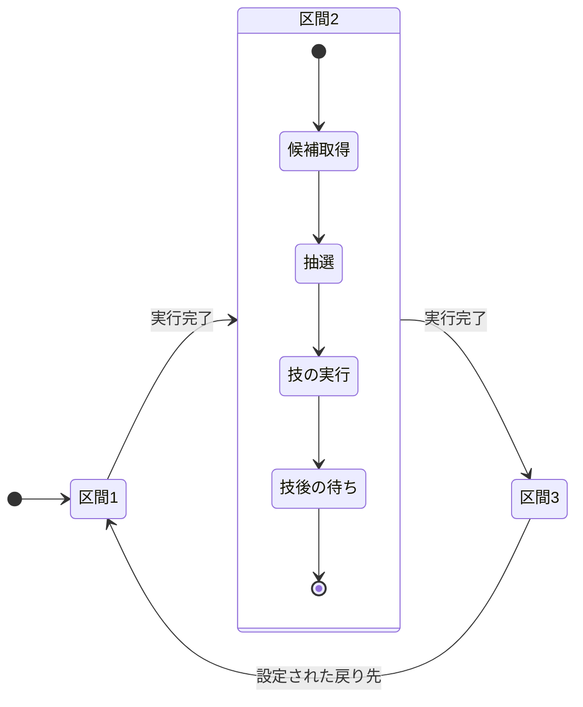
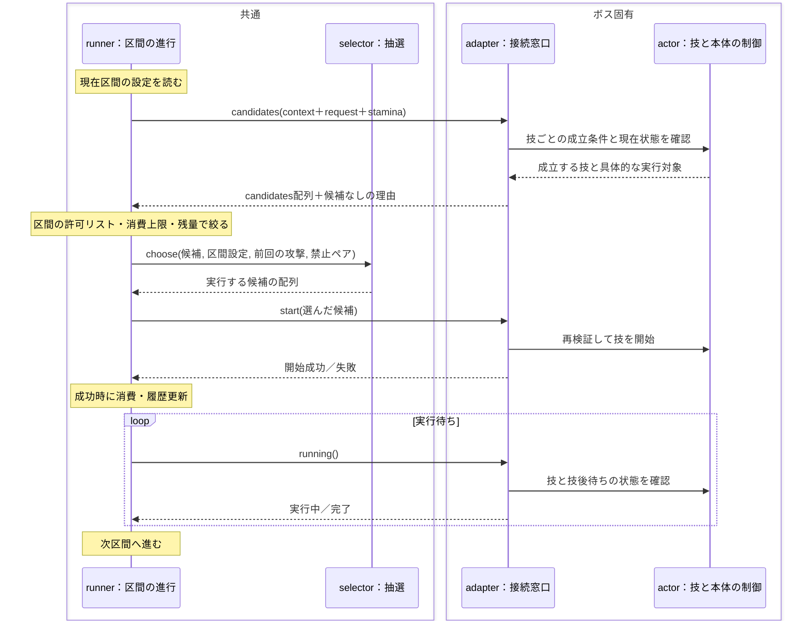

# ステージ制作のAI向け参照

[制作ガイド](stage-production.md)を使う制作者から、実装・データ編集・記録分析を受け取るAIの参照先と確認手順。最初に[AGENTS.md](../../AGENTS.md)と[文書規定](../README.md)を読み、担当ステージの仕様、対象データ、依頼範囲を確認する。録画分析・基準設定の支援・前後比較は[分析スキル `speed-balance-analysis`](../../.agents/skills/speed-balance-analysis/SKILL.md)を読み、その手順で進める。ステージ4は[個別仕様](../game/stages/stage-4.md)を入口とする。敵・ボスの設計は[検討手順](#敵ボスの設計を支援する)を使う。

共通XP・機体強化幅・共通敵定義・基礎システムは基礎担当が調整する。基礎調整の依頼で合意した場合だけ、その範囲を扱う。別のステージ制作担当は基礎値を固定し、担当ステージ内の配置・出現・上書きを対象とする。担当範囲が不明なら共通値変更を勧める前に確認し、共通側の課題は基礎担当への相談に分ける。

## 質問に応じて読む場所

人間向けガイドは工程・目的・入口・最小操作を示す。追加質問には、この資料の操作詳細と実装照合を使って答える。ゲームの決まり・目標値・記録形式はリンク先のSSOTを参照する。

| 質問・作業 | 読む場所 |
|---|---|
| 何を変更してよいか、どのファイルか | [依頼の確認](#依頼を受けたら)・[編集先](#編集先を選ぶ) |
| クリップ・formation・候補・重み・補充 | [操作詳細](#タイムラインの操作と編成制作)・[実装照合](#タイムライン編成重み) |
| F4・敵ドックの操作、保存・解除・競合 | [操作詳細](#f4と敵ドックの操作保存)・[実装照合](#f4ステージ敵上書き) |
| 共通値がどこまで広がるか | [優先関係の例](#共通値とステージ上書きの具体例) |
| 実験場で何を試せて、どこへ保存するか | [操作と保存範囲](#実験場の操作と保存範囲)・[参照経路](#実験場共通デフォルトステージ上書き) |
| 成長フェーズや配置のtips | [成長・構成の調整](#フェーズと成長の調整を支援する) |
| 敵・ボスの狙いや編集の入口 | [設計支援](#敵ボスの設計を支援する)・[ボスの参照先](#ボスの区間フロー攻撃値タイムライン) |
| 録画の選択、統計、変更後の比較 | [プレイ記録](#プレイ記録を読む) |
| 保存後に動かない、生成物をどう扱うか | [正規の保存・生成](#編集元を保存し実行用データを生成する)・[最終確認](#編集後に確認する) |
| 解析・合成・読み込みをいつ行うか | [処理の実行時期の設計・レビュー](#処理の実行時期を設計レビューする) |

## 依頼を受けたら

1. `AGENTS.md` と文書規定から作業・公開・検証の制約を確認する。対象ステージ、分析か実装か、調整モード、許可されたファイル・項目を依頼と既存会話から特定する。既に明示された内容を再質問しない。
2. [制作ガイド](stage-production.md)と対象ステージ仕様を読み、狙う体験・既存目標・想定機体強化を確認する。ステージ4の数値を他ステージの目標へ転用しない。
3. 録画分析では[スキル正本](../../.agents/skills/speed-balance-analysis/SKILL.md)を読み、必要な計測・統計の参照へ進む。形式や適用範囲が不明な項目は[設計書14.3](../architecture.md#143-プレイの記録)と実装で確認する。
4. 編集先は下表で選び、参照先と実行時の適用経路を確認する。仕様の到達目標、データの実装値、録画の実測値を分けて扱う。
5. `git status --short` と対象ファイルの `git diff` で開始時の差分を確認する。同じ作業ブランチの他担当の変更・未追跡ファイルを保護し、編集直前にも対象箇所を読み直す。ディスク上の差分からGodotの未保存編集の有無は分からない。制作者が同じリソースを編集中なら、保存・生成・再読込で上書きする前に担当と保存状態を確認し、その間は読み取りと分析を進める。
6. 判断に使う目標レベル・選択間隔・装備完成度と、その仮目標/確定/未決の状態を確認する。不足する設計基準は制作者本人と決めてから調整する。仮目標は仮のまま比較に使い、AIが確定へ変更しない。値の変更依頼がある場合も、採用する基準と変更範囲を特定してから編集する。

## 編集先を選ぶ

以下のパスは本番プロジェクトの `speed/` からの相対パス。

| 依頼 | 編集・確認する場所 | 参照する定義 |
|---|---|---|
| フェーズ・雑魚の曲線・強敵の出現 | `data/stages/stage_*.tres` | `scripts/data_types/stage_def.gd`・`phase_def.gd`・`spawn_curve.gd`・`spawn_clip.gd`、[出現仕様](../spec.md#113-出現と補充) |
| 群れの形と出現位置 | `data/formations/*.tscn` | `scripts/encounters/` の `EnemyFormation`・`FormationLayout`・`FormationMarker`・`FormationEntry`、[配置の構造](../architecture.md#81-定義データresource) |
| 強敵の同時攻撃 | ステージの `phases[].attack_budget`・`enemy_attack_values`、クリップの `attack_priority`・`formation_values` | [攻撃の管理](../spec.md#117-敵の攻撃の形)、`scripts/encounters/attack_director.gd` |
| ステージ内の敵数値 | 対象ステージの `enemy_tuning` | `scripts/data_types/stage_enemy_tuning.gd` の許可項目と `scripts/runtime/systems/enemy_system.gd`、[敵一覧](../game/catalog/enemies.md)を照合する。共通定義を保ってラン専用の値へ解決する |
| 敵の共通基準と行動（基礎担当の依頼範囲） | `data/enemies/<type ID>.tres`、種類別の `scripts/enemies/` | `scripts/data_types/enemy_def.gd`、`scripts/runtime/systems/enemy_system.gd`、[敵一覧](../game/catalog/enemies.md) |
| 成長とドロップ | ステージ固有の時間帯の `xp_bonus` 等。共通の `data/config.tres`・敵の報酬値は基礎担当の依頼範囲 | [成長](../spec.md#9-成長)・[ドロップ](../spec.md#10-ドロップと回収)、`scripts/runtime/systems/loadout_system.gd`・`pickup_system.gd` |
| ボス | 対象の `data/bosses/`・`scenes/bosses/`・`scripts/bosses/` | ボスの個別仕様と[AI・技・演出の分担](../architecture.md#61-敵とボスの-ai) |
| 敵の絵・攻撃の描画 | `assets/pixel/`、`scripts/render/run_presentation.gd`、対象の描画処理 | [アートスタイル](../game/art-style.md)・[素材の入口](../../speed/assets/pixel/README.md)。ヒュドラは[個別素材と演出](../game/bosses/hydra.md#8-素材と演出) |

ステージの `phases` が参照するリソースを辿って編集する。専用時間帯はステージ内部にも保存でき、`data/phases/s4_*.tres` の存在だけでは通常ランへの適用を判断できない。雑魚の曲線を持つステージでは、時間帯の `mix`・`pop_from`・`pop_to` より曲線を確認する。

HPは `EnemyDef.base_hp()` の計算結果で確認する。星の基準対象は `config.rank_hits`・`base_attack` と敵の `toughness` を使い、`hp` 欄と実効HPを区別する。サイズ・エリートなどの補正は[敵の共通仕様](../spec.md#111-見た目と強さ)へ辿る。武器・特性の威力は、保存値・攻撃力に対する倍率・成長後の計算値を分ける。

ステージリソースの `scene_path` を使うときは、保存されているパスの実ファイルと呼び出し箇所を確認する。配置シーンの存在と、通常ランの開始経路を区別する。制作確認は制作ガイドにある通常起動・タイムラインから目的に合うものを選び、録画では開始経路も照合する。

## フェーズと成長の調整を支援する

人間向けの判断材料は[制作ガイド3章のtips](stage-production.md#構成調整のtips)に置く。操作質問への回答でも、何を狙ってその項目を変えるかを対象ステージの仕様へ結び付ける。

1. 担当ステージのコンセプト・成長方針・敵の役割を読む。[ステージ4](../game/stages/stage-4.md#2-フェーズと成長目標)の育成区間では分裂する雑魚を多めにし、噛みつく雑魚の数を同じフェーズ内でも増減させる。[ステージ3](../game/stages/stage-3.md#成長の方針)では分裂する雑魚を出さず、猟犬の群れで経験値を得る。個別の方針を全ステージへ一般化しない。
2. 敵の役割は[敵一覧](../game/catalog/enemies.md)と実装で照合する。分裂する雑魚の撃破時分裂と生存中増殖を区別し、親・分裂体の撃破と経験値供給・回収を確認する。出現の目標数だけから、分裂後の総数・取得XP・成長速度を確定しない。
3. ボス前装備の完成度を起点に、フェーズごとのレベル増分・選択ペースを既存目標と比較する。担当ステージの仮目標・確定・未決を保ち、試遊結果に合わせて目標を無断変更しない。
4. 育成の供給、山・ラッシュでの装備活用、密度の山と間、混成時の出現量と同時攻撃を分けて観察する。どの敵・配置・数・間隔・予算を変える仮説かを示し、保存した値から通常開始で比較する。手順は[記録分析](#プレイ記録を読む)へつなぐ。

## 敵・ボスの設計を支援する

ステージに出す雑魚・強敵・ボスは、モチーフの設定と形から「高速移動でどう戦い、どうなぞると気持ちよいか」を考えて作る。具体例は[ヒュドラの体験と攻撃の整理](../game/bosses/hydra.md#1-狙う体験と攻撃の整理)。

1. **脅威と快感の組にする。** プレイヤーが受ける脅威と、それを高速移動と突進で覆す快感を組で決め、技はこの組から導く。
2. **攻撃を「近距離／遠距離 × 点／線／面」で整理する。** 点は噛みつきや塊のような局所の攻撃、線はビームのように長さを持つ攻撃、面は爆発のようにその地点の範囲を占める攻撃。ステージの雑魚・強敵・ボスの攻撃を同じ表に並べ、分類の偏りと、避け方・攻め方まで同じ技の重複を見直す。山ごとに違う分類の攻撃を組み合わせ、道中の体験を変化させる。
3. **高速で動く自機に対して成立させる。** 逃げ続ければ済む攻撃には、攻撃範囲・向き・残る障害物などで進路を選ぶ理由を持たせる。
4. **大技には、避ける以上の判断を求める。** 回数や範囲の増加より、通る道・進む方向・攻め始める位置を考えさせる。攻撃後に残る配置を、一筆でなぞる経路にする。
5. **体の形で無理なく出せる技にする。** 本体・部位の形と動ける範囲から技を選ぶ。
6. **ボスの技に役割を分ける。** 通常技は部位や形態の個性、組み合わせ技は特性の重なり、大技は戦場全体の動き方の変化を担う。
7. **攻撃と反撃の隙を一続きで作る。** 構える→狙いを固定する→攻撃する→止まる、までを1つの流れにし、止まった配置から攻めどきが分かるようにする。大技のあとは反撃の時間を取る。
8. **技の絵と遊びを決めてから行動判断へ落とす。** 自機の位置、参加できる部位、途中で倒された場合、終了後の配置を詰め、欠けても別の技へ移れる形にする。数値と立ち回りは試遊で決める。

## 調整箇所ごとに実装と適用先を照合する

操作の概要は[制作ガイド](stage-production.md)、細かい項目名・例外・保存範囲は以下の操作詳細を使う。AIは以下の順で公開項目・保存範囲・実行時の参照を読み、実装済みの範囲で変更方法を示す。UIに表示される値、編集元、生成結果、実行中の値を分ける。

### 実験場・共通デフォルト・ステージ上書き

概要は[制作ガイド5章](stage-production.md#5-敵の動きと見た目を仕上げる)、具体例と操作は以下の詳細を参照する。AIは以下の経路を照合し、共通値・ステージ差分・その実験だけの試行を混同しない。

1. 本番の通常敵は `EnemySystem._stage_definition()` → `StageEnemyTuning.resolve()` を読む。敵IDごとに指定された項目だけを共通定義へ重ねる。共通変更の影響は、その敵を使うステージと項目ごとの上書き有無から判断する。共通値と等しい明示上書きも固定値として扱い、共通追従へ戻すときは該当キーを解除する。
2. 実験場は `gyms/enemy_lab/lab_session.gd` の `_rebuild()`・`_edit_definition()`・`_edit_boss_definition()` を読む。設定とステージを複製し、敵・ボスの定義変更時も複製して実験へ適用する。`scripts/runtime/run_simulation.gd` は実験モードで `set_stage_tuning()` を省く。担当ステージの選択だけで、保存済み `enemy_tuning` による挙動確認まで済んだと報告しない。
3. `enemy_lab.gd` の `_save()`・`_export()` と `lab_io.gd` の `preset()`・`record()` を追う。数値差分の保存先は `user://enemy_lab/` の実験用JSON。本番へ採用する場合は許可された編集元と項目を別に特定し、共通値の変更を対象ステージだけの反映と説明しない。仕様書の既存の採用手順も適用範囲を確認し、ステージ制作の依頼だけで共通敵定義を変更しない。
4. 外観保存は `lab_controls.gd` の `_save_appearance()` を読む。「この種類の設定をステージへ保存」という表示でも、現処理は共通 `EnemyDef.visual_settings` のファイルを保存し、ContentManagerの参照も更新する。通常の数値試行・JSON保存と分け、保存権限と他ステージへの影響を確認する。
5. ボス本体・技の `BossDef` は既存の `StageEnemyTuning` の対象外。実験場の `boss_overrides` をステージの上書きと見なさない。実験場からの共通戦闘値の保存、選択ステージの上書きを優先する数値プレビュー、ボスのステージ別保存は未対応として扱う。

変更が許可された場合も、共通側は基礎担当、担当ステージの差分はステージ制作担当という責務を保つ。試行値と保存値を分け、共通を変更した比較では上書き済み項目が固定されたままか、未指定項目だけが新しい共通値へ追従するかを確かめる。必要な確認は新しく起動した本番ランで行い、実験場だけの一致から全ステージへの反映を断定しない。

### 実験場の操作と保存範囲

1. Godot上部の「▶ 実験場」で `res://gyms/enemy_lab/enemy_lab.tscn` を開く。
2. 「実験条件」→「フィールド」で担当ステージ・Seed・空の実験や地形・仕掛けの条件を選び、「新しい実験」で開始する。残したい既存の試行は先にプリセットか再生履歴へ保存する。
3. 左のパレットで敵・ボスを探して中央へドラッグし、まず単体を置く。「選択」で対象を選び、右側の数値を確認する。「再生」で敵の動きを見て、「機体を固定」で同じ位置に対する挙動を観察する。「試遊」では自機を操作して予兆・範囲・回避後の隙を確かめる。
4. 数値を変えて再生し、予告から攻撃・硬直・次の行動まで確認する。変更は複製した定義を使い、その実験内の同じ種類へ反映する。共通の `EnemyDef`・`BossDef` のファイルへ自動保存する操作とは分ける。
5. 条件を残すときは上部の「保存」から「配置・条件のプリセットを保存」、経過と操作を残すときは「再生履歴と分岐を保存」を使う。保存先は `user://enemy_lab/` のJSON。「AI用フォルダを書き出す」はその下の `exports/<実験名>/` に確認資料をまとめる。本番データへの採用は編集対象を合意した別の作業として行う。

**現在の実験場では、ステージを選んでも、そのステージの `enemy_tuning` を敵へ適用しない。** ステージの環境と、敵の実効数値を再現できたことを分けて判断する。F4のステージ敵調整も実験場では使わない。ステージ固有の値を確認・保存するときは、[F4](stage-production.md#51-f4でステージ内の敵数値を試す)か[敵dock](stage-production.md#53-保存戻すエディターで編集する)を使い、本番ランを起動し直して確認する。

実験場から共通の戦闘数値を保存する機能と、選択ステージの上書きを優先した数値プレビューは未対応。ボス本体・技の `BossDef` も、既存の `StageEnemyTuning` の対象外になる。実験場でボス数値を試せることを、ステージ別に保存できることと同一視しない。

外観には別の保存経路がある。「外観」の「この種類の設定をステージへ保存」は、表示名に反して共通の敵定義の `visual_settings` へ保存し、次にその種類を使う全ステージへ影響する。ステージ専用の戦闘値を残す操作として使わず、共通の見た目を変更する担当範囲で扱う。

操作全体は[実験場の仕様](../spec.md#201-敵ルート実験場)、現在の反映経路は[セッション処理](../../speed/gyms/enemy_lab/lab_session.gd)と[外観保存](../../speed/gyms/enemy_lab/lab_controls.gd)で確認する。

### 共通値とステージ上書きの具体例

パネルの「共通値（参照） → ステージ設定 → 実効値」は、次の順で読む。

| 表示・状態 | 読み方と確認すること |
|---|---|
| 共通値（参照） | 全ステージの基準となる敵定義と共通設定から読む。F4では参照値として表示する |
| ステージ設定のチェックOFF | その項目は共通値を使う |
| チェックONと数値入力 | その敵IDのその項目を担当ステージ内で置き換える。同じ種類の敵が複数クリップから出る場合も同じ上書きを使う |
| 実効値・状態 | 今のランで使う標準値、上書きの差、未保存かどうかを確認する |
| 保存済み | パネルが保持する保存基準との差がない状態。保存失敗・生成失敗時は下部のメッセージを確認する |

共通デフォルトは全ステージの基準で、ステージ上書きは**敵ID・項目ごと**に優先する。1項目を上書きしても、その敵の全項目を固定することにはならない。基礎担当が共通値を変更した場合、上書きのない項目は次の読み込みから新しい共通値へ追従し、上書き済みの項目はその指定値を保持する。

次は同じ敵の移動速度と発射間隔を使った、優先関係の説明用の例。採用する調整値は試遊と相談で決める。

| 設定 | 共通の速度100・発射間隔2秒 | 共通速度を120へ変更した後 |
|---|---|---|
| ステージA：上書きなし | 速度100・間隔2秒 | 速度120・間隔2秒 |
| ステージB：速度だけ80で上書き | 速度80・間隔2秒 | 速度80・間隔2秒 |
| ステージC：発射間隔だけ3秒で上書き | 速度100・間隔3秒 | 速度120・間隔3秒 |

ステージBで速度の上書きを解除して保存すると、次回はその時点の共通値120を使い、以後の共通変更にも追従する。解除は保存値へ戻す操作や、数値欄へ共通値をコピーする操作と区別する。共通値と同じ120を上書きとして保存した場合は120で固定し、後で共通値を変えても追従しない。

共通変更の影響確認では、対象の敵を使うステージと、その項目を上書きするステージを調べる。共有設定の変更は開いている別ランへ自動配信する操作とは扱わず、保存・必要な生成・起動し直しで確認する。ステージ制作担当は合意された共通基準を保ち、担当ステージの必要項目だけを上書きする。

### F4・ステージ敵上書き

1. `scripts/dev/stage_enemy_overlay.gd`・`stage_enemy_panel.gd`・`stage_enemy_fields.gd` でF4の入口、実際の表示名、選択ステージ、上書きの有無、未保存状態を確認する。エディターdockの接続は `tools/editor/stage_enemy_tuning/plugin.gd`、敵→分類→項目の縦配置と表示名は `dock_panel.gd` を読む。F4の「Save」とdockの「保存」、項目の上書き・解除表示を区別する。プレイ中のF4と実行前のdockでは、適用先と保存後の確認方法が異なる。
2. `scripts/data_types/stage_enemy_tuning.gd` の `keys_for()`・`base_value()`・`error_for()`・`resolve()` と対象敵の定義を読む。対象項目が許可されるか、整数か、最小値などの制約、標準HPの計算、報酬項目の除外を確認する。辞書には明示的に上書きする項目だけを持たせ、共通値へ戻す項目はキーを外す。同じ値を保存した上書きと、未指定で共通値へ追従する状態を区別する。
3. `scripts/runtime/systems/enemy_system.gd` の `update_stage_tuning()` と、対象の行動が値を読む箇所を追う。既存個体・次の出現・次回の行動参照のどこへ反映するか、残HP割合の保持や発射済み攻撃への適用範囲を確認する。ステージ単位で同じ敵IDへ適用するため、同種を使う他クリップにも影響する。クリップ別・個体別の任意戦闘値上書きを作り足さない。
4. 保存は `scripts/dev/stage_enemy_edit.gd` を読み、対象ステージの `enemy_tuning` だけを変更する。保存基準との競合判定、未保存試行の破棄、上書き解除と「Save」の違いを[操作手順](stage-production.md#53-保存戻すエディターで編集する)と照合する。競合時は自分の変更内容を保持して相手と確認し、古い辞書の全量で保存し直さない。
5. 録画を使う場合は、適用の `enemy_tuning_changed` と保存の `enemy_tuning_saved` を分ける。再起動後の比較では保存済み上書きと実行条件を照合し、未保存のF4試行を変更後データとして扱わない。

### F4と敵ドックの操作・保存

#### プレイ中に試す

GodotエディターからF5で開発版を起動し、担当ステージのラン中にゲーム画面へ入力フォーカスを置いてF4を押す。「ステージ敵調整  [F4]」が開く。実験場の単体調整と、ここで行う本番ステージの局所調整を使い分ける。

パネルのタイトルをドラッグして移動し、右下のハンドルでサイズを変える。「□」で画面内に広げ、もう一度押すと元のサイズへ戻る。横幅が狭いときは「敵・分類」で一覧を開き、「編集へ戻る」で数値欄へ戻る。一覧と編集欄の境界もドラッグで広げられる。

1. **対象ステージと敵を確認する。** 上部のステージ選択はプレイ中のステージに固定される。「敵名 / IDを検索」で種類を絞り、敵一覧から選ぶ。一覧には全種類が出るため、担当ステージで使う敵かを `Enemies`・クリップ・編成と照合する。
2. **分類や項目検索で絞る。** 「すべて」「変更した項目」と、「耐久・弱点」「移動」「攻撃」「固有行動」の配下から分類を選ぶ。「項目を検索（威力・間隔・射程…）」でも絞れる。「変更した項目」は現在ステージ上書きがある項目を表示する。
3. **共通値と実効値を読む。** 各行は「項目」「共通値（参照）」「ステージ設定」「実効値・状態」で読む。狭い画面では同じ情報を縦に並べる。項目名へカーソルを当てると項目キー・意味・単位を確認できる。
4. **必要な項目だけ上書きする。** 「このステージで上書き」をONにすると、共通値を初期値にした数値入力欄が出る。値を変え、右側の「実効」と共通値との差を確認する。ONのまま共通値と同じ数を入れた場合も、その数値をステージ設定として保持する。共通値へ追従させる項目はOFFにする。
5. **動きを見て残す値を選ぶ。** 値が確定するとそのランへライブ適用する。未保存の差は行・敵名の「*」と「● 未保存の試行」で分かる。「変更した項目」へ絞り、意図した敵・項目だけに上書きがあるか確認する。

調整対象は「標準HP」「装甲」「移動速度」「加速」「旋回速度」「背面の弱点角度」と、その敵が持つ数値の固有行動項目。固有項目は敵ごとに変わる。HPは星から計算した標準HPを置き換え、画面の実効値はサイズ・エリートなどの個体補正前の値を示す。報酬・ドロップなどの共通基準は基礎担当の範囲として扱う。許可項目とHPの計算は[設計書8.1](../architecture.md#81-定義データresource)と[AI向け資料](stage-production-ai.md#編集先を選ぶ)を参照する。

既に出現した通常敵と以後の出現にライブ反映する。既存個体の残HP割合・位置・ID・現在の行動を保ち、標準HPの変更では最大HPと現在HPをその割合で更新する。固有行動値は次にその値を参照するときから使うため、発射済みの攻撃や生成済みの配置を維持したまま、次の予告・攻撃・出現で確かめる。ボスは対象ボスの定義と確認手順を使う。

F4パネルを開く操作はランを自動停止しない。数値入力中はパネルがキー入力を受ける。観察へ戻るときは入力欄の外をクリックしてフォーカスを外すか、F4・「×」で閉じる。閉じても、そのランの未保存の試行値と適用は保持する。保存して次の起動で使う値と、そのランだけで試した値を分けて扱う。

#### 保存・解除・再読込・競合

| 操作 | 結果 |
|---|---|
| 行の「このステージで上書き」をOFF、または「↶」 | その項目の上書きを解除し、共通値へ戻す |
| 「共通値へ ↶」→「この敵の上書きを解除」 | 選んだ敵の全上書きを解除する |
| 「共通値へ ↶」→「全敵の上書きを解除」 | 対象ステージの敵上書きをすべて解除する |
| 「再読込」 | 未保存の試行を破棄し、ディスクの保存済みステージ設定を読み直して適用する。保存済み上書きがあればその値へ戻る |
| 「Save」 | ステージの敵上書きを編集元へ保存し、実行用データを生成する |
| F4または「×」 | パネルを閉じ、現在のランの試行値を保持する |

上書き解除も、その場ではライブ変更として扱う。次回起動にも解除を残す場合は「Save」を押す。未保存の試行はラン退出で終わるため、終了前に保存か破棄を選ぶ。

「Save」はGodotエディターから実行しているときに使う。保存先はプレイ中ステージに対応する `res://data/stages/stage_<番号>.tres` の `enemy_tuning`。下部状態表示のツールチップでもパスを確認できる。共通敵ファイルは参照元として保ち、ステージ内の上書きだけを書き込む。

保存時はディスクのステージを読み直し、他の項目を保持して `enemy_tuning` を更新する。別の編集で保存済みの敵調整が変わっていた場合は「別の編集で敵調整が変わりました。再読込してから保存してください。」と表示して保存を止める。試した値を控えて変更相手と確認してから「再読込」し、必要な変更だけを入れ直す。

成功時の「保存・実行用データの生成完了」を確認する。「保存済み / 生成失敗」が出たら編集元は保存されているため、生成エラーを確認・解消してから再起動する。保存後の比較は実行を停止し、F5でゲームを起動し直して通常のステージ選択から遊ぶ。開いているランの試行と、保存済みデータから始めたランを比較できる。

実行前に編集するときは、エディター右側の「ステージ敵調整」dockを開く。表示されない場合は「プロジェクト設定」の「プラグイン」で `Stage Enemy Tuning` の有効状態を確認する。共通の `EnemyDef` は `res://data/enemies/` の対象 `.tres` を選んで通常のインスペクターで開き、担当ステージの上書きはこのdockで編集する。

1. 上部のステージ選択で担当ステージを選ぶ。ステージの `.tres` をインスペクターで開くと、dockもそのステージへ切り替わる。
2. 「敵を検索（名前 / ID）」で絞り、その下の「敵」の選択欄で対象を選ぶ。
3. 続く「分類」を選び、「選択した分類の項目を検索」で必要な項目を探す。dockは敵→分類→項目の縦配置で、最初の分類は「耐久・装甲」。項目欄は縦にスクロールできる。
4. 各項目の「共通値:」と実効値を読み、「上書きする」をONにして数値を編集する。「解除」はその項目を共通値へ戻す。共通値と同じ数を指定した上書きも保持する。
5. 上部の「保存」で編集元へ保存する。「再読込」は未保存の試行を破棄する。「上書きを解除」のメニューには「この敵の上書きを解除」「全敵の上書きを解除」がある。解除を次回にも残す場合も「保存」を押す。

未保存変更がある間の別ステージへの切り替えは止められるため、「保存」か「再読込」で整理してから移る。保存と生成の成功・失敗はF4と同じ状態表示で確認し、ランを起動し直して保存済み上書きを検証する。

表形式の共通値編集は「プロジェクト → ツール → データ編集」（プラグイン `Data Editor`）から開く。共通値を変更する作業は基礎担当の範囲で行う。

UIと保存の実装は[調整パネル](../../speed/scripts/dev/stage_enemy_panel.gd)・[保存処理](../../speed/scripts/dev/stage_enemy_edit.gd)、ライブ反映は[EnemySystem](../../speed/scripts/runtime/systems/enemy_system.gd)を参照する。共通基準を調整する場合の編集先は[AI向け資料](stage-production-ai.md#編集先を選ぶ)、素材の差し替えも同資料から辿る。

### タイムライン・編成・重み

1. ステージの `enemies`・`clips`・`zako_curves`・`phases` を読み、実際の外部リソースと内蔵リソースを辿る。既存の時間帯や編成を共有する他ステージも調べ、変更範囲に入るか確認する。局所調整は対象ステージの設定と専用の参照先で行い、共有定義の変更は許可範囲を別に確認する。
2. `addons/spawn_timeline/type_checks.gd`・`timeline.gd`・`timeline_canvas.gd`、`scripts/data_types/spawn_clip.gd`、`scripts/encounters/formation_*.gd`・`enemy_formation.gd` を読む。`Spawn assets` のシーン、`Formations` の使用選択、`Types` の許可種類、並びと出現位置の実データを照合する。保存キーはシーンのファイル名と並びのノード名に依存するため、改名時は `layouts`・`formation_values` と参照元を確認する。
3. `tools/content/build_runtime_stage.gd` で使用候補の抽出とRuntimeClipへの変換、`scripts/runtime/systems/spawn_system.gd` の `_tick_clips()`・`_pick_weighted()`・`spawn_formation()` で候補除外・抽選・補充を確認する。単にシーンを登録した状態と、実行用候補へ入った状態を区別する。ルール違反は使用OFFの並びも含む登録シーン全体を検査するので、使用チェックだけで不一致の解消を確認しない。
4. 変更する量を次の表で特定する。数・選択比率・攻撃消費・優先度を一度に同じ意味で増減しない。

| 対象 | 実際の役割・確認先 |
|---|---|
| `FormationLayout.weight`・`FormationEntry.weight` | 選択済みシーン内の並び・出現位置の抽選比率。シーン選択は使用可能な候補間で等確率 |
| `groups`・`interval`・クリップ区間・マーカー数、雑魚の曲線 | 残存群れ・補充間隔・1群れの構成・雑魚の目標数。出現量の変更先 |
| `enemy_attack_values`・`formation_values`・時間帯の `attack_budget` | 個体/群れの攻撃消費と同時攻撃予算。Formationsの `Auto` と明示 `Override` を区別 |
| `attack_priority`・`enemy_attack_priorities` | 攻撃待ちの順。クリップの0を含む値が種類別設定より優先 |

5. シーンの `Preview Layout`・`Preview Entry` は見た目の確認用として扱い、クリップに使用候補を適用した証拠と分ける。選択候補・重み・出現位置の警告を確認後、保存したデータからランを起動し、実際の出現と補充を確かめる。具体的な操作は[同資料の編成手順](#タイムラインの操作と編成制作)を使う。

### タイムラインの操作と編成制作

#### 開く・時間を配置する

担当ステージの `.tres` をインスペクターで開くと、下部パネル「出現タイムライン」に表示する。広く編集するときは上部の同名タブを開く。クリップや時間帯を選んでも、そのステージの表示を保つ。別のステージを編集するときは、先に対象の `.tres` を開き直す。

上から時間の目盛り、フェーズ（時間帯）、雑魚の目標数の合計、種類別の雑魚の曲線、強敵のクリップが並ぶ。

| 編集するもの | 見方と基本操作 |
|---|---|
| フェーズ | 境目をドラッグして開始時刻を変える。区間をクリックするとインスペクターで内容を開く。右クリックの「新規追加」「削除」「名称変更」「強化区間」で区間を編集する |
| 雑魚の曲線 | 種類ごとの「その時刻にいてほしい数」。上段「雑魚敵」から種類を追加する。曲線の空いた所をダブルクリックして点を追加し、ドラッグで時刻と数を変える。点のダブルクリックでは時刻と数を直接入力する（例：`2:00 30`） |
| 強敵のクリップ | 上段「強敵」で空のトラックを増やし、空き部分をダブルクリックしてクリップを置く。棒をドラッグして開始時刻、右端をドラッグして長さを変える。選択するとインスペクターで編成・数・間隔などを開く |
| ボス・終了ピン | 目盛りをクリックして再生位置を決め、上段「ボス」「終了」で配置する。先頭位置では既存の配置の末尾へ置く。再クリックで解除、ピンのドラッグで移動、ダブルクリックで時刻入力ができる |

ピン・クリップの選択後は左右キーで1秒ずつ移動できる。曲線の点は左右キーで時刻、上下キーで数を変え、Shift＋上下で数を10ずつ変える。ドラッグ中のShiftは時刻を0.1秒刻みにする。上下の移動はホイール、横の移動はShift＋ホイール、拡大縮小はCtrl（⌘）＋ホイールを使う。上段の「-」「+」「最大」でも表示倍率を変えられる。

時間帯を追加すると、その位置の時間帯の設定を引き継いだリソースをステージ内部に作る。既存時間帯の編集前には参照先を確認する。外部の `.tres` を使う時間帯は、そのファイルへも保存されるため、共有している他ステージへの影響を確認する。雑魚の曲線を使う場合の補充の読み方は[出現と補充](../spec.md#113-出現と補充)、強化区間の詳細は[設計書14.2](../architecture.md#142-出現タイムラインのエディタ拡張)を参照する。

#### クリップに編成を登録し、使う候補を選ぶ

1. **ステージの敵を登録する。** ステージのインスペクターで `Enemies` の見出しを開き、使う敵のチェックをONにする。初めは折りたたまれている。
2. **クリップの敵を選ぶ。** タイムラインでクリップをクリックし、インスペクターの `Types` で、このクリップが出す敵を選ぶ。通常は開いているステージの `Enemies` から候補が出る。
3. **編成シーンを登録する。** `Spawn assets` の見出しを開き、「＋ Spawn asset」で欄を増やし、`data/formations/*.tscn` をリソース欄へ指定する。複数のシーンを登録できる。「−」はそのクリップからシーンの登録を外す。リソースを選択すると、その編成シーンを編集用に開ける。
4. **使う並びを選ぶ。** `Formations` を開き、「使用」のチェックで、そのシーンのどの並びを出すか選ぶ。「並び」には `dolphin：2体並び` のようにファイル名と配置ノード名が出る。初期の「すべての並びを使う」は全候補が有効な状態。絞るときは使わない行をOFFにする。最後の1候補をOFFにする操作は戻されるため、出現を止めたいときはクリップの区間・配置を編集する。
5. **数と補充間隔を設定する。** `Group counts` に同時にいてほしい群れ数、`Interval` に群れを出してから次を出せるまでの最短秒数を入れる。群れ数が不足し、間隔が経過したときに補充する。1群れの体数は選ばれた並びのマーカー数で変わる。生きている敵が1体でもいる群れは残存群れとして数える。

`Spawn assets` は候補のシーン、`Formations` はその中の並びの使用選択を管理する。選んだ並びを含まないシーンは、そのクリップの出現候補から外れる。クリップ内の並びはシーンのファイル名とノード名で対応するため、名前を変えたら使用選択と `Override` を確認し直す。候補一覧には敵を配置した並びが出る。

たとえば既存の `dolphin.tscn` には「1体」「2体並び」がある。同じシーンを登録した2つのクリップで、一方は「1体」だけ、もう一方は「2体並び」だけを選ぶと、シーンを共有したまま区間ごとに体数の構成を変えられる。これは操作例で、各ステージへの採用や目標数を指定するものではない。

#### 編成シーンで並び・出現位置・重みを作る

編成はクリップが参照する `.tscn` として編集する。既存シーンを開くと、2D画面に敵の並びと出現位置が見える。担当ステージ専用の並びや重みが必要なときは、別名で `data/formations/` に保存した専用シーンを編集し、対象クリップの `Spawn assets` を差し替える。共有シーンを直接編集すると、それを使う他のクリップ・ステージにも反映する。

既存の `dolphin.tscn` の構造は次のように読む。各クラスはNode2Dに対応するスクリプトを付けたノードとして保存している。

```text
Dolphin                         EnemyFormation：編成の根
├─ 1体                          FormationLayout：並びの候補
│  └─ いるか座                  FormationMarker：敵1体の位置と向き
├─ 2体並び                      FormationLayout：別の並びの候補
│  ├─ いるか座左                FormationMarker
│  └─ いるか座右                FormationMarker
├─ 正面                         FormationEntry：出現位置の候補
├─ 左前                         FormationEntry
└─ …                            残りの出現位置
```

1. **置ける敵を決める。** 根の `EnemyFormation` を選び、インスペクターの `Types` で置く敵を指定する。マーカーの `Enemy` の候補はここから出る。根の `Types` が空なら全種類から指定できる。クリップの `Types` と合わせて確認する。
2. **並びを編集する。** 根の直下の `FormationLayout` を選ぶ。並びを増やすときは既存の並びを複製し、見分けられるノード名にする。子の `FormationMarker` を増減し、それぞれの `Enemy` で敵IDを指定する。2D画面でマーカーの位置・向きを動かすと、その並びの中心・正面に対する配置を変えられる。敵が未指定のマーカーは出現データに含まれない。
3. **出現位置を編集する。** 根の直下の `FormationEntry` を複製・移動して候補を作る。シーン原点の機体は上向きで、出現位置はその機体に対する相対位置。正面は自動で原点へ向く。並びの中心と正面をこの位置・向きへ合わせて出すため、並びの編集用ノードを画面の左側などへ置いても、実際の出現場所は `FormationEntry` で決まる。
4. **候補ごとの重みを入力する。** `FormationLayout` を選ぶと並びの `Weight`、`FormationEntry` を選ぶと出現位置の `Weight` を編集できる。使う候補には正の値を設定し、出現させたい比率で調整する。保存してからクリップへ戻り、`Formations` の候補と使用チェックを確認する。

**`Weight` は候補の出現選択の比率を表す。** 抽選は、使用可能なシーンを等確率で1つ選び、そのシーンで有効な並びを重みで1つ、出現位置を別の重みで1つ選ぶ順に行う。敵の同時出現上限に達した種類を含むシーンは候補から外れる。並びの重みは選ばれたシーン内で比べる。たとえば有効な並びがA・Bの2つで `Weight` が1・3なら、選択比率は1対3になる。同じ値を両方2倍にしても比率は同じ。

出現量は `Group counts`・`Interval`・区間・マーカー数から調整し、攻撃待ちの順は `Attack Priority`、攻撃予算の消費は `Auto` / `Override` から確認する。`Weight` はこれらの設定と分けて扱う。並びが選ばれる頻度を変えると、体数が違う並びの構成比も変わるので、実際の敵数は試遊で見る。

#### 編成のプレビューを確認する

根を選び、インスペクターの `Preview Layout` と `Preview Entry` で、重ねて見る並びと出現位置を番号指定する。番号はそれぞれ根の直下にある対応ノードの並び順で0から数える。`-1` で重ね描きを隠す。

原点の機体、停止中の画面の目安枠、画面外配置の目安の円を見ながら、出現位置へ重ねた薄い敵の表示を確認する。円の内側に入る敵は赤く表示され、ノードの構成警告に並び・出現位置・敵の組が出る。各候補を切り替え、間隔・向き・画面への入り方を確認してシーンを保存する。プレビューの番号は確認用で、クリップの使用候補は `Formations` のチェックで選ぶ。

実行時は機体の進行方向に合わせて編成を回し、視界の広がりに応じて出現位置までの距離も伸ばす。編集画面の枠は配置の目安として使い、速度や進行方向を変えた実際の見え方は再生で確かめる。構造と変換の詳細は[設計書8.1](../architecture.md#81-定義データresource)、編集項目は[編成シーンの実装](../../speed/scripts/encounters/enemy_formation.gd)を参照する。

#### 出現量と攻撃の重なりを調整する

クリップを配置したら、狙う変化に応じて編集先を選ぶ。攻撃管理の詳細な判定は[共通仕様11.7](../spec.md#117-敵の攻撃の形)を正とする。

| 変えたいこと | 操作する場所 |
|---|---|
| 群れの残存数・補充の速さ | クリップの `Group counts`・`Interval`、開始位置・長さ |
| 1群れの体数・形・敵の組み合わせ | 編成シーンの並びとマーカー、クリップの `Formations` の「使用」 |
| 並び・出現方向の選ばれやすさ | シーンの各 `FormationLayout`・`FormationEntry` の `Weight` |
| 同時攻撃に使える枠 | 時間帯に表示される「予算」をクリックし、整数を入力してEnterで確定 |
| 敵1体が攻撃中に消費するvalue | ステージの `Enemy attack values`。種類ごとの欄を編集する。未設定は「仮値」と表示する |
| 並びの攻撃消費を見積もる・群れ共有にする | クリップの `Formations` の `Auto` を確認し、共有させる場合は同じ行の `Override` をONにして数値を入力する。OFFで個体ごとの消費へ戻す |
| このクリップから出る敵の攻撃待ちの優先度 | クリップの `Attack Priority` に0〜5の整数を指定する。大きい値を先にし、0を含めてステージの種類別優先度より優先する |
| クリップ以外から出る敵の攻撃待ちの優先度 | ステージの `Enemy attack priorities`。未設定は「標準」と表示する |

`Auto` は、その並びの全員が同時攻撃した場合の個体value合計の目安。使用OFFの並びも比較用に表示する。`Override` はその並びから1回で出た群れが共有する攻撃value。両欄を見比べてから変更し、出現の重みや群れ数の欄として扱わない。

#### 保存・警告・再生を確認する

タイムライン上の編集と、開いているステージ・時間帯・クリップのインスペクター編集は、確定時に編集元を自動保存する。取り消し・やり直しも保存へ反映する。実行用データはF5・F6・ツールバーの実行・タイムラインの途中再生を始める前に生成する。編成シーンはGodotのシーン保存で保存する。ステージ側のクリップ・使用候補・攻撃設定は `data/stages/stage_*.tres`、編成の並び・位置・重みは参照する `data/formations/*.tscn` が編集元になる。`.content/` はそこから作る実行用データとして扱う。

同じ編成を繰り返すときはクリップの右クリック、または⌘（Ctrl）＋C / V / Dでコピー・貼り付け・複製する。元の右側の同じトラックに置く。空きがない操作や種類の合わないトラックへの移動などが拒否されたら、タイムラインの詳細欄を読む。

赤枠のクリップは選択するかカーソルを当て、足りない敵と修正方法を読む。上段「ルール違反のクリップ」の「詳細」から全件も確認できる。`Types` と `Spawn assets` に登録したシーン全体の敵を照合するため、`Formations` で並びを使用OFFにした場合も、登録シーンの種類は検査対象になる。足りない敵をステージの `Enemies` とクリップの `Types` に登録するか、対象シーンを構成に合うものへ差し替える。

編集元の保存を確認し、目盛りをクリックして「再生」で出現、向き、数、補充間隔、攻撃の重なりを見る。起動前の生成に失敗すると実行を中止し、「実行用データの生成に失敗」をGodotの出力へ表示する。参照先や検証エラーを修正してから再度実行する。シーンやタイムラインの変更は保存後にランを起動し直して確認する。実行中のランで敵数値だけを試す入口は[5.1](stage-production.md#51-f4でステージ内の敵数値を試す)。通しの成長と録画の比較には[6章](stage-production.md#6-記録と感想で調整する)を使う。

操作一覧は右上の「？」と[設計書14.2](../architecture.md#142-出現タイムラインのエディタ拡張)、候補・保存欄の実装は[インスペクター拡張](../../speed/addons/spawn_timeline/type_checks.gd)、抽選の実装は[SpawnSystem](../../speed/scripts/runtime/systems/spawn_system.gd)を参照する。

### ボスの区間フロー・攻撃値・タイムライン

共通の「ボス行動」画面は、うみへび座・いっかくじゅう座・りゅう座の区間フローと技を編集する。概要は[制作ガイド5.6](stage-production.md#56-ボス行動を調整する)。データの役割・生成契約のSSOTは[設計書6.1](../architecture.md#61-敵とボスの-ai)、個別の技・形態・欠員・演出は[ヒュドラ](../game/bosses/hydra.md)・[いっかくじゅう座](../game/bosses/monoceros.md)・[りゅう座](../game/bosses/draco.md)の仕様を読む。

#### スクリプトの入口と追加実装の判断

作業の分担は[ノードで調整すること・実装を依頼すること](stage-production.md#ノードで調整すること実装を依頼すること)を正とする。AIは依頼を既存値の変更、既存技の組み合わせ、新しい技の制御、ボス全体の固有制御に分け、実装済みの範囲と追加が必要な範囲を伝える。以下のパスはGodotプロジェクトの `speed/` を基準とし、Godot内では `res://` を先頭に付ける。

| ファイル | 読む目的・変更する責務 |
|---|---|
| `scripts/bosses/flow/runner.gd` | 現在区間、共有スタミナ、休息、実行待ち、次区間への遷移。戦闘の大きな流れを保持する |
| `scripts/bosses/flow/selector.gd` | 区間の方針による抽選、連発回避、同時使用の制約。ボス固有の動作は個別側へ渡す |
| `scripts/bosses/flow/range_condition.gd` | 共通の距離・方向条件。座標の準備と追加の成立条件は呼び出し側も追う |
| `scripts/bosses/flow/combo_runner.gd` | コンボの順次・並列・待機・分岐。子の技はアダプターの実行窓口を使う |
| `scripts/bosses/hydra_flow_adapter.gd` | 共通処理と海蛇の橋渡し。候補の具体化、開始時の再確認、実行完了・失敗・取消の取り扱い |
| `scripts/bosses/hydra_normals.gd` | 海蛇の通常技の動作と到達範囲。通常技の軌道・攻撃方法を変える入口 |
| `scripts/bosses/hydra_techniques.gd` | 海蛇の連携技・大技の動作。曲線ビーム、渦と瓦礫の連携など |
| `scripts/bosses/hydra_boss.gd` | 海蛇の技開始・終了・成立判定、Timelineとの接続、首の状態、成長・分離・護衛。上記の技処理を呼ぶ本体 |
| `scripts/bosses/hydra_grid.gd`・`hydra_snake_motion.gd` | 海蛇の格子配置・蛇の移動。大技や分離後の具体的な位置制御から呼び出しを追う |
| `scripts/bosses/flow/single_actor_adapter.gd` | 1体ボス用の候補・開始・完了窓口。役者のメソッド群を呼ぶ。一角獣と竜が利用する |
| `scripts/bosses/draco_boss.gd`・`draco_*.gd` | 竜の全身命中先、HP段階、技のdriver、ピカロの生成・担当、登場・最終入力・決着。吸引の弧は技内の `DracoExhaleArc` を編集し、正規生成した新しい試遊で確認する |
| `scripts/bosses/monoceros_boss.gd` | 一角獣の技ごとの制御と全体制御。成立判定、照準、突進、攻撃判定、終了、形態変更 |
| `scripts/data_types/boss_technique.gd` | 技ID・種別・公開性能値。海蛇は `scripts/bosses/hydra_technique.gd` の派生型も使う |
| `tools/editor/boss_flow/editor.gd`・`range_preview.gd` | 調整項目の表示・保存・試遊と範囲図。公開値を増やす際の表示名・単位・図の対応 |
| `tools/content/build_boss_program.gd` | 編集元の検証と実行用スナップショット生成。コードを生成する処理とは分ける |

技ノードは技IDと性能リソースを参照し、実行側がそのIDに対応する動作を呼ぶ。現在のファイル構成では複数の技を1つのスクリプトにまとめている。技ノードの複製は既存の動作を利用する別の発動条件を作る操作で、独立した新動作の実装にはID・定義・実行側の対応を揃える。

「技ごとの制御」には移動・照準・攻撃生成と、その技を開始できるか、途中で続行できるか、いつ完了するかを含める。部位を使うボスでは、その技を実行する部位の選出もここに含まれる。「ボス全体の固有制御」は技をまたぐ形態・部位・移動の管理を担う。一般向けの説明はこの2分類を使い、首の選出などは対象ボスの具体例として補足する。

#### 区間が管理する大きな流れ

次のUML状態図は構造を示す例で、実際の区間名と遷移先はフローの設定を読む。外側が区間の進行、内側がその区間での1回の攻撃選択と実行になる。各区間は同じ候補取得・抽選・実行待ちの手順を使う。



休息は全区間から利用する共通状態として扱う。残量不足時は補充後に同じ区間へ、実行後の枯渇時は補充後に次区間へ進む。明示休息も含めた分岐は[スタミナ・休息・技後待ち](#スタミナ休息技後待ち)を参照する。区間の接続は1回の更新ごとに進め、循環を同フレームで走査し続ける実装を避ける。

#### 共通側と個別側の受け渡し

左を共通、右をボス固有に揃えたUMLシーケンス図。区間設定はrunnerが読むデータであり、個別側には通常／大技などの要求と現在の状況を渡す。区間の許可リスト・割合・禁止ペアは共通側で扱う。



図のactorへの呼び出しは責務の要約。実メソッドは下表と各アダプターで確認する。アダプターは役者を保持し、位置・向き・形態等を役者から直接読む場合もある。`query` が全状態を完全にコピーした唯一の情報源とは扱わない。

| 接点 | 入力・出力と実装時の確認 |
|---|---|
| `configure_flow(program)` | 役者が生成済みのルール・フローを取り込み、技ID索引、runner、アダプター、ランの乱数を接続する |
| `blocked()` | 状態移行・終了等で進行を止めるかを返す。技を開始する許可と、形態移行中の実行整理を確認する |
| `candidates(query)` | `request`・`stamina` を含む問い合わせを受け、`{candidates: Array, reason: String}` を返す。現実装の残量フィルターはrunnerが担当する |
| 候補1件 | `id` は技ID、`category` は `single` / `combo` / `major`、`cost` は消費、`parts` は同時使用を防ぐ実体ID、`exclusive` は他候補との併用禁止。個別側は海蛇の `heads`、カスタムコンボの `program` 等も添える |
| `start(actions)` | 選択済み候補の配列を受け、開始可否をboolで返す。候補取得後の状態変化を再検証する。複数開始の途中で失敗した場合は開始済みの動作を整理する |
| `running()` | 技後の待ちを含め、選択した攻撃の実行が続いているかを返す。falseになった更新でrunnerが次区間へ進む |
| `tick(dt)` | アダプターが持つコンボ等を進める。世界時間の停止や形態変更との整合を確認する |
| コンボの `start_step(id)` | 子の技を開始し、`running()`・`failed()`・`cancel()` を備える実行票を返す。開始失敗はnull。分岐は `step_condition(gate)` を使う |

`parts` は共通側が同一実体の重複を判定するための識別子で、首の種類などの解釈は個別側に置く。`parallel` は共通選択器が複数の通常技候補から作る種別で、登録された連携技の `combo` と区別する。取消の入口はアダプターによって `cancel_all()` / `cancel()` 等が異なるため、呼び出し元と実装を対で確認する。

#### 技を登録して技ノードへ表示する

技の表示元は **`data/bosses/ai/<boss>_action_rules.tres` の `techniques` 配列**。スクリプトのディレクトリを走査して技を登録する機構とは分ける。既存ルールを読む通常経路では、`<boss>_moves/` に `.tres` を保存しただけでも表示対象へ入らない。

1. 実行側に一意な技IDの動作を接続する。例えば一角獣は `monoceros_boss.gd` がそのIDを受けて開始・更新・終了できるようにする。既存の技を別ファイルへ分けるかは責務に合わせて判断し、技ごとに新しい `.gd` を必須としない。
2. `data/bosses/<boss>_moves/<technique_id>.tres` に性能リソースを作る。`BossTechnique`（海蛇は `HydraTechnique`）の `technique` を実行側と同じIDにし、`category` と実行側が読む `parameters` を設定する。技IDとファイル名は役割が異なり、参照の照合には技IDを使う。
3. 対象ボスの `_action_rules.tres` をGodotのInspectorで開き、`techniques` 配列にそのリソースを追加する。テキストで編集する場合は外部リソース宣言と配列への参照を両方追加する。既存の要素と値を保持する。
4. 同じルールの `conditions[技ID]` に初期の発動条件、`costs[技ID]` に消費量を登録する。未指定時の既定値へ偶然依存する登録を避け、開始できる距離・方向を実行側と合わせる。`graph_nodes` に同IDが既存なら `hidden`・`connected`・`source` も確認する。
5. `tools/editor/boss_flow/technique_graph.gd` の `title_for()` にある表示名対応を確認し、新技の名前を整える。性能項目は `editor.gd` の `PARAM_LABELS` 等を確認する。IDだけで画面の意味を推測させず、技名と調整項目の意味が分かる表示にする。
6. 編集中のコピーを保存してからルールを再読込する。既存の2ボスでは、未保存変更を解消して別ボスへ切り替え、対象へ戻すと `open_boss()` → `_load_rules()` が走る。同じボスを選ぶだけでは `open_boss()` は早期returnする。未保存のコピーを残したまま外部ファイルを変更して、画面の保存で上書きする操作を避ける。
7. `BossActionRules.node_ids()` が `techniques` の技IDを列挙し、`technique_graph.show_rules()` が技ノードを作る。所属未設定の技は種別に対応する条件選択へ加わる。表示後に条件選択の所属・接続・技の発動条件を整え、明示許可リストを使う区間に技IDを追加する。
8. 保存・生成・単独試遊・区間内での試遊を確認する。表示成功と実行対応は別々に確認し、生成物を編集して登録を補わない。

既存の登録例は `data/bosses/monoceros_moves/lance.tres` と `data/bosses/ai/monoceros_action_rules.tres`。前者は `technique = &"lance"` と性能値を持ち、後者が外部リソースとして参照し `techniques` 配列へ登録する。同じIDを `conditions`・`costs`・区間の許可リスト・実行処理で使う。

テキスト編集時の参照構造は次の形になる。これは追加箇所の抜粋で、既存ファイルを置換する完成ファイルではない。

```ini
[ext_resource type="Resource" path="res://data/bosses/<boss>_moves/<technique_id>.tres" id="new_move"]

; [resource] 内の既存 techniques 配列へ ExtResource("new_move") を追加する。
; conditions と costs の既存 Dictionary へ同じ技IDの項目を追加する。
```

技IDを入力して任意の `.gd` を接続する汎用UIや、フォルダへ置いたスクリプトの自動登録は現在未対応。表示に必要な登録は上記の性能リソース参照であり、実行する関数との対応は役者・アダプター側に実装する。ルールファイル欠損時の `_load_rules()` には海蛇の技フォルダを読むフォールバックがあるが、通常の追加手順は既存ルールへの明示登録とする。

#### 新しい技・調整項目・ボスを追加する手順

1. 対象ボスの仕様を読み、技ID、開始条件、予告・照準固定・攻撃・技後待ち、中断・形態移行時の扱いを整理する。既存技の順次・並列・待機・距離分岐で満たせる依頼は、コンボ編集の経路を使う。
2. 新動作なら役者と技スクリプトに開始・更新・終了処理を実装する。海蛇では通常技と連携・大技の入口を分け、一角獣では `technique_ready()`・`start_attack()`・`attack_playing()` と技内の処理を追う。攻撃判定・演出・部位の解放まで確認する。
3. 技の性能リソースを作り、`technique`・`category`・実行処理が読む `parameters` を揃える。ルールの `techniques` に参照を追加し、消費は `costs`、発動条件は `conditions` に設定する。技を追加しただけで区間の明示許可リストへ入るとは扱わず、使わせる区間の参照も確認する。
4. 公開値を増やすときは、値の読み取り先・型・単位・有効範囲・日本語の項目名を揃える。`editor.gd` の性能欄は実在キーを列挙するため、単にDictionaryへ追加して表示できることと、意味が伝わる項目であることを分けて確認する。詳細説明はツールチップに置く。技の値は技へ、区間の選択方針は区間へ置く。
5. 新しい判定条件なら、条件データ・評価処理・編集欄・保存／読込・必要な範囲図を一緒に扱う。技名や数値を増やすだけで「プレイヤーが突進中」等の判定が追加されるとは説明しない。共通に使える判定とボス固有の判定を分ける。
6. 候補取得・開始時の再検証・完了・失敗・取消を接続する。コンボから使う技は内部開始と実行票の扱いも確認する。候補を表示できるだけで対応完了としない。
7. 攻撃形状を変えた場合は `range_preview.gd` と到達範囲の計算を確認する。図で表せる基準形状と、実際の移動・照準による範囲を区別し、単独試遊で技の挙動を確かめる。
8. 新ボスは役者の `configure_flow()` と生成データの読込、ボス定義・シーン・登録、生成対象、エディターのボス選択、試遊シーンまで接続する。`single_actor_adapter.gd` は役者の所定メソッド群を要求するため、既存クラスへ付けるだけで汎用化済みとは扱わない。現行エディターのボス選択は海蛇・一角獣の列挙を持つ。
9. 保存後の再読込と明示的な生成を確認し、単独再生と区間全体の試遊を分けて検証する。実装変更に応じて候補なし、残量不足、開始失敗、中断、ループ、同時使用制約を確認する。テスト実行は依頼範囲に従い、実画面の操作確認と分けて報告する。対象のボス仕様と敵一覧も共通の運用ルールに従って更新する。

編集のたびにランタイムデータを再生成する処理は追加しない。公開値は編集元を正とし、実行コードとTimelineが同じ値を読む。保存・生成・試遊の具体的な経路は[保存・生成・試遊・録画](#保存生成試遊録画)に従う。

#### 編集元と適用範囲

以下は `speed/` 内のパス。`<boss>` は `hydra`・`monoceros`・`draco`。

| データ | 保存する内容 | 実装の確認先 |
|---|---|---|
| `data/bosses/ai/<boss>_flow.tres` | 区間の要求・候補技・割合・直前種別別の割合・消費上限・禁止ペア・次区間・共有スタミナ・休息・区間の図配置 | `scripts/data_types/boss_flow_def.gd`、`flow/runner.gd`・`selector.gd` |
| `data/bosses/ai/<boss>_action_rules.tres` | 技参照・技ノードごとの発動条件・技IDごとの消費・コンボ内部・条件選択の所属・接続・非表示・図配置 | `scripts/data_types/boss_action_rules.gd`、`tools/editor/boss_flow/technique_graph.gd` |
| `data/bosses/<boss>_moves/*.tres` | 各技の性能・判定範囲・動作時間・技後待ち・再使用待ち等 | `boss_technique.gd`、対象の技実行処理。Hydraは `HydraTechnique` が首の種類を追加する |
| `data/bosses/<boss>.tres`・シーン | 本体設定・移動・形態・個別の部位管理・演出参照 | 各 `BossDef` と役者、`scripts/runtime/systems/boss_system.gd` |
| `.content/boss_<boss>.tres` | 検証済みの実行用スナップショット | `tools/content/build_boss_program.gd`。編集元から正規生成し、直接編集しない |

これらはボスごとの共通デフォルト。同じ定義を使うランへ影響し、選択ステージだけの値にはならない。`StageDef.enemy_tuning`・F4・敵dockの上書きは `EnemyDef` を対象とし、ボス本体・技・フローの保存先ではない。現行のボスエディターにステージ専用保存を付け足して説明しない。共通変更の権限と影響範囲を確認する。

Hydraの `move_params()` は本体の `params` に技別 `parameters` を重ね、同名の技別値を優先する。消費は `action_rules.costs[技ID]` が正で、残存する技 `parameters.cost`・`major_cost` をさらに加算しない。フロー制御中の通常技は従来の `normal_budget` 判定を迂回する。雑魚のdirectorの予算・`attack_priority`・個体valueを、共有スタミナや共通選択器の重みと混同しない。

#### 開く・区間を作る

`tools/editor/boss_flow/plugin.gd` が上部「ボス行動」、ツールメニュー、Cmd/Ctrl＋Alt＋Bを登録する。プラグイン名も「ボス行動」。左上のボス選択は2つの `_action_rules.tres`・`_flow.tres` を開く。未保存変更があれば切り替えを止める。ファイルメニュー「技の設定ファイルを開く…」は性能リソースを開く操作であり、選択中ボスのフロー・ルール全体を自動で切り替える操作ではない。

1. 上段の青い区間を選ぶ。「区間名」を入力し、「要求する攻撃」で「通常・同時・コンボ」「大技」「休息」「全候補」を選ぶ。
2. 「全技を候補にする」をOFFにすると「この区間で使える技」を個別に選べる。保存するのは技IDの参照。未指定は全候補、明示した空配列は候補なしになる。
3. 「今回の消費上限」と種別の割合を設定する。「割合を使う条件」は基本の割合、または直前の単独／同時／コンボ／大技の割合を編集する。履歴別の行は、作成時に基本の割合をコピーしてから対象欄を変える。基本値の変更が作成済みの履歴別行へ自動追従するとは扱わない。
4. 「同時攻撃の禁止」で技2つを選び「禁止ペアを追加」。不要な行は「この禁止ペアを削除」で外す。この指定が効くのは、その区間の選択器が通常技から作る同時攻撃の組。コンボ内部の `parallel` へ自動で同じ禁止表が適用されるとは説明しない。
5. 「次の区間」を選ぶか、区間の右出力から別区間の左入力へ接続する。線は `sections[i].next` を更新する。戻るループ・自分へ戻る接続も、時間経過による自動切り替えと分ける。開始は0番目、選択した技の実行完了後に次へ進む。
6. 「＋ 区間を追加」で増やし、「区間を整列」で並べる。ノード位置は動作順を決めず、接続先が順序を決める。区間を全削除する操作は受け付けない。

`fallback` は候補が空の際の遷移先として実行側が読むデータ項目だが、現在の区間パネルの公開欄にはない。未指定時はその区間で再評価を続ける。表示されない設定欄を案内しない。

#### 共通判定・個別候補・選択器の順序

1. `flow/runner.gd.tick()` が世界時間の `dt` で進み、休息・実行中・状態移行を確認する。区間の要求と残量を個別アダプターへ渡し、開始時の候補を返させる。実行中の技に対し、毎更新の位置変化だけで選び直さない。
2. 共通 `flow/range_condition.gd` が距離・方向を判定する。個別側はこれを呼び、さらに形態・生存部位・画面内・到達上限・配置・再使用待ち・個別状態を確認する。共通側が全条件を先に一括判定し、その後に個別処理が無条件で技名を返す構造とは異なる。
3. 個別の `candidates()` は `{id, category, cost, parts, exclusive}` と具体的参加者／コンボプログラムを返す。共通runnerが `allowed_techniques` と、非負の消費が区間上限・最大スタミナに収まる候補を絞り、現在残量で払えるものだけ残す。
4. `selector.gd.choose()` が単独・コンボ・大技を種別→技ID→同じIDの実行候補の階層へまとめる。同時攻撃は通常技候補から成立するペアを作り、技IDを並べ替えた組を1つの選択肢にする。
5. 直前の実行種別に一致する `probability_rules` の最初の行を使い、なければ基本の `weights` を使う。割合は非負の相対値として扱い、100へ合計する必要はない。候補のない種別は抽選対象から外れ、残る種別の割合で再計算する。割合が大きくても、参加者や残量等の制限を飛び越えない。
6. 「連発を避ける」がONで正の割合を持つ別候補があれば、直前と同じ技ID集合を除く。首の個体が違っても同じ技ID集合なら同じ選択として扱う。代替候補がなければ反復を許す。履歴は休息終了時に消える。
7. 種別を割合で抽選し、その種別内の技ID／ペアIDを等確率で選び、同じIDの具体的参加者候補も等確率で選ぶ。Hydraで同じ技を使える首が増えても、単独技のID自体を候補数倍に重くしない。実行時の乱数は各役者でランの `run_state.rng` へ接続する。
8. 同時攻撃は合計消費が `min(残量, 区間上限, 最大量)` 以下、部位IDに重複がなく、どちらも排他指定ではなく、禁止ペアに入らないことが必要。選択したペアから3技以上へ拡張する際は、候補を乱数順に取り出し、50%の継続抽選と同じ成立判定で追加する。最終的な全ての部分集合が等確率になるとは扱わない。
9. 個別側の `start()` が参加者・実行条件を再検証し、成功した場合だけ合計消費を引き、直前履歴を更新する。技個別の優先度順・区間内の技別重み・出現タイムラインの `Attack Priority` は、この選択器の並び替え基準として実装されていない。

「条件選択」の緑ノードは所属の整理とカバー確認に使う。グループごとの追加抽選器ではない。`active_gates_for()` は接続・非表示を確認し、同じ技を参照する接続済みノードの条件をORで扱う。ノードを複製しても同じ技IDの抽選比率を増やさない。区間の候補技制限は元の技IDへ作用し、その技の別条件ノードを個別の性能として複製しない。

開始の許可には、実験場の攻撃directorが別に作用する場合もある。Hydraの `start_normal()` は非formationモードで個体の `attack_priority` と消費×`attack_value` をdirectorへ要求し、大技は別の要求を出す。一角獣は `BossSystem.admit()` を使う。通常のformationモードではこの要求を迂回する。候補へ入ったのに開始しない場合は、共通の割合だけでなく実行側の許可も確認する。

Hydraの分離後は `_update_guard_approach()` が残量・区間上限・技消費から画面内へ向かう首を選び、待ち始めた時刻と自機までの距離で並べる。この位置取りが画面内の実行可能候補へ影響するが、共通選択器の技別優先順位を設定するUIではない。

#### スタミナ・休息・技後待ち

| 状態 | runnerの扱い |
|---|---|
| 技の開始に成功 | 選択した技の消費合計を1回引く。カスタムコンボは全体の `costs[コンボID]` を1回だけ引き、内部技を追加課金しない |
| 位置・形態等で候補なし | 通常は0.15秒ごとに再評価。残量が少ないだけと断定しない |
| 上限内の技はあるが残量不足 | その区間へ戻る休息に入る |
| 技の実行後に残量ゼロ | 次区間へ進む前に枯渇休息。次が明示休息なら二重に休まない |
| 「休息」区間 | 残量あり／枯渇を判別して共有休息へ入り、終了時に満タンにして次区間へ進む |
| 上限に収まる技がない | 「区間上限または最大スタミナで実行できる技がありません」。休息しても解決するとは扱わない |
| 残量内の候補はあるが成立種別の割合がすべて0 | 「成立する攻撃種別の確率が0です」。割合と同時攻撃の制約を見直す |

休息の時間は全区間共有の `partial_rest`・`empty_rest`。継続回復の速度や回復開始待ちを追加の設定として案内しない。コンボ内の `wait` は実行の間隔であり、満タンへ戻す休息ではない。休息終了の更新では、満タン・次区間・履歴消去まで行い、同じ更新内で次の攻撃を連鎖開始しない。

技後待ちと再使用待ちも分ける。Hydra通常技は内部の停止 `normal_hold` の後に `attack_cd` を持ち、アダプターは参加首のモードとCDが終わるまで実行中として扱う。大技は `tech_recovery` の全体待ちまで待つ。`cooldown` や個別役者の再使用可能時刻は、その技を次の候補へ戻せるかを制限する。どの時点から数えるかは役者で確認する。全技の待ちを同じ1項目として換算しない。

#### 技・条件・範囲図を編集する

技ノード選択は性能と発動条件を右欄へ、線のクリックは接続先ノードの条件を右欄へ出す。「この技へ進む条件」は「最小距離」「最大距離」「中心角度（度）」「半角（度）」。距離はpx、角度は0度を基準方向とし半角まで許容する。攻撃の長さ・幅・半径・移動距離は技の性能として別に読む。

距離と角度の基準は `conditions` 内の `distance_origin`・`angle_origin` 等も確認する。Hydra通常技では距離を頭から、方向を首の根元の取り付け方向から測るデータがあり、分離時の角度免除も保存されている。現在のUIで基準原点や形態条件の任意設定欄まで公開されているとは説明しない。一角獣の `min_phase` など表示欄以外の成立条件もコード・データから確認する。

技性能の欄は `BossTechnique.parameters` の実在キーから作る。例えば予告・実行時間・停止・再使用待ち、ビームの長さ／幅／威力など、その技が読む値を編集する。全技に同一の射程・ダメージ欄が存在するとは案内しない。旧 `cost`・`major_cost` は性能欄から除外し、消費スタミナの編集先を `action_rules.costs` に統一する。

Hydraの `_configure_tech_timeline()` は技別の `warning_time`・`performance_time` と伸長時間等から内部Timelineのイベントを構成する。一角獣も `_begin_pass()` で `warn`・`active` からイベントを組む。性能リソースの数値とTimelineの時刻を別々の調整元として二重管理しない。ビーム等の技内追加予告・持続は個別の実行コードも追い、動作開始イベントと判定開始を区別する。

条件選択を選ぶと、名前・配下技のON/OFF・「技の接続先を変更」が編集できる。ON/OFFは接続状態を変える。`condition_groups` の名前・所属・見た目そのものは、技の性能・発動条件を上書きする値ではない。

「範囲図の戦闘状況」は表示専用の `preview_stamina`・`preview_heads`・`preview_separated`・`preview_radius`。編集値はカバー解析へ使うが、フロー・技設定へ保存しない。通常技の図は青が条件、橙が基準形状。カバー表示の橙点は未カバーの標本を表す。`range_preview.gd.analyze()` の角度64×半径16のサンプル検査であり、全連続空間の証明ではない。

Hydraは基準姿勢の首配置・生存本数・一部の参加条件と、通常技の到達上限を組み合わせて表示する。動いている首、地形、再使用待ち、実際の格子配置等をすべて再現した図ではない。他ボス側も残量と条件範囲の概略表示で、全ての形態条件を再現した試遊の代替ではない。プレビューの穴・色だけから戦闘中の命中・不発・安全な通路を確定しない。

#### コンボ内部と個別ボスの責務

「＋ 追加」→「コンボ技を作成」で `action_rules.combos` のプログラムを作る。技、待機、順次グループ、並列グループ、条件分岐を追加できる。「実行する技」は既存の技定義を参照し、子の性能を別にコピーしない。任意の新しい攻撃動作をID入力だけで生成する機能とは分ける。

- 順次は子を順番に実行し、各技の技後待ちまで終了してから次へ進む。並列は各子を進め、全子が終了すると完了する。時差は枝の順次グループ内の待機で作る。
- 条件分岐は内部へ入った時点の条件で子を1つ選び、左が成立、右が不成立。動作中の毎更新で別の枝へ切り替えない。右欄で `min`・`max`・`angle`・`half_angle` を編集する。
- グループをダブルクリックして中へ入り、「親のグループへ戻る」で上へ、「内部編集を閉じる」で技グラフへ戻る。実行順は「前に移動」「後ろに移動」で変える。図のノード位置を動かすだけでは実行順は変わらない。
- 内部の技が開始できない、または参加者を失う等で失敗した場合はコンボを失敗させ、走っている枝を片付ける。部位の確保・解放と既存技の欠員継続／中断は各アダプターと役者の責務になる。

`hydra_flow_adapter.gd` は種類と現在の生存・待機状態から候補を具体的な首のIDへ結び、開始時に再検証する。通常技は首ごとの複数候補、協調技は必要な首の組、大技は個別の参加条件を持つ。カスタムコンボは `_requirements()` で必要種類数を検査し、現在の実装では利用可能な待機首全体を排他的に確保する。コンボ内部の技開始でもその確保内の部位と、その時点の実行条件を確認する。調整者に首一本ごとの状態機械を組ませる編集手順へ変えない。

`single_actor_adapter.gd` は本体IDを排他的に使う1体ボスへ接続する。同じ本体を使う技同士は通常の同時攻撃候補にならない。並列グループを作成できることを、どのボスでも任意の複数技を同時実行できることと同一視しない。個別に成立しない内部構成は開始失敗になるため、保存時の構文検証に加えて試遊で確認する。

#### 配置・線・複製・Undo

技グラフの「表示・整列」から全体表示、条件選択ごとの整列、拡大率、グリッド・間隔を操作する。上下の図の仕切りもドラッグできる。技のドラッグ時は近いノードの縦横・間隔に位置を合わせ、Altで補助を一時解除する。`wire_router.gd` は外周配線と方向矢印を描く。線の描かれ方を追加の実行条件として解釈しない。

| 操作 | 保存・実行上の意味 |
|---|---|
| 区間の複製 | 候補・割合等を複製し、選択してまとめて複製した区間同士の `next` / `fallback` を新しい番号へ対応付ける |
| 通常技の複製 | 同じ性能リソースを参照し、別の発動条件・接続を持つ。片方の性能変更は同じ技を使う全区間・ノードへ作用する |
| コンボの複製 | 内部プログラムと消費を新しいコンボIDへ複製する。子の技は引き続き既存技を参照する |
| 条件選択の複製・削除 | 配下の技ノードもまとめて対象にする。単なる飾りの整理として削除しない |
| 下段の線を接続・切断 | 技の所属・接続状態を更新する。切断した技はその接続から候補へ入らない |

空白ドラッグの複数選択、Cmd/Ctrl＋C・V・D、Delete／Backspace、右クリックの編集メニューを使う。Cmd/Ctrl＋ZとShift＋Cmd/Ctrl＋Z、上部の「元に戻す」「やり直す」はエディターの履歴を使う。入力欄にフォーカスがある間は文字・数値の通常編集を優先する。コンボの表示設定は実行プログラムの `layout` と分け、配置から順序を推測しない。

#### 保存・生成・試遊・録画

1. `editor.gd.save_current()` はフォーカスを外して入力を確定し、変更した外部技、ルール、フローを保存する。「保存済み（実行データは生成していません）」を確認する。外部技は読み込み時のSHA-256と比較し、不一致なら `ERR_BUSY` で止める。ルール／フロー全体に同じファイル競合検査があるとは扱わず、同一ファイルの並行編集は保存順を合わせる。
2. ノード移動・数値入力・「変更を保存」は全体生成を呼ばない。「保存して再生」「保存して戦闘を試す」は保存に成功してから `build_boss_program.gd.compile()` で `.content/boss_preview.tres` を作り、`.content/boss_preview.json` と試遊シーンを使う。検証・生成失敗時は試遊を起動しない。
3. 単独再生は選んだ元技IDだけが候補となる確認用フローへ差し替え、一度実行したら候補のない終了区間へ進める。編集元にはこのフローを保存しない。試遊では残量を増やし、Hydraの首を8本にして必要なら分離し、一角獣の必要形態へ合わせ、待ち時間と自機位置も調整する。元の技条件や再使用待ちを完全無視した強制再生とは扱わず、成立しない場合は条件・参加者・到達範囲を調べる。
4. 「保存して戦闘を試す」は保存済みフロー全体を使う。試遊セッションは空のフィールド・無敵・攻撃director無効などの確認条件を持つ。実戦の勝率・成長・攻撃頻度は通常ステージへ戻って評価する。
5. 通常の起動前生成とexportは `addons/content_build/builder.gd` からボスプログラムを生成する。`compile()` は版と意味的署名が同じなら再利用し、異なれば一時ファイル経由で置換する。図配置・条件選択の見た目と、接続・条件・技性能等の戦闘内容を分ける。`.content/` を直接修正して合わせない。
6. 本番を起動し直し、同じ開始条件で録画し、時刻付きの感想と一緒に分析する。実験場の試遊は通常の録画母集団から分ける。画面確認だけで実行した全候補やスタミナ履歴を保存済みと見なさず、[計測の観測限界](../../.agents/skills/speed-balance-analysis/references/measurement.md#編成とボスの調整で観測できる範囲)を確認する。

関連する自動検証の入口は `tests/boss_flow_select.gd`・`boss_flow_stamina.gd`・`boss_flow_range.gd`・`boss_flow_sections.gd`・`boss_flow_groups.gd`・`boss_flow_combo.gd`・`boss_flow_editor_workflow.gd`・`boss_flow_trial_run.gd`。実行は依頼範囲に従う。これらの読解・自動実行を、実ウィンドウで入力・選択・保存・試遊を操作した手動確認と表現しない。UIを未確認の場合は、その範囲を報告する。

## プレイ記録を読む

録画は数値・イベントのJSONL。試遊・録画操作は[制作ガイド6章](stage-production.md#6-記録と感想で調整する)、形式・保存先・開始条件は[設計書14.3](../architecture.md#143-プレイの記録)、分析と詳細統計の正本は[スキル](../../.agents/skills/speed-balance-analysis/SKILL.md)と[計測・統計の参照](../../.agents/skills/speed-balance-analysis/references/measurement.md)を使う。

### 録画操作と開始条件の補足

F9の待機はラン開始前にONにし、通常のステージ選択から開始する。録画はクリア・死亡・退出時に閉じ、F9でも手動停止できる。停止・再開は別ファイルとして扱う。ラン終了後も待機は続く。

プレイ中のF9開始は成長を引き継ぐ途中録画、タイムライン途中再生はその時刻から初期の成長状態で始める区間検証。タイムラインは時刻0からでも通常開始と区別する。途中時刻のXP0を通常成長の集計へ混ぜない。

録画中のF4は適用と保存を別の通知として読む。変更した時刻・項目・感想を確認し、設定区間を分ける。候補を探すライブ試行後は保存済みの値で先頭から再録画し、固定条件の比較につなぐ。通知形式は[設計書の開始条件と分析](../architecture.md#開始条件と分析の読み方)を参照する。

保存先は端末の書類フォルダ内 `SPEED/recordings/`、取得できない場合はGodotの `user://recordings/`。録画・待機が有効な間はF10で開ける。F9で無効にするとF10も無効になる。F10や利用者の手動探索を録画分析の必須手順にしない。

### 1. 目的と調整基準を揃える

- 調べたい体験と時間帯を、時刻付きの感想から具体化する。感想は課題の発見と体験評価に使い、原因の証明とは分ける。
- 既存の時刻別目標レベル・選択間隔・ボス前装備完成度・機体強化の想定を読む。仮目標も比較に使い、既存の合意を再質問しない。
- 判断に必要な基準が未設定なら、ボス前装備→選択ペース→時刻/レベルの順で必要なものだけ一つずつ相談する。AIが目標値や許容幅を確定しない。回答待ちの間も基準なしで示せる実測の整理を進める。

### 2. 保存先を解決し、対象録画を選ぶ

- 指定されたファイル・ディレクトリを優先する。未指定なら `speed/scripts/dev/play_recorder.gd` の `folder()` と各端末の書類フォルダ/Godotユーザーデータ設定から保存先を解決し、AIがJSONLを直接読む。F10でフォルダを開く操作や利用者によるファイル探索を標準手順にしない。
- ヘッダー・末尾・型別件数から候補を確認し、対象ステージ・記録日時・開始条件・終了状態と依頼の試遊範囲を照合する。更新日時が最新のファイルを無確認で対象ランにしない。候補が曖昧なら、確認できた候補の違いと必要な日時/ステージ等だけを聞く。
- アクセスできない場合は対象の保存先と理由を示し、必要なパス指定や読める環境への受け渡しだけを依頼する。個人の絶対パスを共有文書へ保存しない。
- 通常開始・タイムライン検証・途中録画/前半欠落・出自不明を、スキルの適格性判定で分ける。通常成長へ途中時刻のXP0開始を混ぜず、採用したファイル/秒範囲と除外理由を残す。schema番号だけでなく測定版と実在項目を確認し、欠けたイベントを創作しない。

### 3. スキルを呼ぶ

Codexでは `$speed-balance-analysis` を使う。自動検出しない環境やClaude等では、リポジトリの `.agents/skills/speed-balance-analysis/SKILL.md` を明示して読み、参照文書も含めて同じ手順を実行する。利用者へスキル名を案内するだけで終わらず、受け取った依頼をその手順で分析する。

```text
$speed-balance-analysis
モード：ステージ制作。共通の基礎値を固定し、担当ステージ固有の項目だけを候補にする。
対象：担当ステージ、今回の試遊日時/範囲。録画は保存先を解決して直接読む。
目的：育成区間の成長速度。感想：「180〜240秒に選択が少なく感じる」。
既存目標を使い、今回必要な未設定基準だけ一つずつ相談する。
条件の近いランを比較し、目標との差・観測・仮説・少数の変更候補と次の試遊条件を提示する。
まず分析と相談まで。実装は合意された範囲を別途依頼する。
```

スキルを直接指定する場合は先頭行を「`.agents/skills/speed-balance-analysis/SKILL.md` を読み、その手順で分析する」に替える。基礎調整の依頼ではモードと許可された共通値の範囲を替える。既知の録画パスや変更前後の区分があれば、対象へ添える。

### 4. 観測・仮説・調整候補を提示する

スキルの統計手順で条件を揃え、ラン単位の結果と不確実性を示す。報告には次の情報を必要な範囲で含め、統計手法の詳細をここで重複定義しない。

```text
対象：モード、目的、採用ファイル/秒範囲、比較条件、除外と欠測
基準：参照した目標、仮/確定/未決、必要な相談事項
観測：目標と実測の差、ラン数・観測範囲・分布/ばらつき、根拠の時刻
仮説：原因候補、競合する説明、記録だけでは分からないこと
変更候補：固有/共通の区分、ファイルと項目、現在値→候補値、狙いと影響範囲
確認方法：再試遊で見る指標と感想、条件、仮説を見直す判断材料
```

現在値は対象データと実行条件から確認する。記録が支持しない精密な変更値を計算したように示さず、共通値が必要なステージ制作の課題は基礎担当への相談へ分ける。

複数プレイの集計は[計測参照の統計手順](../../.agents/skills/speed-balance-analysis/references/measurement.md#複数ランの比較と不確実性)に沿って行う。各ランの適格性・共通の観測区間・パラメータ版を先に揃え、1ランしかなければ観測と仮説までを示す。サンプル不足時も記述統計を返し、「何を判断できないか」と「どの条件の再録画がその不足を減らすか」を組にする。sample行や敵の件数でラン数を水増ししない。

### 5. 合意した変更と再比較へ進む

- 合意された内容・許可された変更範囲を依頼と会話から確認し、その範囲で実装する。既に明示された許可を繰り返し求めず、新たな共通値変更や対象外の改修へ広げない。分析や目標設定の相談から自動実装の権限を導かない。
- 変更前の条件・値と比較指標を確認できる状態に保ち、少数の項目を変更する。正の編集元と生成済みRuntimeStageを区別し、必要な生成・検証は依頼範囲に従う。
- 下の確認手順で編集結果を検証し、次の試遊条件を具体的に渡す。利用者が再録画したら、AIが保存先と対象ランを確認して読み、同じスキルで前後を比較する。
- 前後の分布と差・体感の変化・打ち切り/欠測・残る不確実性を報告する。他の同時変更を単独の効果とせず、次に必要な試遊条件や追加観測へつなぐ。

変更前には「原因仮説 → 触る項目 → 期待する方向 → 観測指標/時刻 → 支持・反証の見方」を会話で対応づける。たとえば育成の遅れなら、出現量・撃破・供給・回収・必要XP・選択保留のどこが詰まる仮説かを分ける。再録画では期待した中間指標も変わったかを確認し、最終レベルだけが変わった結果から原因を確定しない。判定に必要な記録がなければ、観測可能な部分までの結論と次の確認条件を示す。

## 処理の実行時期を設計・レビューする

Godotの新規処理・変更処理は、着手時とレビュー時に[設計書15.1](../architecture.md#151-ビルドと実行時の境界)へ照合する。現行実装の存在と方針への適合を区別し、生成・参照の実装は同節で確認する。次の根拠は設計相談・PR説明・レビューへ簡潔に示す。

1. **入力を分類する。** 画像・定義・配置・塗装・参照先と生成条件を列挙し、固定入力から求める結果と、ゲーム状態・端末・ライブ編集で変わる結果を分ける。実行時に残す解析・合成は理由と適用範囲を確認する。
2. **生成から配布までを追う。** 変換関数だけでなく、正規ビルド入口、生成形式の版、入力変更・出力欠落の検出、依存一覧、exportの同梱先まで読む。配布版の経路と、editorの不足時生成・開発用の一時変換を区別する。
3. **取得の呼び出し経路を追う。** 直接の `load()` だけでなく、Resource・スクリプト・シーンが持つ依存参照も確認する。予定より早い同期読み込み、準備の重複、初回表示時の解析・合成がどこで発生するかを示す。
4. **更新と寿命を照合する。** キャッシュの鍵・更新条件、既存ランと新しい利用者への参照、Scope等の所有者、取り消し後の実行中処理の回収と未使用資源の解放を確認する。
5. **実装状態と確認結果を示す。** 見た目・判定・既存データの互換性、生成物の量、読み込み・保持の影響を確認する。未実装と実施済み、実測と未計測を分け、既存の未移行箇所を新規処理の根拠にしない。

`tools/check_docs.py` は文書の配置・表記・リンク等、`speed/tests/check_rules.gd` は依存等の一部の規約を確認する。上記の意味的な判断はコードと生成・利用経路のレビューで行う。チェック通過を方針全体への適合や性能の保証として扱わない。生成・テスト・画面確認の実行は依頼範囲とAGENTS.mdに従う。

## 編集元を保存し、実行用データを生成する

1. `tools/content/build_runtime_stage.gd`・`build_stage_resources.gd`、`addons/content_build/builder.gd`・`plugin.gd`、`scripts/managers/content_manager.gd` を読み、編集元から実行時の読み込みまでを確認する。`.content/` と `data/content_catalog.tres` は正規の生成処理の出力として扱い、手で値を合わせない。実効値の根拠は対象ステージと参照する編集元へ戻る。
2. Godotでの未保存リソースとディスクの編集を競合させない。ラン中のF4試行は「Save」を経て編集元へ保存し、シーン・BT・外部ライブラリも保存状態を確認する。ディスクから変更した場合は、古いエディター上のリソースをそのまま保存して上書きしない。作業中の同一ファイルは担当と保存順を合わせる。
3. ゲームデータの編集と生成が許可されている作業では、F5・F6・ツールバー実行・タイムライン途中再生に共通する起動前フックでの生成、またはリポジトリルートから次の正規コマンドを使う。生成は索引も書き換えるため、他担当が編集しているデータ・参照先の保存を確認してから実行する。

   ```bash
   godot --headless --path speed --script res://tools/content/build_all.gd -- --force
   ```

4. 終了コードとGodotの出力を読み、生成失敗時は参照先・検証エラーの原因を調べる。古い生成物で成功したように報告しない。差分を読み直し、生成に伴う索引の変更と他担当の変更を区別する。文書のみ・読み取りのみの依頼では生成を実行せず、コード照合までと実行確認の未実施を明記する。
5. ランを停止し、保存・生成後に起動し直して確認する。実行中の資源キャッシュと、保存済みデータの次回読み込みを分ける。タイムライン途中再生は配置・挙動の検証に使い、通常成長の比較は通常開始の再録画へつなぐ。

タイムラインの編集確定・取り消し・やり直しは `timeline.gd` の `_save_stage()` で編集元を保存する。実行用データは `addons/spawn_timeline/plugin.gd` の `_build()` が起動前に生成し、失敗時は `false` を返して起動を拒否する。保存と生成を分けて確認し、編集操作ごとに生成が終わる前提を置かない。F4と敵dockの保存は `stage_enemy_panel.gd` の `_save()` から生成も呼ぶため、保存元の成功と生成結果をそれぞれ読む。

## 編集後に確認する

- 依頼されたステージ・敵だけを編集する。全ステージ共通値の変更が必要なら、その影響も相談する。出現数を変える案と攻撃の重なりを変える案は、それぞれ対象を明示する。
- 編成の種類とステージ/クリップの種類を照合し、タイムラインの警告、保存後のリソース読み込み、変更に応じた短い画面確認を行う。ゲームの自動テスト・長時間自動プレイは依頼時に実行する。
- 素材・見た目・挙動の仮実装と、試遊による品質確認を分けて報告する。実験場の書き出しを本番へ反映する場合は[採用手順](../spec.md#201-敵ルート実験場)と、この資料の[共通値・ステージ差分の確認](#実験場共通デフォルトステージ上書き)を併せて使い、許可された編集先だけを変更する。
- 文書を変えたら `python3 tools/check_docs.py` を実行する。敵・武器・特性の仕様を変えた作業では[一覧ルール](../game/catalog/rules.md)に沿って同じ作業で更新する。
- 解析・合成・索引・資源取得の処理を変えたら、[実行時期の確認手順](#処理の実行時期を設計レビューする)で設計と実装を再照合する。
- 最後に対象ファイルの差分を確認し、変更した項目・適用先・保存/生成/読み込み/画面確認の結果と未実施、次の比較条件を報告する。UIを見ていない場合は実装照合として示す。他担当の差分を整理・破棄・一括stageせず、自分の対象外をコミットへ含めない。commit/pushの可否と待機指示は会話とAGENTS.mdに従う。
