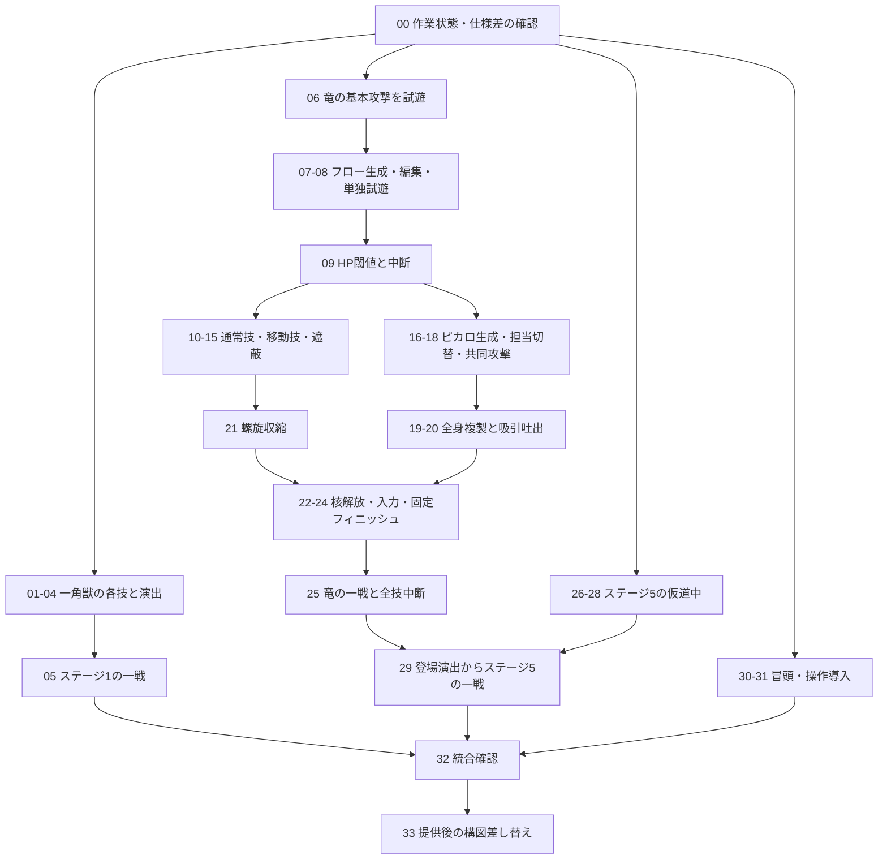

# ステージ1・5 実装計画

自動実装承認済み。[作業一覧](todo.md) の順序で実装・テスト・コミットを行う。[SPEC](../SPEC.md) と各ボス・ステージ文書を要件の正本とする。構図・ポーズの完成を待たず仮表示で進め、提供後に差し替える。別セッションのポーズ案は採用しない。

## 目的と完成ライン

両ステージの道中を仮タイムラインで遊べ、一角獣・竜の全技、行動判断、演出、決着が本番と編集用試遊で動く状態にする。冒頭とチュートリアルも接続する。仮素材・仮調整値と正式完成を区別する。ピネウスの救出・ウルトは対象外。

## 調査に基づく接続先

パスは `speed/` 基準。新規ファイル名は計画上の候補であり、既存ファイルとは区別する。

| 現行の事実 | 計画への影響 |
|---|---|
| `data/stages/stage_1.tres` は13フェーズ、monoceros、boss_time=480 | 既存の6山を維持して編集・試遊をつなぎ直す。作り直さない |
| `data/stages/stage_5.tres` は旧6フェーズ、time_limit=900、boss_id空、boss_enabled=false | 8分の道中を新構成へ置換。900は現行値であり制作目標ではない。竜の接続確認まで出現無効を保つ |
| `scripts/actors/boss_actor.gd` と `runtime/systems/boss_system.gd` が本番・実験場の役者を所有 | 新ボスを既存の定義・役者登録へ接続。別の戦闘シミュレーションを作らない |
| `bosses/flow/runner.gd` と `single_actor_adapter.gd` が候補・開始・完了・取消を扱う | 竜側に必要な役者契約を実装。距離・方向条件を既存ノードに設定する |
| `addons/content_build/builder.gd` の生成対象、`tools/editor/boss_flow/editor.gd` の選択肢はhydra/monocerosを列挙 | 竜は役者追加だけでは使えない。生成・選択・試遊までを専用タスクで接続する |
| `CombatSystem` はHP減算→body_damaged通知→HP0判定の順 | 閾値のクランプを死亡判定前に完了させる。大ダメージで段階を飛ばさないことを早期検証 |
| `BossSystem.on_boss_defeated` が役者へ引受けを問い合わせ、最終的にboss_deadを通知 | 竜のHP0は専用決着へ引き受け、共通CLEAR・保存へ通知するのは最後の一度だけ |
| `runtime/intro_sequence.gd` はFLIGHTで自動移動、PRACTICEで通常操作 | 北極星の導入追加だけでなく、敵生成前の操作可能な航行を作る必要がある |
| `enemies/sniper.gd` は遮蔽を扱い、`bosses/hydra_normals.gd` に通常技がある | 参照元の既存契約を調べて再利用。Hydra本番の挙動を竜用に上書きしない |
| 光の矢4スクリプト・SVGとProjectileSystemの差分が既にある | 未接続・未検証の試作として保持し、矢のタスクで評価する。既存差分を完成品として数えない |

## 依存関係

同じ役者・共通のHP/入力/生成/編集コードを触るタスクは順に実施する。一角獣、道中、導入は依存上独立して進められるが、本計画では単一セッションで順次実施する。構図差し替えは32の仮素材での完成を妨げない。

## 実装の順序と区切り

1. **一角獣を一戦として仕上げる（00〜05）**。全技の既存動作を確認し、移動・予告・命中・表示・終了を技ごとに仕上げる。ステージ1の6山からボスへ接続する。
2. **竜を早期に試遊できるようにする（06〜09）**。噛みつき一技と仮本体を実験場で動かし、フロー・編集・生成へつなぐ。HP閾値・多重命中のリスクを技の量産前に確認する。
3. **竜の技を一技ずつ完成させる（10〜21）**。各タスクはパラメータ→選択→予告→判定と表示→終了/中断→再読込までを扱う。全技のロジックだけを先に作って演出を最後へ回さない。
4. **決着まで遊べる一戦にする（22〜25）**。核解放、合体、自由描画、固定フィニッシュ、共通保存へ接続し、技同士の遷移を確認する。
5. **ステージ5の道中と登場を接続（26〜29）**。合意済みの育成・雑魚・カラス・時間配分を使う。山の編成の最終案はチェックポイントで確認し、未決を無断で確定しない。
6. **冒頭と操作導入を完成（30〜32）**。タイトルから旅立ちまで、既存の再視聴・スキップ・セーブの扱いを保って確認する。

各フェーズ内にも2〜3タスクごとの確認点をtodoに置く。確認では、動く成果、編集後の反映、未解決事項を提示する。

## 編集・生成・実行時の責務

- 技の数値・条件・フローは既存Resource、編成はシーン、ステージはStageDefを編集元にする。固定画像・形状・技の解析結果は正規の生成経路へ渡す。
- `.content/` とカタログ生成物を手修正しない。竜の新資源は生成対象・依存一覧・欠落検出・形式の版・配布参照まで追う。
- 本番はSessionの資源ScopeとBossSystemが所有する。ピカロ、弾、亀裂、演出は所有者と取消時の解放を定める。HP移行で残す弾と破棄するビーム等を区別する。
- 編集用プレビューは明示的な生成・新しい試遊へ渡す。既存ランの参照を差し替えて壊さない。
- 入力切替、勝利通知、敵表の行ID、画面と世界座標は既存の共通経路を使う。

## 保留・確認する点

- 構図・ポージングは仮表示で進める。後日の正式差し替えでは判定、遮蔽、縦横比も再確認する。
- 山の具体的な強敵編成は会話の直近案がある一方、正本では未決。26でその表を提示して確認する。時間配分・育成構成・成長方針を再質問しない。
- 技の照準固定時点・当たりの意味など未決の挙動は該当タスク着手時にまとめて相談する。秒数・速度等の調整値を仮設定できることと、挙動を決めることを混同しない。
- ピネウスは制作しない。複製数を吸収量で増やす案も採用しない。
- 通常敵をボス中にどう出すか、HP0時の残留物等の未決は該当接続点で確認する。ドキュメントにある規則は再質問しない。

## リスクと対処

| リスク | 対処・確認するタスク |
|---|---|
| 全身の複数判定で一撃が重複 | 本体の命中先を統一し、接触・なぞりの再命中規則を06/09で確認 |
| 多段階HPを一撃で飛ばす、HP0で早期CLEAR | 09で閾値クランプ、22〜24でHP0と最終勝利を分離 |
| 弾・ビーム・ピカロ・亀裂の中断が違う | 各技の中断チェックを必須にし25で移行中の組合せ確認 |
| ピカロの実装が既存敵や攻撃予算を壊す | 元絵/元行動を保ち、個体所有・予算・通常切替とHP切替を16〜18で検証 |
| ブレスの安全地帯と見た目がずれる | 13で描画とダメージが同じ遮蔽を参照。岩破壊直後も確認 |
| 竜用変更が海蛇・一角獣の生成/編集を壊す | 07/08と32で既存2体の保存・生成・単独試遊を確認 |
| 技・構図が画面比率で避けられなくなる | 固定解像度を使わず、各技と演出を複数の画面比率で確認 |
| 仮配分を最終バランスとして扱う | 区間試遊と通常開始の成長を別評価。恒久強化9割とラン装備MAXを混同しない |

## 検証と境界

検証コマンドは [SPECの開発コマンド](../SPEC.md#5-開発コマンド) を使う。実装段階で、正規生成・読み込み→短い手動試遊→保存して再読込を行う。自動テスト・長時間自動プレイは依頼時だけ。人間による通常開始の試遊で成長を確認し、途中再生のXPを通常成長の結果に混ぜない。

計画作成後の自動実装承認に従い、Godot起動・ビルド・自動テスト・実装コード変更・タスク単位のコミットを行う。pushは別途承認を得る。元の作業ツリーと未保存エディターを保護する。共有タスク一覧は更新しない。

指定された `tasks/plan.md`・`tasks/todo.md` はこの個別セッションの計画であり、共有タスク一覧とは別。文書規定と `tools/check_docs.py` は、この2ファイルに限って配置を認める。その他の作業文書の禁止を維持し、許可範囲と拒否範囲を回帰テストで確認する。
