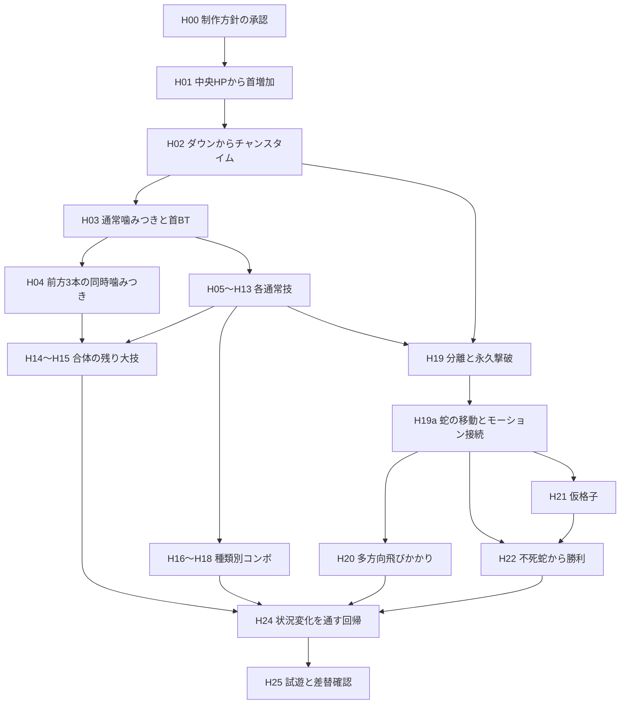

# ヒュドラ再設計の実装計画

**状態：承認済み。実装中。既存テスト失敗は別課題として扱う。** 実装の目的・検証・作業境界は [SPEC.md](../SPEC.md)、個別仕様の正は [ヒュドラ専用仕様](../docs/game/hydra.md)。本書は実装順・依存関係・受け入れ条件を定義し、未決のゲーム仕様は「承認待ちの提案」として区別する。[タスク一覧](todo.md) の対象はヒュドラ再設計だけとする。

## 対象と到達点

初回実装では、試遊シーンで中央を攻める合体形態から分離形態、不死の蛇の撃破、羅針盤の解放まで一戦を通せるようにする。分離後の通常の立ち回りは仮実装とする。ユーザーの試遊と立ち回り調整は今回の実装完了後の別作業として [タスク一覧の保留項目](todo.md#after-implementation) に残す。分離蛇の体全体のうねり、直進・曲線移動・旋回・被弾のモーションとゲーム中の自然な接続は初回実装に含める。通常10技、コンボ3種、大技5種、位置と欠員へ対応するBehaviorTree、アニメーション、ピクセルアート調のリッチなシェーダー演出を含む。

正式な格子5配置は配置案の受領待ち。今回の実装対象は仕組みと差替可能な仮1配置までとし、正式5配置は受領・レビュー後に追加タスクとして扱う。通常ステージへの出現変更、他のボス、demo、性能改善専任作業、共通獲得演出そのものの再制作、mainへの統合・push・公開は対象外。

## 着手前の判断（H00・CP0）

決定事項は [専用仕様](../docs/game/hydra.md) を正とする。以下は、その回答状況と実装時・試遊後に詰める内容を示す。分離後の通常時の移動範囲や間合いは、初回実装前に完成形を決める条件には含めない。仕様への回答と、ゲーム実装を始める許可は区別する。**実装開始は承認済み。**

| 判断 | 回答状況と残りの内容 | 関係するタスク |
|---|---|---|
| 首の増加と過剰ダメージ | 3→5→8、超過ダメージ持ち越しを確定。複数閾値を同時に越えた場合の演出順序を整理する | H01 |
| 増加・分離時の首 | 増加するたびに全回復し、分離への移行後も全回復する | H01・H19 |
| 中央破壊と勝利 | 「瓦礫破壊で分離、不死の蛇撃破で勝利」を確定。実装側でその進行を共通の勝利処理へつなぐ | H01・H22 |
| 合体中の防衛 | 中央への直接攻撃を首が守る方針。具体的な迎撃と位置取り、他の攻撃との優先度を整理する | H03・H06・H24 |
| 再生と火 | 火による再生抑制を維持し、倒された首の復活待ち時間を延長する。延長量は試遊で調整する | H02 |
| 風と瓦礫 | 高速移動中は風の影響を受けない。瓦礫は既存の硬い瓦礫のルールを使う | H06・H08・H09 |
| 大技の参加者 | 同時噛みつきは前方3本。曲線ビームは動ける全首が参加。順番噛みつきの本数、欠員時の成立条件は残る | H04・H14・H15 |
| コンボの発動 | 一定間隔の発動機会に、実行可能な候補からランダムに1種類。発動後に共通の待ち時間を置く。候補なし・大技との競合・途中喪失の扱いを整理する | H16〜H18・H24 |
| 分離した蛇の通常行動 | 不死の蛇を守る。重み・攻撃コスト・全体予算で通常技を選び、攻撃時は画面内へ入る。非攻撃中は画面外へ移動できる。通常移動はこの制約で仮実装し、試遊後に間合い・接近・離脱・画面内での配置を調整する | H19。調整は実装完了後の別作業 |
| 分離後の大技の頻度 | 個別クールダウンを持ち、連続飛びかかりを格子より頻繁に使う。発動位置と順番、複数の大技が使用可能な場合の選択を整理する | H20・H21 |
| 格子の仮配置 | 仮1配置の形は実装側で任意に作る。一筆経路・優先枠・欠員への対応を満たし、正式5配置と差し替えられるようにする | H21 |
| 不死の蛇とHP表示 | 通常の攻撃ルールで直接攻撃できる。大きいゲージは合体中に中央、分離後に不死の蛇。通常頭は頭の近くにHPを出す | H01・H19・H22 |
| 分離蛇のモーション | 直進・曲線移動・旋回・被弾を体全体の動作として作り、ゲーム状態に合わせて連続的に組み合わせる。初回実装に含め、完成形の間合いは試遊後に調整する | H19a。調整は実装完了後の別作業 |
| HPと硬さ | まずHPと実際の減り方を調整する。装甲は既存ルールを使い、別の硬さの仕組みを追加することを着手条件にしない | H19。調整は実装完了後の別作業 |
| 羅針盤の方位 | 実装側で任意に割り当てる。対応の選定を実装開始の確認事項にしない | H04以降 |

分離後の大技の初期試遊目安は、連続飛びかかりのクールダウンを約15秒、格子ビームを約30秒とする。これは発動を強制する周期ではなく、使用可能になるまでの待ち時間の目安。実装時に`.tres`へ置き、以後はデータを数値の正とする。コンボの共通間隔の値は未決。

HP、距離、速度、再使用時間、予告・硬直時間などは、承認した規則に従う試遊用の調整値として`.tres`へ置く。未合意の値を確定バランスとして扱わない。

仮実装にできるのは移動・間合い・選択の調整であり、技の追加、形態進行の変更、特別な無敵条件の追加は範囲に含めない。今回の完了条件は一戦分の実装・検証・受け渡しとし、ユーザー試遊やその結果による調整の完了を含めない。

各攻撃の条件表は、開始できる形態・距離・向き、参加首と必要状態、狙い固定、割込み、終了後の各首、ほかの首の行動、再使用待ち、出せない場合の次の行動をそろえる。本体防衛より大技後の攻めどき・全首ダウン・形態移行を優先する構成を提案する。

## 現コードからの接続と依存関係

| 部品 | 現状 | 計画上の接続方針 |
|---|---|---|
| Hydra役者 | `hydra_boss.gd`に首の生成、通常技、再生、旧露出、タイムラインを集約 | 形態の確定処理を役者に残す。追加する動作は必要な単位で分け、状態と所有者を重複管理しない |
| ダメージと勝利 | 本体の行はボス扱い。`CombatManager.kill_enemy`は直ちに`BossManager.on_boss_defeated`へ渡す | 中央破壊を最終勝利と分ける共通の接続点が必要。ManagerにHydra固有分岐を追加せず、役者へ破壊の扱いを委ねる |
| 部位の所有 | `EnemyTable`の親行とID、`part_defeated`で解放前に通知 | 合体・分離とも所有IDで照合し、行再利用と部位撃破を安全に扱う。中央破壊後もボス全体を管理する役者は最終勝利まで存続する |
| LimboAI | 既存BTは北・東・西の大技選択だけ。通常技はコードでランダム選択 | 全体のBTが防衛・コンボの発動機会・大技を調停し、首ごとのBTが画面内への接近・位置取り・通常攻撃・硬直を扱う。通常攻撃は重みと攻撃コストを使い、全体予算内で選ぶ |
| 首の形状 | FABRIKの根元と先端を固定。胴体回避なし | 首の外側の経路・到達可能性と参加者選択をセットで検証する。背面首を正面へ無理に伸ばさない |
| 攻撃枠 | `manager.admit`と実験場directorが分類別の予約を扱う | 条件評価は読み取りのみ。選択後に参加首を確保し、失敗・中断・形態移行で所有予約を解放する |
| 攻撃の形 | 直線BEAM・ZONE・WAVE・WALLと飛翔BOLTが存在 | 既存の直線と光弾は再利用を検討。曲線・風の帯・三日月には表示と一致する形状が必要 |
| 演出 | `presentation_event`・`presentation_advanced`と差替シーン、世界時間の手動更新 | 契約を拡張し、各技と同じタスクでシェーダー・アニメーションを完成させる。攻撃の点列と時間を共有する |
| 最終決着 | `RunManager._begin_finish`、`finish_legendary`、HUDの獲得表示が存在 | 不死蛇の最終撃破を一度だけ共通勝利へ渡し、中心破壊や頭のダウンには接続しない |
| 回帰テスト | `hydra_ai`・`hydra_targeting`・`thrill_acceptance`に旧露出・旧段階・火の再生停止を検証する項目がある | まず基準状態を記録し、承認仕様に置き換わる項目だけ対応タスクで更新する。既存テストの成功は未確認 |



同じ役者と状態を触るため、実装はタスク順で進める。依存グラフは必要条件を示すもので、並列担当の開始を意味しない。

## 各タスクの共通完了条件

- 期待する結果の失敗テストを先に実行し、最小実装後に成功を確かめる。仕様置換が必要な旧テストは、理由を明確にして同じ縦切りで更新する。
- 対象のBT選択・予告・判定・硬直・中断・演出を一緒に確認する。追加する攻撃を強制発動だけで完成扱いにしない。
- 新しいタイムラインとVFXは世界時間へ同期し、実ダメージのない命中エフェクトを作らない。Headlessの成功と描画品質の確認を区別する。
- 1タスクは主に3〜5ファイルを目安とする。表にあるパスは候補で、共有ファイルをすべて毎回触る指定ではない。大きく超える場合は、着手前にさらに遊べる縦切りへ分割する。
- 敵一覧の実装状況と必要な仕様・編集手順を同じ変更で更新する。調整値を文書へ転記しない。
- 実装時は対象ケース、Godot読み込み、影響する既存回帰を実行する。全体検証は下記の範囲を使い、失敗した基準状態を自分の変更による回帰と混同しない。
- 承認済みの実装段階では自分の変更だけを1タスク1コミットにする。計画作成段階ではコミットしない。未完のタスクを完了にせず、main・他作業・生成画像を巻き込まない。

## 検証方法

この計画作成中にゲーム・ゲームテストは実行しない。以下は実装承認後の検証手順。

1. 編集前に本番テストの対象一覧と起動方法を確定し、基準状態を実行する。`res://tests/*.tscn`の自動検証シーンと`check_rules.gd`を対象にし、`screen_capture`等の補助シーンは用途を確認して分ける。demoのテストは対象外。
2. 各タスクで独立した実験セッションと固定seedを使い、失敗→成功を記録する。新規ケースは`tests/hydra_*.gd`と対応シーンを基本とし、無制限の自動プレイを行わない。
3. 読み込み確認は`load_all.tscn`とGodotのインポートを使う。専用の本番配布ビルドは未設定なので、配布ビルド成功とは報告しない。
4. 描画付きの`hydra_trial.tscn`で短い画面確認をする。シェーダーの見た目・予告と危険範囲・反撃の成立は実画面で確認する。

```bash
/Applications/Godot.app/Contents/MacOS/Godot --headless --path speed --editor --import --quit
/Applications/Godot.app/Contents/MacOS/Godot --headless --path speed res://tests/load_all.tscn
/Applications/Godot.app/Contents/MacOS/Godot --headless --path speed --script res://tests/check_rules.gd
/Applications/Godot.app/Contents/MacOS/Godot --headless --path speed res://tests/hydra_ai.tscn
/Applications/Godot.app/Contents/MacOS/Godot --headless --path speed res://tests/hydra_targeting.tscn
/Applications/Godot.app/Contents/MacOS/Godot --headless --path speed res://tests/thrill_acceptance.tscn
/Applications/Godot.app/Contents/MacOS/Godot --path speed res://gyms/hydra_trial.tscn
python3 tools/check_docs.py
git diff --check
```

実験場の`lab_core`・`lab_director`・`lab_replay`、攻撃枠の`attack_priority`・`clip_attack_priority`等も影響範囲に含め、全体検証では残る本番の自動検証シーンを実行する。既存の旧Hydra検証は仕様置換タスクと同時に更新し、理由なくスキップして成功扱いにしない。コマンドの終了値に加え、ログのFAILと読み込みエラーを確認する。図形・素材・シェーダーだけの変更では、振る舞いを再現するだけのテストを増やさず、読み込みと実画面を検証する。

## タスク詳細

各チェックポイントでは、該当ケース・読み込み・描画の証拠をレビューする。H00の明示的承認までは実装を開始しない。承認後のauto実行では、H25の実装・検証・受け渡しまで進める。仮実装と明記した立ち回りや調整値は完成形の事前回答を求めず進め、採用済みルールと矛盾する判断、成立しない配置、原因不明の失敗がある場合は止める。ユーザー試遊とその結果による立ち回り調整は今回のタスクと依存関係から外し、実装完了後の別作業として残す。

### P0：制作方針を確定する
<a id="h00"></a>

#### H00：未決の制作方針を承認可能な形にする

仕様の未決事項を、承認する判断と試遊で調整する数値に分ける。冒頭の判断表と技別の条件表をレビューし、実装開始の根拠をそろえる。

**依存：** なし。 **規模：** S。

**受け入れ条件**

- [x] 決定済みルール・初回の仮実装・試遊後の調整が区別されている。技別条件表には暫定値と調整可能な項目を明記し、分離後の移動範囲・間合いの完成形を着手条件にしない。
- [x] 全体計画と制作方針の明示的な承認がある。承認済みの決まりだけを専用仕様へ反映する。
- [x] 既存の未コミット変更の帰属・保全方法が整理され、実装対象とコミット対象が明確である。

**検証：** 仕様と判断表を照合する文書レビュー。ゲーム・自動テストは実行しない。 文書チェックを適用する。

**変更候補：** docs/game/hydra.md、tasks/plan.md、tasks/todo.md。Godot内のパスは`speed/`基準。

<a id="cp0"></a>

#### CP0：制作方針を確定するの確認

- [x] 判断表・技別条件表・依存関係・検証範囲をレビューし、制作方針と実装開始の明示的承認を得る。決定済みの戦闘ルールを変更する未承認事項があればH01へ進まない。仮実装と試遊で詰める項目は開始を妨げない。

### P1：中央を攻める経路を成立させる
<a id="h01"></a>

#### H01：中央の被弾から首の増加までをつなぐ

試遊シーンで中央へ直接攻撃し、HP閾値による無敵・増加アニメーションを経て戦闘へ戻る一本道を作る。中央瓦礫のHPと最終勝利を分離する。

**依存：** H00。 **規模：** M。

**受け入れ条件**

- [x] 上部の大ゲージに中央HP、頭付近に個別HPを表示する。体当たり・武器による中央への実ダメージで、承認済みの首構成へ一度ずつ進む。超過ダメージを持ち越し、複数閾値を越える際の演出順序も条件表どおりになる。
- [x] 無敵中の被弾と攻撃開始を止め、増加のアニメーション終了後に復帰する。増加時は既存首も全回復し、ダウンから復帰する。
- [x] 中央破壊は分離への移行要求になり、最終撃破・報酬・クリアを発火させない。分離未接続の間は試遊内で移行待機に入る。

**検証：** RED：閾値境界・過剰ダメージ・無敵中被弾・中央破壊時の勝利通知を再現。GREEN後に試遊で増加を確認する。 共通の読み込み・文書確認も適用する。

**変更候補：** hydra_boss.gd、hydra.tres、combat_manager.gd／boss_manager.gdの必要最小限の共通接続、tests/hydra_progression.*。Godot内のパスは`speed/`基準。

<a id="h02"></a>

#### H02：首を倒して中央のチャンスタイムを作る

個別HP・ダウン・再生と全首ダウンの攻めどきを、中央への実攻撃までつなぐ。

**依存：** H01。 **規模：** M。

**受け入れ条件**

- [x] 1本の頭を削り切ると攻撃と予約を解除し、定義した猶予後に復活する。火で倒した首は通常より再生待ち時間が長くなる。
- [x] 全首ダウンは同じ更新の再生より先に成立し、保証されたチャンスタイムを通して中央を攻められる。
- [x] 通常攻撃後の硬直とHPを削り切ったダウンを区別し、部位の行が再利用されても別の敵を復活・解放しない。

**検証：** RED：全滅と再生期限の同時到達、連続撃破、行再利用、火のケース。GREEN後に頭を順に倒して中央をなぞる。 共通の読み込み・文書確認も適用する。

**変更候補：** hydra_boss.gd、hydra.tres、tests/hydra_progression.*、既存hydra_targeting.gdの該当ケース。Godot内のパスは`speed/`基準。

<a id="cp1"></a>

#### CP1：中央を攻める経路を成立させるの確認

- [x] この段階の全タスクの受け入れ条件、対象テスト、読み込み、描画確認を満たす。配置やAIが成立しない場合は当該タスクを未完了として止める。

### P2：首の形状と3本の大技を先に検証する
<a id="h03"></a>

#### H03：突き噛みを位置判断から反撃まで作る

通常の突き噛みを、首のBTによる選択から溜め・狙い固定・掃引判定・停止・復帰まで完成させる。以降の通常技もこの経路を拡張する。

**依存：** H02。 **規模：** M。

**受け入れ条件**

- [x] 射程・向き・首の状態を満たし、重みとコストを使った全体予算内の選択で発動する。画面内へ入ってから予告し、背面や到達不能位置では胴体を貫かず位置を取り直す。
- [x] 固定後の自機移動で狙いが変わらず、高速の頭の移動区間で命中を判定する。停止した頭を攻撃できる。
- [x] 溜め、口、衝撃、硬直をピクセル表現で見せ、他の首は許可された行動を継続する。

**検証：** RED：到達可能／不能、固定前後の移動、掃引命中、他首の硬直。GREEN後に正面・側面・背面から描画確認する。 共通の読み込み・文書確認も適用する。

**変更候補：** hydra_boss.gd、首行動用BTリソース、噛みつきのタイムライン／演出、tests/hydra_targeting.*。Godot内のパスは`speed/`基準。

<a id="h04"></a>

#### H04：前方3本の同時噛みつきを成立させる

最優先の形状リスクを検証する。5本以上で本体を少し回し、前方3本の頭が一筆でなぞれる位置に止まる大技を完成させる。

**依存：** H03。 **規模：** M。

**受け入れ条件**

- [x] 参加できる前方3本と胴体外側を通る首経路を確保した場合だけ開始し、残る首は待機する。根元は本体の取り付け位置を保つ。
- [x] 予告・固定・同時伸長・停止を実現し、頭列が一筆の攻撃経路に収まる。途中で首を失った場合は承認済みの中断処理へ進む。
- [x] 5本・8本、各方向の自機位置、参加候補のダウンを試し、胴体貫通・根元の滑り・停止直後の追撃妨害がない。

**検証：** RED：参加3本の不足・胴体交差・一筆経路・中断。GREEN後に俯瞰画面で首全体と反撃を確認する。成立しなければ後続の大技へ進まず配置設計へ戻る。 共通の読み込み・文書確認も適用する。

**変更候補：** hydra_boss.gd、hydra_neck.gd、BT／タイムライン、対応演出、tests/hydra_targeting.*。Godot内のパスは`speed/`基準。

<a id="cp2"></a>

#### CP2：首の形状と3本の大技を先に検証するの確認

- [x] この段階の全タスクの受け入れ条件、対象テスト、読み込み、描画確認を満たす。配置やAIが成立しない場合は当該タスクを未完了として止める。

### P3：近距離の攻め方を増やす
<a id="h05"></a>

#### H05：噛みつき首の横薙ぎを使い分ける

横から接近した自機への通常横薙ぎを加え、突き噛みと異なる位置条件・回避・硬直を作る。

**依存：** H03。 **規模：** M。

**受け入れ条件**

- [x] 承認した距離・角度で横薙ぎが選ばれ、突き噛みと選択条件が区別される。
- [x] 弧状の頭移動と判定が一致し、停止後に頭へ反撃できる。
- [x] 首の引き・口・残像・衝撃を含む演出があり、ダウン／中断で判定と予約が残らない。

**検証：** RED：選択境界、弧の内外の命中、硬直中断。GREEN後に突き噛みとの見分けを画面確認する。 共通の読み込み・文書確認も適用する。

**変更候補：** 噛みつき動作、首BT、タイムライン／演出、対応テスト。Godot内のパスは`speed/`基準。

<a id="h06"></a>

#### H06：風の帯で近距離から押し返す

渦首の近距離技を、一定時間の風の帯への接触・押し返し・終了後の接近までつなぐ。

**依存：** H03。 **規模：** M。

**受け入れ条件**

- [x] 風の帯に入った通常速度の自機を頭から離れる方向へ押し返す。高速移動・なぞり中は風の影響を受けない。
- [x] BTが近距離の位置条件から選び、倒れた首・硬直中・全体の攻めどきには新規発動しない。
- [x] 帯の輪郭、流れ、圧力、停止をピクセルシェーダーで読み取れ、見える範囲と押し返し範囲が一致する。

**検証：** RED：帯の内外・移動状態ごとの押し返し、倒された瞬間の解除。GREEN後に高速で入り反撃する短い試遊。 共通の読み込み・文書確認も適用する。

**変更候補：** 渦の動作、首BT、風の演出／シェーダー、対応テスト。Godot内のパスは`speed/`基準。

<a id="h07"></a>

#### H07：三日月の風刃3枚を撃つ

首振りに合わせた3枚の風刃を、遠距離の選択から飛翔・衝突・終了硬直まで完成させる。

**依存：** H06。 **規模：** M。

**受け入れ条件**

- [x] 角度と発射時刻の異なる3枚が形を保って直進し、発射後に自機を追尾しない。
- [x] 刃の幅と形に対応する判定を持ち、高速移動でも通過区間の命中を検出する。
- [x] 首振りと発射を同期し、3枚目の後に頭が止まる。BTが風の帯と距離・位置で使い分ける。

**検証：** RED：枚数・時差・進行方向・掃引判定。GREEN後に3枚の隙間と首の停止を描画確認する。 共通の読み込み・文書確認も適用する。

**変更候補：** 渦の動作、風刃の判定、首BT、風刃の演出、対応テスト。Godot内のパスは`speed/`基準。

<a id="cp3"></a>

#### CP3：近距離の攻め方を増やすの確認

- [x] この段階の全タスクの受け入れ条件、対象テスト、読み込み、描画確認を満たす。配置やAIが成立しない場合は当該タスクを未完了として止める。

### P4：瓦礫と持続ビームの攻撃経路を作る
<a id="h08"></a>

#### H08：瓦礫の塊を投げる

瓦礫首が自機を狙って塊を投げる通常技を完成させる。

**依存：** H03。 **規模：** M。

**受け入れ条件**

- [x] 承認した位置条件で狙いを固定して投げ、飛翔後は直進する。
- [x] 既存の硬い瓦礫と同じ衝突ルールを使い、基本的に突進で壊せない。
- [x] 溜め・発射・塊の回転と残光・衝撃・首の硬直がつながり、途中ダウンで未発射の予約を解放する。

**検証：** RED：狙い固定・接触の種類・発射前後の中断。GREEN後に塊を避けて頭へ接近する。 共通の読み込み・文書確認も適用する。

**変更候補：** 瓦礫の動作、首BT、瓦礫の判定／演出、対応テスト。Godot内のパスは`speed/`基準。

<a id="h09"></a>

#### H09：瓦礫を扇状に散らす

瓦礫首のもう一つの通常技を加え、塊投げと位置条件で使い分ける。

**依存：** H08。 **規模：** M。

**受け入れ条件**

- [x] 扇状の発射角・広がり・隙間が表示と判定で一致する。
- [x] 塊投げと選択条件が区別され、射程外・背面では向き直しや位置取りを選ぶ。
- [x] 散弾の発射・破片・頭の硬直を見分けられ、中断時に所有する攻撃だけを片付ける。

**検証：** RED：扇の境界・発射数・各攻撃の選択・所有者解除。GREEN後に間を縫う／側面へ入る経路を確認する。 共通の読み込み・文書確認も適用する。

**変更候補：** 瓦礫の動作、首BT、散弾の演出、対応テスト。Godot内のパスは`speed/`基準。

<a id="h10"></a>

#### H10：1本の固定ビームを照射する

ビーム首の固定照射を、射線の判断・予告・照射・消灯後の反撃までつなぐ。

**依存：** H03。 **規模：** M。

**受け入れ条件**

- [x] 前方に射線が成立する場合だけ予告し、固定後に自機を追って曲げない。
- [x] 予告中・照射中・消灯後の安全状態と実判定が一致する。
- [x] 光の芯・発光・周辺粒子と予告を描き分け、BTで硬直・中断・クールダウンを扱える。

**検証：** RED：固定射線・予告中の安全・消灯と首喪失による解除。GREEN後に射線を横切る時機を確認する。 共通の読み込み・文書確認も適用する。

**変更候補：** ビームの動作、首BT、ビームの演出／シェーダー、対応テスト。Godot内のパスは`speed/`基準。

<a id="cp4"></a>

#### CP4：瓦礫と持続ビームの攻撃経路を作るの確認

- [x] この段階の全タスクの受け入れ条件、対象テスト、読み込み、描画確認を満たす。配置やAIが成立しない場合は当該タスクを未完了として止める。

### P5：光弾と雷を完成させる
<a id="h11"></a>

#### H11：短い光の棒を飛ばす

固定照射と異なる有限長の光弾を実装する。既存BOLTの再利用範囲を確認し、必要な差分だけ加える。

**依存：** H10。 **規模：** M。

**受け入れ条件**

- [x] 前端と後端を持つ光弾が直進し、通過後の射線は安全になる。
- [x] BTの位置条件で固定照射と使い分け、飛翔物の所有者・中断後の扱いが承認表と一致する。
- [x] 持続ビームと見分けられる光弾の芯・尾・命中があり、飛翔中の判定と表示が一致する。

**検証：** RED：前端／後端の通過・高速横切り・所有者喪失。GREEN後に固定照射と並べて見比べる。 共通の読み込み・文書確認も適用する。

**変更候補：** ビームの動作、projectile_manager.gdの必要差分、首BT、光弾演出、対応テスト。Godot内のパスは`speed/`基準。

<a id="h12"></a>

#### H12：雷首の帯電頭突きで攻防を作る

雷首の種類データを追加し、帯電から頭突き・到達放電・硬直までを完成させる。

**依存：** H03。 **規模：** M。

**受け入れ条件**

- [x] 5種類の構成で雷首が出現し、追尾首とのデータ対応・表示名が承認内容に従う。
- [x] 狙い固定後に頭突きし、到達時だけ頭の周囲へ放電する。噛みつきと異なる攻撃面が判定にもある。
- [x] 枝分かれする電気、閃光、消電、停止を描き分け、消電後に反撃できる。

**検証：** RED：構成・固定・到達放電・消電後の安全。GREEN後に帯電から反撃まで確認する。 共通の読み込み・文書確認も適用する。

**変更候補：** 雷の動作／敵データ、首BT、雷の演出／シェーダー、対応テスト。Godot内のパスは`speed/`基準。

<a id="h13"></a>

#### H13：雷首が進行先へ落雷を予告する

先回り落雷を加え、近距離の帯電頭突きと使い分ける。

**依存：** H12。 **規模：** M。

**受け入れ条件**

- [x] 自機の進行先に予告円を出し、固定後は地点を移動させず落雷する。
- [x] 落雷の範囲・時刻・中断が予告と一致し、描画中のスローと停止に同期する。
- [x] BTが位置条件で雷2技を選び、予告・雷柱・余韻・頭の硬直が読み取れる。

**検証：** RED：予測位置・固定後の切り返し・スロー／停止・中断。GREEN後に予告から進路を変える。 共通の読み込み・文書確認も適用する。

**変更候補：** 雷の動作、首BT、落雷演出、対応テスト。Godot内のパスは`speed/`基準。

<a id="cp5"></a>

#### CP5：光弾と雷を完成させるの確認

- [x] この段階の全タスクの受け入れ条件、対象テスト、読み込み、描画確認を満たす。配置やAIが成立しない場合は当該タスクを未完了として止める。

### P6：合体の大技をそろえる
<a id="h14"></a>

#### H14：首が順番に伸びて噛みつく

順番噛みつきの参加者を確保し、予告された順番で攻撃し、全体の攻めどきへ入る。

**依存：** H04、H13。 **規模：** M。

**受け入れ条件**

- [x] 参加本数・固定時点・次首の開始・終了後の頭位置が承認した条件表に一致する。
- [x] 必要な首の欠落と途中ダウンを扱い、非参加首は指定された待機を守る。
- [x] 同時噛みつきと順番を視覚で区別でき、最後に全体で反撃の隙を作る。

**検証：** RED：攻撃順・各固定時点・途中欠員・全体硬直。GREEN後に同時技と連続で試す。 共通の読み込み・文書確認も適用する。

**変更候補：** 大技の動作、BT、タイムライン、対応演出、対応テスト。Godot内のパスは`speed/`基準。

<a id="h15"></a>

#### H15：回転する曲線ビームの間を抜ける

本体の回転に遅れて尾が曲がる放射ビームを、射線選択から中央への反撃まで作る。

**依存：** H04、H10。 **規模：** M。

**受け入れ条件**

- [x] 種類を問わず行動可能な全首が参加し、本体回転から慣性のある曲線が生まれる。ダウンした首の欠け方を条件表で扱う。
- [x] 描画と判定が同じ点列を使い、移動中も曲線の間に通れる経路が成立する。
- [x] 予告・照射・消灯・中断・全体硬直をBTと同期し、光の帯と安全な隙間を読み取れる。

**検証：** RED：曲線点列と掃引命中・隙間・参加者喪失・停止。GREEN後に複数角度と画面比率で経路を確認する。 共通の読み込み・文書確認も適用する。

**変更候補：** 曲線ビームの動作／判定、BT／タイムライン、シェーダー演出、対応テスト。Godot内のパスは`speed/`基準。

<a id="cp6"></a>

#### CP6：合体の大技をそろえるの確認

- [ ] この段階の全タスクの受け入れ条件、対象テスト、読み込み、描画確認を満たす。配置やAIが成立しない場合は当該タスクを未完了として止める。

### P7：首の種類によるコンボをそろえる
<a id="h16"></a>

#### H16：渦と瓦礫で瓦礫竜巻を放つ

渦首が受け皿の渦を作り、瓦礫首が入れ、渦首が放つ一連の連携を作る。

**依存：** H07、H09。 **規模：** M。

**受け入れ条件**

- [x] コンボの共通発動機会に、使用可能なコンボからランダムに1種類を選ぶ。竜巻が選ばれたら行動可能な渦首と瓦礫首を重複予約せず確保し、正しい発生元・順序で連携する。発動後は共通の待ち時間へ入る。
- [x] 竜巻全体が動く攻撃面になり、片方のダウンと各工程の中断を承認表どおり処理する。
- [x] 瓦礫投入、回転、放出、残光、終了後の各頭の隙を見分けられる。

**検証：** RED：参加種類の不足・二重確保・各工程での喪失・攻撃面。GREEN後に連携の因果が読めるか確認する。 共通の読み込み・文書確認も適用する。

**変更候補：** コンボ動作、BT、竜巻判定、竜巻演出、対応テスト。Godot内のパスは`speed/`基準。

<a id="h17"></a>

#### H17：瓦礫をビームで砕く

展開した瓦礫とビームの交差から破片を発生させる連携を作る。

**依存：** H09、H10。 **規模：** M。

**受け入れ条件**

- [x] 共通のコンボ候補へ登録し、選択された場合だけ行動可能な瓦礫首とビーム首を確保して、承認した形態・位置で使う。
- [x] 実際のビーム交差で瓦礫が一度だけ砕け、破片と実ダメージが発生する。
- [x] 中断・終了で残る瓦礫と破片の扱いを守り、破砕と反撃時機を演出で示す。

**検証：** RED：交差／非交差・二重破砕・片方の喪失・所有者解放。GREEN後に破砕と通過経路を確認する。 共通の読み込み・文書確認も適用する。

**変更候補：** コンボ動作、BT、破砕判定／演出、対応テスト。Godot内のパスは`speed/`基準。

<a id="h18"></a>

#### H18：2本のビームで挟む

異なるビーム首2本が1本ずつ担当する連携を作る。

**依存：** H10、H11。 **規模：** M。

**受け入れ条件**

- [x] 共通のコンボ候補へ登録し、行動可能なビーム首が2本ある場合だけ選択する。各首が1本の射線を担当する。
- [x] 二又配置とはさみ薙ぎのうち承認した動作・予告・閉じ方を実現する。
- [x] 片側の喪失と終了時の硬直を扱い、射線の予告・芯・消灯・残光が判定と一致する。

**検証：** RED：1本しか残らない場合・同じ首の二重利用・片側中断。GREEN後に2本の出所と通れる側を確認する。 共通の読み込み・文書確認も適用する。

**変更候補：** コンボ動作、BT／タイムライン、連携ビーム演出、対応テスト。Godot内のパスは`speed/`基準。

<a id="cp7"></a>

#### CP7：首の種類によるコンボをそろえるの確認

- [ ] この段階の全タスクの受け入れ条件、対象テスト、読み込み、描画確認を満たす。配置やAIが成立しない場合は当該タスクを未完了として止める。

### P8：分離した蛇の攻防を作る
<a id="h19"></a>

#### H19：瓦礫破壊から独立した蛇との戦闘へ移る

移行待機だった中央破壊を、羅針盤を抱える不死の蛇の逃走と通常蛇の分離へ接続する。合体中の通常技を分離形態のBTから使えるようにする。通常時は不死の蛇を守る位置を目標とし、攻撃を担当する蛇が画面内の発動位置へ接近し、技の後は守る位置へ戻る仮の立ち回りを出発点とする。距離や戻り方はデータ・BTで調整できるようにする。

**依存：** H02、H13。 **規模：** M。

**受け入れ条件**

- [x] 中央破壊で一度だけ分離し、形態移行演出後に承認済みの本数の通常蛇（最大8体）と不死の蛇が独立して移動する。移行後は通常の蛇を全回復させ、ダウンした首も復帰する。
- [x] 通常蛇は護衛位置を目標にする仮の立ち回りを持ち、重みとコスト・全体予算で既定の通常技を選ぶ。攻撃前に画面内へ入り、非攻撃中の画面外移動も許容する。立ち回りの面白さの試遊・調整は、今回の実装完了後の別作業とする。
- [x] 通常蛇は倒すと再生せず、残存数・行番号・所有IDを一貫させる。ほかの蛇が残っていても不死の蛇へ実ダメージを与えられ、中央破壊だけでは勝利にならない。

**検証：** RED：移行重複・引継ぎ・永久撃破・所有者再利用・本命への被弾。GREEN後に分離から2体を減らす短い試遊。 共通の読み込み・文書確認も適用する。

**変更候補：** hydra_boss.gd、分離蛇の動作／BT、移行演出、tests/hydra_separation.*。Godot内のパスは`speed/`基準。

<a id="h19a"></a>

#### H19a：分離蛇が体をうねらせて動作をつなぐ

[分離蛇のモーション仕様](../docs/game/hydra.md#83-分離した蛇の移動とモーションの接続)を、実際の通常戦闘へ接続する。移動・旋回・被弾の動画を個別再生するだけでなく、不死の蛇を守る位置への回り込みと画面内への接近中に組み合わせる。

**依存：** H19。 **規模：** M。

**受け入れ条件**

- [ ] 上下左右・斜めへの直進、曲線移動、旋回・切り返しで、頭から胴へ曲がりが伝わる。通常の接近は曲線的に回り込め、直線追跡だけの雑魚と異なる動きになる。
- [ ] ゲーム中の速度・進行方向・被ダメージ・攻撃状態からモーションを組み合わせ、移動→旋回→被弾→移動、移動→構え→攻撃→硬直→移動を連続させる。位置や姿勢の飛び、移動を止めて全体をその場回転する機械的な方向転換がない。
- [ ] スロー・停止・途中の被弾でも体の形と頭の位置を保ち、動作・遷移を差し替えられる。技の狙い固定や反撃用の硬直は戦闘の規則を守る。初回の試遊提出時にこれらのモーションが実戦で動く。

**検証：** RED：移動方向の連続変化、姿勢を保つ被弾割込みと復帰、世界時間の停止を確認する振る舞いテスト。GREEN後に上下左右の旋回と回り込み、被弾からの復帰、攻撃前後を描画付きで確認する。見た目の自然さは実画面で確かめ、モーションの有無だけで完了にしない。

**変更候補：** 分離蛇の移動／モーション、対応シーンまたはアニメーション、分離BTの接続、対応する回帰ケース。Godot内のパスは`speed/`基準。

<a id="cp8a"></a>

#### CP8a：分離蛇の動作が通常戦闘へつながる確認

- [ ] 分離した蛇が体をうねらせながら接近・回り込み・旋回・被弾を連続して行い、画面内で既定の通常攻撃を使える。大技の配置移動でも同じ自然な移動動作を使える。

<a id="h20"></a>

#### H20：分離蛇が多方向から連続で飛びかかる

自由に移動する蛇を個別の出発位置へ置き、直線的な連続飛びかかりを実行する。

**依存：** H19a、H14。 **規模：** M。

**受け入れ条件**

- [ ] 残存数に応じて参加者・出発位置・経路・順番を決め、遅いビームのような直線の脅威を作る。個別クールダウンで格子より頻繁に使用可能になる。
- [ ] 予告から攻撃終了まで同じ経路を使い、途中撃破で指定した攻撃だけを欠けさせる。
- [ ] 各蛇の予告・伸長・噛む衝撃・停止と全体の反撃時間が読み取れる。

**検証：** RED：残存8／少数、経路固定、順番待ち中の撃破、全体硬直。GREEN後に別方向の予告を追って切り返す。 共通の読み込み・文書確認も適用する。

**変更候補：** 分離大技の動作、BT／タイムライン、飛びかかり演出、対応テスト。Godot内のパスは`speed/`基準。

<a id="h21"></a>

#### H21：仮1配置の格子ビームを一筆で抜ける

5領域の判定、優先度付き配置、可変長ビームを使う仕組みを作り、差替可能な仮1配置で不死の蛇へ一筆で到達する。

**依存：** H19a、H10。 **規模：** M。

**受け入れ条件**

- [ ] 全種類の通常蛇が参加でき、残存数から優先度の高い枠を埋める。最低参加数未満では選ばず、連続飛びかかりより長い個別クールダウンを持つ。
- [ ] 機体半径・判定幅・なぞりの長さを含め、攻撃を壊さずに通れる経路がある場合だけ発動する。発動後に欠員を埋めて経路を塞がない。
- [ ] 5領域の判定と配置データ差替が動き、仮1配置で不死の蛇へ直接攻撃できる。正式5配置は素材受領待ちとして区別する。

**検証：** RED：領域の境界・優先枠・最低数・経路の余裕・配置前後の欠員。GREEN後に複数画面比率で一筆の実操作と途中の蛇への任意攻撃を確認する。 共通の読み込み・文書確認も適用する。

**変更候補：** 格子配置と判定、分離BT、仮配置データ、格子演出、tests/hydra_grid.*。Godot内のパスは`speed/`基準。

<a id="cp8"></a>

#### CP8：分離した蛇の攻防を作るの確認

- [ ] この段階の全タスクの受け入れ条件、対象テスト、読み込み、描画確認を満たす。配置やAIが成立しない場合は当該タスクを未完了として止める。

### P9：不死の蛇の撃破まで一戦をつなぐ
<a id="h22"></a>

#### H22：不死の蛇を倒して羅針盤を解放する

護衛がいる間の逃走と単独時の抵抗を、最終撃破から共通の勝利・モジュール獲得へつなぐ。

**依存：** H19a、H21。 **規模：** M。

**受け入れ条件**

- [ ] 護衛が残る場合も通常の攻撃ルールで直接攻撃でき、単独時は短い逃走・振り返り噛みつき・頭の停止を繰り返す。上部の大ゲージを不死の蛇のHPへ切り替え、通常頭のHPは頭付近へ表示する。
- [ ] 不死の蛇の撃破だけが最終勝利を一度発火し、残る蛇・攻撃・予約・BTを片付ける。
- [ ] 共通の撃破・伝説モジュール獲得へ接続し、姿と既存名を見せる。用途の説明と報酬付与の重複がない。実験場はセーブへ書かない。

**検証：** RED：護衛あり／なし・最終通知重複・中央破壊との区別・実験場のセーブ保護。GREEN後に本番の共通演出との接続を描画確認する。 共通の読み込み・文書確認も適用する。

**変更候補：** 不死蛇の動作／BT、Hydra最終勝利接続、既存共通演出の必要な接続点、対応テスト。Godot内のパスは`speed/`基準。

<a id="cp9"></a>

#### CP9：最終勝利までの接続確認

- [ ] 中央破壊から分離、不死の蛇の撃破、共通勝利への接続を実装側で確認できる。H24の総合検証へ進める。

### P10：一戦の回帰と素材差替を確認する

<a id="h24"></a>

#### H24：欠員と位置が変わる一戦を通して検証する

各タスクで完成させたBTと攻撃を組み合わせ、位置・欠員・割込みが変わっても一戦が停止しないことを検証する。コンボの共通発動間隔、通常攻撃の全体予算、画面内へ入ってからの攻撃を含め、連携不良だけを直す。

**依存：** H04、H05、H07、H09、H11、H13、H14、H15、H16、H17、H18、H19a、H20、H21、H22。 **規模：** M。

**受け入れ条件**

- [ ] 近／中／遠、正面／側面／背面、3／5／8本、行動可能0／1／複数、各種類の欠員、予告・実行・硬直中の撃破を条件表と照合する。
- [ ] 条件評価は攻撃枠を取得せず、選択後だけ取得する。BT中断・形態移行・勝利・リセットで枠と表示が漏れず、無効な技を待ち続けない。
- [ ] 通常攻撃中の他首の行動・全体予算・本体防衛・大技後の全体硬直が条件表どおりになる。コンボは一定の発動機会に候補からランダムに1種類だけ選び、共通待ち時間中に連発しない。

**検証：** 固定seedの短いシナリオでRED/GREEN。新仕様に対応したHydra回帰・実験場・攻撃枠・全ステージ受入れを含む本番テスト一式と読み込み確認。 共通の読み込み・文書確認も適用する。

**変更候補：** tests/hydra_ai.*、tests/thrill_acceptance.gd、実際に不良が出たBT／動作だけ。Godot内のパスは`speed/`基準。

<a id="h25"></a>

#### H25：試遊と素材差替で完成を確認する

試遊シーンで合体から決着まで操作し、各攻撃で作成済みの演出と絵担当の差替経路を検証する。

**依存：** H24。 **規模：** M。

**受け入れ条件**

- [ ] 通常10技・コンボ3種・大技5種を試遊で再現でき、仮格子と正式配置待ちを識別できる。
- [ ] 素材差替後も予告・判定・命中・破壊・硬直が一致する。スロー・停止・画面比率変更でピクセル表現と安全な隙間が保たれる。
- [ ] 実装側で一戦を確認し、敵一覧と実装方法を実態へ更新する。正式格子が未受領の場合は全5配置の完成とは報告しない。

**検証：** 描画付きのhydra_trialで一戦、演出の代表画面と素材差替を確認。実装側の修正後に影響ケースと読み込みを検証し、試遊可能な成果物と操作手順をユーザーへ渡す。ユーザー試遊そのものの実施をこのタスクの完了条件に含めない。 共通の読み込み・文書確認も適用する。

**変更候補：** gyms/hydra_trial.*、対応データ、docs/game/catalog/enemies.md、docs/game/architecture.md。Godot内のパスは`speed/`基準。

<a id="cp10"></a>

#### CP10：一戦の回帰と素材差替の確認

- [ ] この段階の全タスクの受け入れ条件、対象テスト、読み込み、描画確認を満たす。配置やAIが成立しない場合は当該タスクを未完了として止める。

## リスクと対処

| リスク | 対処 |
|---|---|
| 中央破壊が共通勝利を先に発火する | H01でダメージから最終勝利までの接続を分け、中央破壊単体で報酬が出ない回帰を先に置く |
| 固定根元から前方3本へ届かない、首が胴体を貫く | H04を早期の成立判定に置く。射程の数値を伸ばして隠さず、根元と経路を描画・幾何の両面で確認する |
| 通常技を増やしてもランダムにしか出せない | 各技で首BTの開始条件と代替行動を完成させる。H24は仕上げの総合確認とし、AI全体の後付け工程にしない |
| 蛇の見た目だけが揺れ、移動は直線追跡やその場回転になる | H19aで曲線移動と体の動きを連動させ、実際の戦闘中に旋回・被弾・攻撃との接続を描画確認する |
| 分離時の立ち回りを事前に決め切ろうとして止まる | H19で決定済み制約を満たす仮の動きを作る。ユーザー試遊と調整は今回完了後の別作業へ残し、今回の実装完了条件に含めない |
| 格子が画面比率や欠員で通れなくなる | 正規化した配置からワールド座標へ変換し、機体半径と経路長を含めて検証する。不成立なら通常行動へ戻る |
| 所有する頭が消えて演出や予約が漏れる | 予約・行とID・タイムライン・演出の終了を各技で検証し、リセットと形態移行でも同じ解放経路を通す |
| 既存回帰が旧仕様を期待し続ける | 基準結果を記録し、各機能の仕様置換時に該当検証を更新する。非Hydraケースを削って通さない |
| エフェクトを後回しにして仮図形のまま完成にする | 各攻撃タスクにピクセルシェーダー・アニメーション・実画面確認を含める |
| 関連外の未コミット変更と混在する | H00で帰属を照合し、明示した対象だけをコミットする。生成画像や他作業を退避・削除・追加しない |
| 共通勝利・獲得演出と競合する | 既存の`boss_dead`からの接続を使い、共通演出の内容は書き換えず必要な接続点だけ調整する |

## 完成判定

- [ ] 合体の中央攻撃・首の増加・再生・攻めどきが、承認した規則で成立する。
- [ ] 通常10技・コンボ3種・大技5種が、BT・予告・判定・反撃・演出まで一戦で動く。
- [ ] 分離後の通常蛇は減り続け、不死蛇の撃破で一度だけ羅針盤の解放と共通勝利へ進む。
- [ ] 分離蛇の移動・曲線移動・旋回・被弾・攻撃前後が体全体のモーションとして連続し、ゲーム状態から組み合わせて再生できる。
- [ ] 形状・高速移動・一筆の反撃・画面比率を実装側で検証し、ユーザーが試遊できる成果物と素材差替の手順を渡す。
- [ ] 正式格子5配置の未受領部分は未完了として明記する。
- [ ] 対象テスト・読み込み・描画確認・文書チェックの結果と、実装済み範囲が一致する。

## 今回の実装完了後の別作業

ユーザー試遊に基づく立ち回り・HP・モーションの調整は、[タスク一覧の保留項目](todo.md#after-implementation) で管理する。今回の実装タスク、依存関係、完了条件には含めない。
